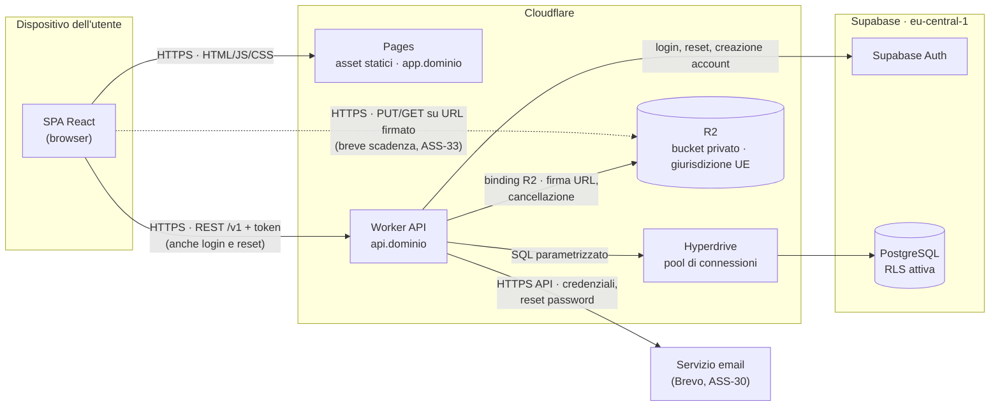
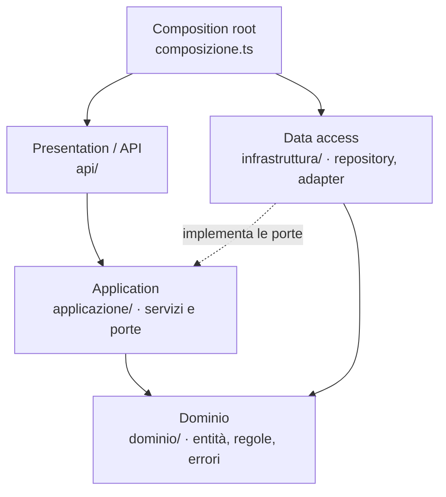
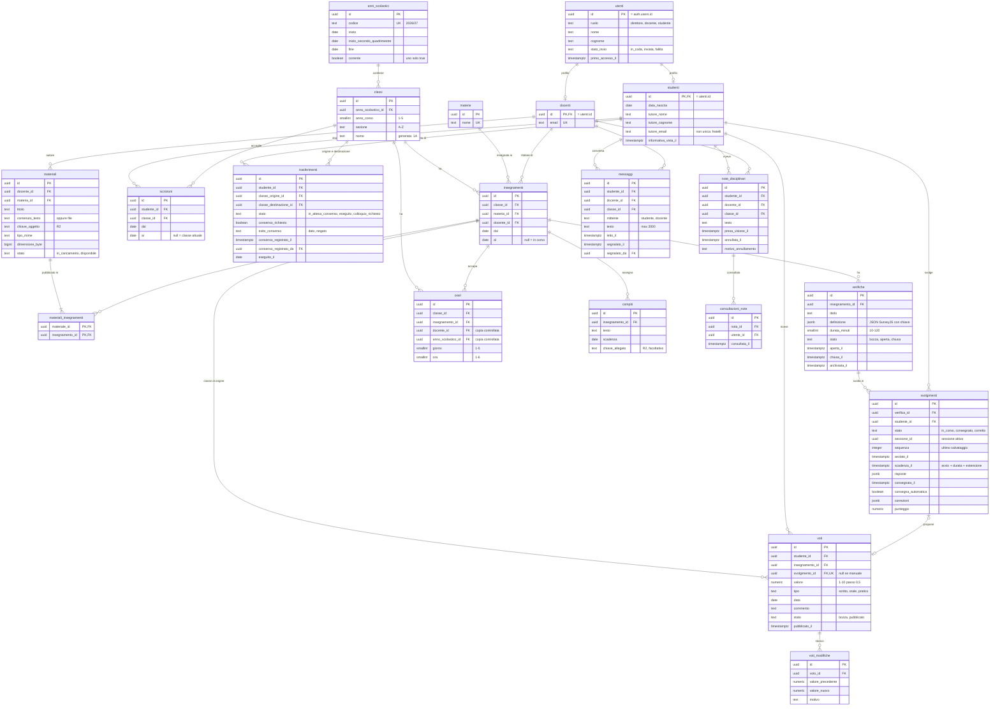
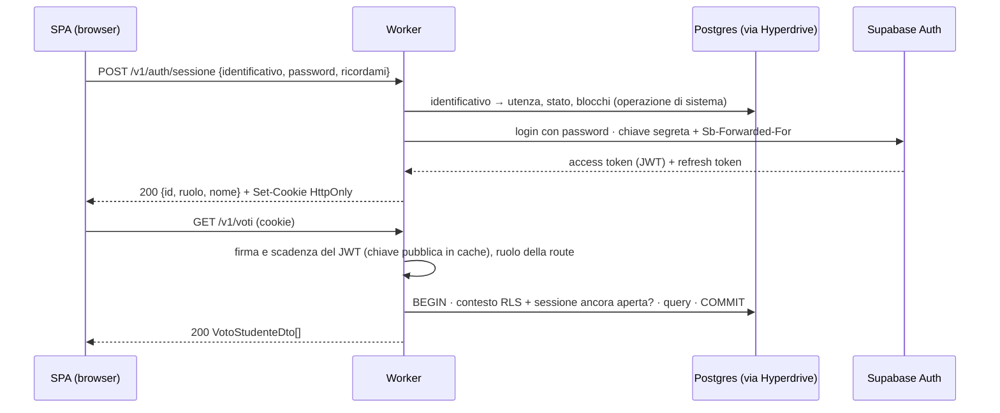
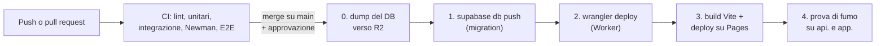

# PRD di ScuolaChill · Team [DA COMPILARE: nome del team]

---

## Informazioni sul documento

|  |  |
| --- | --- |
| **Prodotto** | ScuolaChill |
| **Team** | [DA COMPILARE: nome del team] |
| **Autori** | [DA COMPILARE: nome e cognome di ogni membro] |
| **Versione** | 1.0 |
| **Data** | 23/09/2026 |
| **Stato** | Bozza |

### Storico delle versioni

| Versione | Data | Autore | Cosa è cambiato e perché |
| --- | --- | --- | --- |
| 1.0 | 23/09/2026 | [DA COMPILARE] | Prima stesura, dai flussi della board Miro e dalle decisioni del 18/09/2026 |

---

# Prima parte · Il cosa

## Scopo e perimetro

### Perché esiste ScuolaChill

**Dal lato business.** In un istituto tecnico materiale, verifiche, voti, orario e comunicazioni
passano oggi da canali diversi: carta, email personali, chiavette, gruppi di chat. Il Direttore
non ha una vista d'insieme, i docenti ricopiano gli stessi dati più volte e le famiglie vedono i
voti in ritardo. ScuolaChill raccoglie tutto in un unico posto, con tre ruoli e regole chiare
su chi vede cosa.

**Dal lato tecnico.** Serve un sistema unico, usabile dal browser del telefono e del PC, in cui
ogni operazione passa da un solo punto di controllo lato server (VIN-34) e i dati di minori
sono protetti fin dalla progettazione (VIN-05). Deve reggere il picco delle verifiche in
laboratorio (ASS-02) e rimanere entro il budget dei crediti per studenti (VIN-01).

### Cosa è incluso

- **Direttore**: account docente e studente, classi e materie, assegnazione dei docenti a classi
  e materie, cambio classe con consenso della famiglia, orario settimanale, vista d'insieme
  dell'istituto (DIR-01..04, ORA-01).
- **Docente**: materiale didattico, verifiche online con correzione ibrida, voti con bozza e
  pubblicazione, compiti per casa, note disciplinari, risposta ai messaggi (DOC-01..03, COM-01,
  NOT-01, MSG-01).
- **Studente** (account di famiglia): materiale, voti per materia, orario, compiti e note in
  consultazione; svolgimento delle verifiche; messaggi con i docenti della propria classe
  (STU-01..03, MSG-01).
- **Accesso**: login, logout, primo accesso con credenziali inviate per email, reset password
  (AUT-01..03).
- **Gestione completa** di ogni entità: creazione, lettura, modifica ed eliminazione logica
  (soft-delete: il dato sparisce dalle viste ma resta tracciato e recuperabile, FR-DIR-03).

### Cosa non è incluso

Tutte le voci sono **evoluzioni future**, non promesse per la v1.

| Escluso dalla v1 | Perché |
| --- | --- |
| Assenze, presenze, ritardi e giustificazioni | Area a sé con regole proprie; la v1 si concentra su didattica e valutazione |
| Gestione delle aule e prenotazione dei laboratori | Non serve alle user story della traccia |
| Pagamenti (PagoPA) | Richiede l'accreditamento dell'ente e un Partner Tecnologico |
| Modifica dell'orario trascinando le lezioni (drag-and-drop) | La v1 modifica l'orario da form: stesso risultato, meno complessità |
| Correzione automatica di domande aperte e con formule | Un confronto fra testi sbaglia (0,5 contro 1/2); la valutazione simbolica è fuori portata. Le corregge il docente (FR-VER-04) |
| Account separato per il genitore (quarto ruolo) | Decisione di prodotto: credenziale unica di famiglia (FR-AUT-01) |
| Messaggi fra studenti, chat di gruppo, allegati nei messaggi | Minimizzazione dei dati di minori (FR-MSG-01) |
| Consegna online dei compiti per casa | Il compito in v1 è un avviso con scadenza (FR-COM-01) |
| Scrutini, pagelle ufficiali, collegamento ai sistemi ministeriali | Richiedono integrazioni istituzionali |
| Importazione massiva di studenti e docenti da file | ASS-11 |
| Passaggio automatico all'anno successivo (promozioni in blocco) | ASS-12 |
| Supplenze e variazioni giornaliere dell'orario | ASS-17 |
| Notifiche push e app da installare | La v1 è un'applicazione web; gli avvisi si vedono all'accesso |
| Più istituti sulla stessa installazione, lingue diverse dall'italiano | Una sola scuola (ASS-01), solo italiano (ASS-13) |

---

## Stakeholder

| Stakeholder | Cosa fa | Cosa gli interessa | Come lo coinvolgete |
| --- | --- | --- | --- |
| Direttore | Gestisce l'istituto: account, classi, orario; supervisiona | Vista d'insieme affidabile, meno lavoro manuale a inizio anno | Validazione dei flussi di gestione (board), collaudo |
| Docenti | Caricano materiale, creano verifiche, assegnano voti e note | Meno tempo speso a correggere e ricopiare; controllo su quando i voti diventano visibili | Un docente in collaudo; revisione dei flussi DOC |
| Studenti | Consultano, svolgono le verifiche, scrivono ai docenti | Vedere voti e compiti dal telefono, non perdere risposte in verifica | Collaudo con una classe del primo anno |
| Famiglie (genitore/tutore) | Titolari dell'account Studente e del consenso al cambio classe | Trasparenza su voti e note, tutela dei dati del figlio | Informativa al primo accesso; consenso al collaudo (DIP-03) |
| Docente del corso | Valida il PRD | PRD completo, motivato e coerente | Presentazione e domande alla consegna |
| Collaudatori del primo anno | Usano ScuolaChill come utenti reali | Che sia semplice e veloce da telefono | Intervista (requisiti impliciti), collaudo (ASS-14) |
| Referente protezione dati dell'istituto | Vigila sul trattamento dei dati personali | Minimizzazione e conservazione dei dati di minori (NFR-08) | Revisione di informativa e tempi di conservazione |
| Chi approva, paga e mantiene | Approva: docente del corso; paga: il team con i crediti per studenti (VIN-01); mantiene: il team | Costi entro i crediti, sistema mantenibile | Revisione del dimensionamento e del piano di deployment |

---

## Destinatari e contesto d'uso

### La scuola che avete immaginato

Un istituto tecnico statale di medie dimensioni, in una città di provincia: cinque anni di
corso, cinque o sei sezioni per anno. Le lezioni vanno dalle 8:00 alle 14:00 dal lunedì al
venerdì. Le verifiche online si svolgono nei laboratori, sui PC della scuola collegati allo
stesso Wi-Fi; per tutto il resto studenti e famiglie usano il proprio telefono, a casa o nei
corridoi, spesso in rete mobile. I docenti preparano il lavoro a casa o in sala docenti.

| Voce | Valore | Riferimento |
| --- | --- | --- |
| Studenti | ~600 | ASS-01 |
| Docenti | ~50 | ASS-01 |
| Classi | 28, ~22 studenti per classe | ASS-01 |
| Account Direttore | 1-3 (dirigente e delegati) | ASS-04 |
| Orario scolastico | 8:00-14:00, lunedì-venerdì, 6 ore da 60 minuti | ASS-17 |
| Anno scolastico | settembre-giugno, due quadrimestri | ASS-12 |
| Laboratori per le verifiche | 4, ~25 postazioni ciascuno | ASS-02 |
| Picco verifiche | fino a 4 classi insieme: ~90 studenti aprono la verifica nello stesso minuto | ASS-02, NFR-01 |
| Ora di punta | ~250 utenti attivi | ASS-02, «Stima del carico» |
| Connettività | Wi-Fi scolastico condiviso nei laboratori; rete mobile personale altrove | NFR-05 |

### Gli archetipi

| ID | Chi | Contesto d'uso | Competenze digitali | Dispositivo principale | Frequenza d'uso |
| --- | --- | --- | --- | --- | --- |
| ARC-001 | Direttore: dirigente o delegato di segreteria, 45-60 anni | In ufficio. Picco a settembre (account, classi, orario), poi supervisione e casi singoli (trasferimenti, credenziali) | Medie: usa gestionali e fogli di calcolo, non vuole configurare nulla | PC in ufficio | Quotidiana a settembre, poi settimanale |
| ARC-002 | Docente, 30-60 anni | Prepara materiale e verifiche a casa o in sala docenti; in laboratorio apre e chiude la verifica; corregge e pubblica i voti nel pomeriggio | Molto variabili: dal docente di informatica a chi usa solo l'email | PC per preparare e correggere; telefono per consultare e rispondere ai messaggi | Quotidiana |
| ARC-003 | Studente, 14-19 anni, e la sua famiglia sulla stessa credenziale. I collaudatori sono ragazzi del primo anno (14-15 anni) | **Smartphone in corridoio, sul bus o la sera** per voti, compiti, orario, materiale e messaggi; **PC in laboratorio solo per le verifiche**. Il genitore controlla voti e note dal telefono | Alte sul telefono, basse su file, PC e gestione delle password; famiglie eterogenee | Smartphone (tutto tranne le verifiche) | Studente più volte al giorno; genitore settimanale |
---

## Panoramica e casi d'uso

### ScuolaChill in poche righe

ScuolaChill è il posto unico della scuola per la didattica. Lei, Direttore, crea gli account
di docenti e studenti, forma le classi, decide chi insegna cosa e compone l'orario; da una
sola schermata vede come vanno classi e materie. I docenti caricano il materiale, fanno svolgere
le verifiche al computer in laboratorio, dove le domande a crocette si correggono da sole, e
decidono loro quando i voti diventano visibili. Le famiglie, con un solo accesso per figlio,
vedono dal telefono voti, compiti, note e orario, e possono scrivere ai docenti della classe.
Nessuno vede quello che non lo riguarda.

### User flow e scenari

Regole comuni a tutte le storie: ogni sezione controlla il ruolo lato server prima di mostrare
qualsiasi dato (chi non ha il ruolo torna alla propria area); ogni errore di compilazione indica
il campo e il motivo e conserva i dati già inseriti; ogni elenco è paginato e ricercabile
(NFR-13); se due persone modificano lo stesso dato, il secondo salvataggio viene rifiutato con
l'invito a ricaricare.

#### Accesso (AUT-01..03)

**Storia: AUT-01 · Login e logout**

1. L'utente apre ScuolaChill e inserisce identificativo e password.
2. Il sistema verifica le credenziali e porta l'utente nell'area del suo ruolo.
3. Con il logout la sessione su quel dispositivo si chiude e si torna alla pagina di accesso.

*Scenario principale:* la prof.ssa Rossi accede dal PC della sala docenti e arriva direttamente
alle sue classi. *Scenari alternativi:* credenziali errate → messaggio generico che non dice
quale campo è sbagliato; troppi tentativi → blocco temporaneo; account disattivato → «account
non attivo, rivolgiti alla segreteria»; sessione scaduta → nuovo login e ritorno alla pagina
di partenza.

**Storia: AUT-02 · Primo accesso**

1. Alla creazione dell'account (DIR-01, DIR-02) il sistema invia all'email registrata le
   credenziali temporanee.
2. L'utente accede con le credenziali temporanee.
3. Il sistema impone la scelta di una nuova password; per l'account Studente il genitore/tutore
   prende visione dell'informativa sul trattamento dei dati.
4. L'utente entra nella propria area.

*Scenario principale:* la madre di Marco riceve l'email, accede dal telefono, sceglie la
password, legge l'informativa e passa l'accesso al figlio. *Scenari alternativi:* email non
arrivata o credenziali scadute → il Direttore le rigenera (FR-EXT-01).

**Storia: AUT-03 · Reset password**

1. Dalla pagina di accesso l'utente chiede il reset indicando il proprio identificativo.
2. Il sistema risponde sempre con lo stesso messaggio, che l'account esista o no, e invia
   all'email registrata un link valido per un tempo limitato e usabile una sola volta.
3. L'utente sceglie la nuova password; le sessioni aperte su altri dispositivi si chiudono.

*Scenario principale:* Luca ha dimenticato la password la sera prima di una verifica e la
reimposta da solo in due minuti. *Scenari alternativi:* link scaduto o già usato → nuova
richiesta; servizio email non disponibile → reset dal Direttore (FR-EXT-01).

> Dipendenza: security-privacy (R-09) — identificativo di accesso, durata della sessione,
> soglia di blocco, validità di credenziali temporanee e link di reset.

#### Direttore

**Storia: DIR-01 · Creare e gestire gli account docente**

*User flow* (board, frame 2, esteso al CRUD):

1. Il Direttore apre la sezione Docenti; qualsiasi altro ruolo viene respinto.
2. Apre il form e inserisce nome, cognome ed email.
3. Il sistema controlla, in quest'ordine: campi obbligatori mancanti → errore sul campo; docente
   già esistente (stessa email, ASS-19) → errore specifico; formato non rispettato (email,
   caratteri ammessi nei nomi) → errore specifico; ogni altro problema → errore generico di
   compilazione. In tutti i casi si torna al form con i dati inseriti.
4. Dati validi: il sistema crea l'account e invia le credenziali di primo accesso (AUT-02).
5. Dall'elenco il Direttore apre la scheda del docente, ne legge e modifica i dati e gli
   assegna classi e materie (DIR-03).
6. Disattivazione (soft-delete): il docente non accede più; voti, materiali e verifiche restano
   a suo nome e consultabili. Il Direttore può riattivarlo.

*Scenario principale:* il 5 settembre arriva la prof.ssa Rossi, Matematica. Il Direttore la
crea in un minuto e la assegna alla 1A e alla 2B; lei riceve l'email mentre è ancora in
segreteria.

*Scenari alternativi:* email già usata da un docente disattivato → il sistema propone la
riattivazione invece di un duplicato; invio email fallito → stato «invio fallito» nella scheda
e credenziali rigenerabili (FR-EXT-01); disattivazione di un docente con verifiche aperte →
richiesta di conferma, le verifiche si chiudono.

**Storia: DIR-02 · Creare e gestire gli account studente**

*User flow* (board, frame 3):

1-3. Come DIR-01, con i dati dello studente (nome, cognome, data di nascita), la classe e i
dati del genitore/tutore intestatario (nome, cognome, email). Duplicato = stesso nome, cognome
e data di nascita (ASS-19).
4. La classe indicata esiste ed è attiva nell'anno in corso? No → errore specifico sul campo.
5. Lo studente è già iscritto a una classe? Sì → il sistema lo segnala e chiede «Continuare con
   la procedura di cambio classe?». Sì → trasferimento (DIR-03). No → errore specifico, form.
6. Dati validi: account creato, credenziali inviate all'email del genitore/tutore (AUT-02).
7. Lettura e modifica dei dati anagrafici e dell'email del genitore; la classe cambia solo con
   il trasferimento. Disattivazione (ritiro, fine percorso): accesso bloccato, storico conservato.

*Scenario principale:* Marco, 14 anni, si iscrive in 1C. Il Direttore lo crea con l'email
della madre, che riceve le credenziali.

*Scenari alternativi:* fratelli con la stessa email del genitore → due account distinti
(FR-AUT-01); omonimo con stessa data di nascita → il Direttore conferma che è un'altra persona;
classe piena oltre la soglia indicativa di 30 → avviso, non blocco.

**Storia: DIR-03 · Creare le classi, comporle e trasferire gli studenti**

*User flow, creazione* (board, frame 4):

1. Il Direttore crea una classe: anno di corso (1-5), sezione, anno scolastico, e per ogni
   materia il docente che la insegna.
2. Il sistema controlla: dati mancanti; classe già esistente (stesso anno di corso e sezione
   nello stesso anno scolastico); docenti inseriti correttamente (docente attivo, materia
   esistente, un solo docente titolare per materia); nomenclatura (es. «1A»: cifra 1-5 e
   lettera). Ogni errore è specifico; poi errore generico come in DIR-01.
3. Classe creata; gli studenti entrano da DIR-02 o per trasferimento.
4. Lettura della scheda (studenti, docenti per materia, orario); modifica di sezione e docenti;
   soft-delete solo se la classe non ha studenti attivi. Le materie sono gestite dal Direttore
   con lo stesso schema (FR-DIR-02).

*User flow, trasferimento* (board, frame 5; regole in FR-DIR-01):

1. Dalla scheda dello studente il Direttore avvia il cambio classe e sceglie la destinazione.
2. Studente al primo anno e anno scolastico non ancora iniziato → cambio immediato.
3. In tutti gli altri casi il trasferimento resta «in attesa di consenso» e la famiglia lo vede
   nella propria area. Il Direttore registra l'esito del consenso del genitore/tutore (ASS-05).
4. Consenso dato → cambio eseguito con data; i voti restano allo studente (FR-DIR-01); lo
   studente vede subito orario, materiale e docenti della nuova classe.
5. Consenso negato → nessun cambio, stato «colloquio richiesto» con promemoria al Direttore.

*Scenario principale:* a novembre Giulia chiede di passare dalla 2B alla 2D. Il Direttore avvia
il trasferimento, il padre firma il modulo in segreteria, il Direttore registra il consenso. Da
quel momento Giulia vede l'orario della 2D e i suoi voti di Matematica restano, marcati «2B».

*Scenari alternativi:* destinazione uguale all'origine o disattivata → errore; studente con una
verifica in corso → trasferimento bloccato fino alla consegna; secondo trasferimento mentre uno
è in attesa → rifiutato; eliminazione di una classe con studenti → rifiutata con l'invito a
trasferirli prima.

**Storia: DIR-04 · Vedere tutto**

1. Il Direttore apre la dashboard: studenti, docenti e classi attivi; verifiche aperte oggi;
   trasferimenti in attesa; invii di credenziali falliti; note dell'ultima settimana.
2. Filtra per anno scolastico, quadrimestre, classe, materia.
3. Vede media e distribuzione dei **voti pubblicati** per classe e materia (le bozze non contano).
4. Scende nel dettaglio: classe → studente (voti, note, verifiche svolte); docente → classi,
   materiali, verifiche. Tutto in sola lettura; le modifiche passano dalle sezioni di gestione.

*Scenario principale:* prima dei consigli di dicembre il Direttore filtra la 3A, vede Fisica a
5,1 contro 6,4 d'istituto e apre l'elenco delle verifiche di Fisica.

*Scenari alternativi:* inizio anno senza dati → stato vuoto esplicito; i messaggi non sono
visibili, salvo quelli segnalati (FR-MSG-01).

> Dipendenza: data-modeler (R-08) — letture aggregate per la dashboard.

#### Docente

**Storia: DOC-01 · Caricare e gestire il materiale didattico**

1. Il docente sceglie una delle sue classi e materie (solo quelle assegnate).
2. Carica un file oppure scrive un contenuto, con titolo e descrizione; le formule si vedono
   correttamente.
3. Il sistema controlla tipo e dimensione (ASS-10) e rende il materiale visibile agli studenti
   della classe. Lo stesso materiale si può pubblicare su più classi in un passo.
4. Il docente modifica titolo e descrizione, sostituisce il file, lo elimina (soft-delete:
   sparisce per gli studenti, il docente lo può ripristinare).

*Scenario principale:* il prof. Bianchi carica le slide di Elettrotecnica per la 3A e la 3B.

*Scenari alternativi:* file troppo grande o tipo non ammesso → errore con il limite; caricamento
interrotto → nessun materiale a metà, si riprova; classe non assegnata → rifiuto.

**Storia: DOC-02 · Creare e gestire le verifiche**

1. Il docente crea una verifica per una sua classe e materia: titolo, istruzioni, durata
   (ASS-15), domande di quattro tipi (scelta multipla, vero/falso, aperta, con formule) con
   punteggio e, per le prime due, la risposta corretta.
2. La vede in anteprima come lo studente; la salva in bozza, modificabile liberamente.
3. In laboratorio apre la finestra di svolgimento; solo gli studenti di quella classe la vedono.
4. Durante lo svolgimento vede chi ha iniziato e chi ha consegnato, concede estensioni
   individuali, chiude la finestra.
5. Alla chiusura le domande automatiche sono già corrette; il docente corregge aperte e formule;
   il sistema propone il voto (FR-VER-04), il docente lo conferma o lo cambia: nascono voti in
   bozza (DOC-03).
6. Dopo il primo svolgimento la verifica si modifica solo come previsto da FR-VER-01. Si può
   duplicare per un'altra classe; si elimina (soft-delete) solo se non ha svolgimenti,
   altrimenti si archivia.

*Scenario principale:* la prof.ssa Rossi prepara 10 domande a crocette e 2 esercizi con
formule, alle 9:00 apre la verifica alla 1A in laboratorio, alle 10:00 la chiude; le crocette
sono corrette, lei corregge i due esercizi nel pomeriggio.

*Scenari alternativi:* domanda automatica senza risposta corretta o verifica senza domande →
non si può aprire; errore nella chiave scoperto dopo la consegna → FR-VER-01; studente assente
→ nessuno svolgimento, nessun voto automatico.

**Storia: DOC-03 · Assegnare, pubblicare e correggere i voti**

1. Il docente sceglie classe e materia e vede l'elenco degli studenti.
2. Inserisce i voti: proposti da una verifica oppure manuali (orale, pratico, scritto su carta),
   con data, tipo e commento facoltativo. Valori ammessi: FR-VOT-01.
3. I voti nascono in **bozza**, visibili solo a lui (FR-VOT-02).
4. Pubblica in blocco (tutti i voti di una verifica o una selezione); da quel momento li vedono
   lo studente e la dashboard del Direttore.
5. Può correggere un voto pubblicato indicando il motivo; il valore precedente resta tracciato
   e lo studente vede «modificato il …». L'eliminazione è un soft-delete con motivo.

*Scenario principale:* finita la correzione, la prof.ssa Rossi controlla i 22 voti proposti,
alza di mezzo voto quello di Sara e pubblica tutto con un clic.

*Scenari alternativi:* voto 11, 0, 6,3 o «6+» → rifiutato con errore sul campo (FR-VOT-01);
studente trasferito → i voti già dati restano (FR-DIR-01); studente disattivato → non più
valutabile.

**Storie v1 aggiuntive del docente (forma compatta)**

- **COM-01 · Compiti per casa.** 1. Il docente sceglie classe e materia; 2. scrive testo e data
  di consegna, allegato facoltativo (ASS-10); 3. il compito compare agli studenti della classe
  ordinato per scadenza; 4. modifica ed eliminazione (soft-delete) finché non è scaduto, poi
  resta in sola lettura. *Alternativi:* data nel passato → errore.
- **NOT-01 · Note disciplinari.** 1. Il docente sceglie uno studente di una sua classe; 2.
  scrive la nota; 3. la vedono lo studente interessato (famiglia), i docenti della classe e il
  Direttore (FR-NOT-01); 4. la famiglia ne registra la presa visione. *Alternativi:* stessa nota
  per più studenti → una nota per ciascuno, nessuno vede i nomi degli altri; correzione dopo 24
  ore → solo annullamento motivato (ASS-09).

#### Studente

**Storia: STU-01 · Consultare il materiale didattico**

1. Lo studente apre Materiale e vede le materie della sua classe.
2. Sceglie una materia: elenco dei materiali dal più recente, con ricerca.
3. Apre l'anteprima o scarica il file.

*Scenario principale:* sul bus Marco apre le slide di Informatica dal telefono.

*Scenari alternativi:* rete mobile lenta → l'elenco si carica leggero, il file solo su richiesta
(NFR-05); materiale eliminato dal docente → sparisce; link di un file inoltrato a chi non ha
accesso → non funziona.

**Storia: STU-02 · Svolgere una verifica**

1. In laboratorio lo studente accede e vede «Verifiche disponibili»: solo quelle con la finestra
   aperta per la sua classe.
2. Avvia la verifica: domande e tempo residuo.
3. Ogni risposta si salva da sola mentre scrive, con l'indicatore «salvato» (FR-VER-03).
4. Consegna: riepilogo delle domande senza risposta, conferma, ricevuta con l'orario.
5. Dopo la consegna non può più modificare; vede correzione e voto quando il docente pubblica.

*Scenario principale:* alle 9:05 Sara della 1C apre la verifica di Scienze insieme a 21
compagni, mentre altre tre classi fanno lo stesso: la apre in meno di 2 secondi (NFR-01). A
metà il Wi-Fi cade per un minuto; l'indicatore segna «non salvato, riconnessione», poi torna
«salvato» e non ha perso nulla.

*Scenari alternativi:* connessione che cade o PC che si spegne → ripresa, anche da un'altra
postazione, entro la finestra (FR-VER-03); tempo scaduto o finestra chiusa → consegna automatica
dell'ultimo salvataggio (FR-VER-02); verifica aperta in una seconda scheda o su un altro
dispositivo → la sessione precedente passa in sola lettura (FR-VER-03); verifica non ancora
aperta → non visibile.

**Storia: STU-03 · Consultare i propri voti**

1. Lo studente apre Voti: i voti pubblicati raggruppati per materia, con media indicativa del
   quadrimestre (ASS-07).
2. Apre un voto: data, tipo, commento, docente, classe di origine se diversa dall'attuale.
3. Per i voti da verifica vede le proprie risposte, i punteggi e le correzioni.

*Scenario principale:* uscito da scuola, Luca controlla dal telefono che il 7 di Storia sia
stato pubblicato; la sera la madre vede lo stesso voto con lo stesso accesso.

*Scenari alternativi:* nessun voto nella materia → stato vuoto; voto corretto dal docente →
indicazione «modificato il …».

**Storie v1 aggiuntive rivolte allo studente (forma compatta)**

- **ORA-01 · Orario.** 1. Il Direttore compone l'orario di ogni classe da form: per ogni giorno
  e ora, materia e docente (ASS-17); 2. il sistema rifiuta un docente in due classi alla stessa
  ora; 3. studente e famiglia vedono l'orario della propria classe, il docente il proprio orario
  settimanale; 4. modifiche visibili subito. *Alternativi:* docente non assegnato a quella
  materia nella classe → errore.
- **MSG-01 · Messaggi con i docenti.** 1. Lo studente (o il genitore) sceglie uno dei docenti
  della sua classe; 2. scrive un messaggio di solo testo; 3. il docente lo vede fra le
  conversazioni della classe e risponde; 4. docente o studente possono segnalare un messaggio
  al Direttore (FR-MSG-01). *Alternativi:* docente non più nella classe → conversazione in sola
  lettura; tentativo di scrivere a un altro studente → impossibile per costruzione.

---

## Requisiti funzionali

### Le user story della traccia

Gli AC della traccia restano validi e non si ripetono. Quelli aggiunti dal team partono da
**AC-10** per non collidere con la numerazione della traccia; le storie nuove (AUT, ORA, COM,
NOT, MSG) partono da AC-01. Formato: *Dato che / Quando / Allora*.

| ID | Storia | AC aggiunti dal team | Note |
| --- | --- | --- | --- |
| DIR-01 | Creare account docente | **AC-10** Dato che l'utente è Docente o Studente, quando tenta di creare un docente, allora l'operazione è rifiutata e nessun account nasce.<br>**AC-11** Dato un campo obbligatorio vuoto o un'email già usata, quando il Direttore salva, allora il sistema indica il campo e il motivo e conserva gli altri dati.<br>**AC-12** Dato un docente disattivato, quando prova ad accedere, allora è respinto, mentre i suoi voti e materiali restano consultabili.<br>**AC-13** Dato un invio email fallito, quando il Direttore apre la scheda, allora vede «invio fallito» e può rigenerare le credenziali. | Board frame 2; CRUD completo; FR-EXT-01 |
| DIR-02 | Creare account studente | **AC-10** Dato uno studente già iscritto, quando il Direttore lo assegna a un'altra classe, allora il sistema propone il cambio classe e non crea un duplicato.<br>**AC-11** Dato un genitore con due figli, quando il Direttore crea il secondo account con la stessa email, allora nascono due credenziali distinte.<br>**AC-12** Data una classe inesistente o disattivata, quando il Direttore salva, allora riceve un errore sul campo classe.<br>**AC-13** Dato uno studente disattivato, quando la famiglia prova ad accedere, allora è respinta e lo storico resta. | Board frame 3; FR-AUT-01 |
| DIR-03 | Creare classi e comporle | **AC-10** Data una classe con lo stesso anno di corso e sezione nello stesso anno scolastico, quando il Direttore la salva, allora è rifiutata.<br>**AC-11** Dato uno studente non al primo anno, o un anno già iniziato, quando il Direttore avvia il trasferimento, allora la classe non cambia finché non è registrato il consenso.<br>**AC-12** Dato un consenso negato, quando il Direttore lo registra, allora la classe resta invariata e lo stato diventa «colloquio richiesto».<br>**AC-13** Dato un trasferimento eseguito, quando lo studente apre i voti, allora vede anche quelli precedenti con la classe di origine.<br>**AC-14** Data una classe con studenti attivi, quando il Direttore la elimina, allora l'operazione è rifiutata. | Board frame 4 e 5; FR-DIR-01, FR-DIR-02 |
| DIR-04 | Vedere tutto | **AC-10** Dato il Direttore, quando filtra per classe e materia, allora vede media e distribuzione dei soli voti pubblicati entro i tempi di NFR-10.<br>**AC-11** Dato un voto in bozza, quando il Direttore apre la dashboard, allora quel voto non compare in nessun dato.<br>**AC-12** Dato un Docente o uno Studente, quando chiede la dashboard, allora è respinto. | Sola lettura; messaggi esclusi (FR-MSG-01) |
| DOC-01 | Caricare materiale didattico | **AC-10** Dato un file oltre il limite o di tipo non ammesso, quando il docente lo carica, allora è rifiutato con il limite indicato e non resta alcun materiale parziale.<br>**AC-11** Dato un materiale eliminato, quando uno studente lo cerca o usa un vecchio link, allora non lo trova; il docente lo può ripristinare.<br>**AC-12** Data una classe non assegnata al docente, quando vi carica materiale, allora è rifiutato. | ASS-10 |
| DOC-02 | Creare le proprie verifiche | **AC-10** Data una verifica con almeno uno svolgimento, quando il docente la modifica, allora sono ammessi solo correzione della chiave, annullamento di una domanda ed estensione della finestra (FR-VER-01).<br>**AC-11** Data una correzione della chiave, quando il docente la salva, allora i punteggi di tutti gli svolgimenti sono ricalcolati e i voti già pubblicati coinvolti gli vengono segnalati.<br>**AC-12** Data una domanda automatica senza risposta corretta, quando il docente apre la verifica, allora l'apertura è rifiutata.<br>**AC-13** Data una finestra chiusa, quando uno studente prova ad avviare la verifica, allora è respinto. | FR-VER-01..04 |
| DOC-03 | Assegnare i voti | **AC-10** Dato un valore fuori scala o con passo diverso da 0,5 (11, 0, 6,3, «6+»), quando il docente salva, allora è rifiutato con errore sul campo.<br>**AC-11** Dato un voto in bozza, quando lo studente apre i voti, allora non lo vede; dopo la pubblicazione sì.<br>**AC-12** Dato un voto pubblicato, quando il docente lo corregge senza motivo, allora è rifiutato; con il motivo, il valore precedente resta tracciato.<br>**AC-13** Dato un docente non assegnato a classe e materia, quando inserisce un voto, allora è rifiutato. | AC-01 della traccia letto come «visibile dopo la pubblicazione»; FR-VOT-01, FR-VOT-02 |
| STU-01 | Consultare il materiale | **AC-10** Dato un materiale di un'altra classe, quando lo studente lo richiede anche conoscendone il link, allora è respinto.<br>**AC-11** Dato un telefono in rete mobile, quando lo studente apre il materiale di una materia, allora l'elenco compare entro i tempi di NFR-10. | NFR-05 |
| STU-02 | Svolgere una verifica | **AC-10** Dati 90 studenti che la aprono nello stesso minuto, quando la aprono, allora il 95% la vede entro 2 s (NFR-01).<br>**AC-11** Data una connessione caduta, quando lo studente rientra con la finestra aperta, allora ritrova tutte le risposte salvate.<br>**AC-12** Dato il tempo scaduto o la finestra chiusa, quando lo studente non ha consegnato, allora viene consegnato l'ultimo salvataggio e non sono possibili modifiche.<br>**AC-13** Data la verifica aperta in una seconda scheda, quando lo studente risponde lì, allora la prima passa in sola lettura ed esiste un solo svolgimento. | FR-VER-02, FR-VER-03 |
| STU-03 | Consultare i propri voti | **AC-10** Dato uno studente, quando apre i voti, allora li vede raggruppati per materia con data, tipo e media indicativa.<br>**AC-11** Dato uno studente, quando chiede i voti di un altro studente, allora è respinto.<br>**AC-12** Dato un voto corretto dopo la pubblicazione, quando lo studente lo apre, allora vede «modificato il …». | ASS-07 |
| AUT-01 | Login e logout | **AC-01** Date credenziali errate, quando l'utente accede, allora il messaggio non rivela quale campo è sbagliato.<br>**AC-02** Dato un utente di un ruolo, quando apre l'area di un altro ruolo, allora è respinto.<br>**AC-03** Dato un logout, quando si riusa la sessione chiusa, allora è respinta. | Soglie in «Autenticazione e token» |
| AUT-02 | Primo accesso | **AC-01** Dato un primo accesso, quando l'utente entra, allora deve cambiare password prima di qualsiasi altra funzione.<br>**AC-02** Date credenziali temporanee scadute, quando l'utente le usa, allora è respinto e invitato a rivolgersi al Direttore. | FR-EXT-01 |
| AUT-03 | Reset password | **AC-01** Dato un identificativo esistente o no, quando si chiede il reset, allora la risposta è identica.<br>**AC-02** Dato un link già usato o scaduto, quando lo si apre, allora è respinto.<br>**AC-03** Dato un reset completato, quando si usano sessioni aperte altrove, allora sono respinte. | FR-EXT-01 |
| ORA-01 | Consultare e gestire l'orario | **AC-01** Dato un docente già impegnato a quell'ora, quando il Direttore lo inserisce in un'altra classe, allora è rifiutato.<br>**AC-02** Dato uno studente, quando apre l'orario, allora vede solo quello della sua classe. | FR-ORA-01 |
| COM-01 | Compiti per casa | **AC-01** Data una scadenza nel passato, quando il docente salva, allora è rifiutata.<br>**AC-02** Dato un compito, quando uno studente di un'altra classe lo cerca, allora non lo vede. | FR-COM-01 |
| NOT-01 | Note disciplinari | **AC-01** Data una nota, quando la cerca un altro studente, allora non la vede.<br>**AC-02** Data una nota di oltre 24 ore, quando l'autore la modifica, allora è rifiutato; può solo annullarla con motivo.<br>**AC-03** Data una nota, quando la famiglia ne prende visione, allora data e ora sono registrate. | FR-NOT-01, ASS-09 |
| MSG-01 | Messaggi studente ↔ docente | **AC-01** Dato un docente che non insegna nella classe, quando lo studente gli scrive, allora è respinto.<br>**AC-02** Dato un messaggio inviato, quando il mittente prova a modificarlo, allora è respinto.<br>**AC-03** Dato un messaggio segnalato, quando il Direttore apre le segnalazioni, allora vede solo quel messaggio. | FR-MSG-01, ASS-08 |

### Le decisioni lasciate aperte dalla traccia

#### Obbligatorie per la traccia

> **FR-VOT-01 · Scala dei voti** (collegato a *DOC-03*, *STU-03*)
> Voti da 1 a 10 con passo 0,5: sono ammessi 19 valori (1; 1,5; …; 9,5; 10). I segni «+» e «−»
> non sono ammessi: chi li usa sulla carta registra il mezzo voto (corrispondenza consigliata
> nella guida: «6+» → 6,5; «6−» → 5,5). Qualsiasi altro valore è rifiutato con un errore
> puntuale sul campo.
> *Motivazione:* i segni non hanno un valore numerico condiviso (6+ vale 6,25 o 6,5?), quindi
> renderebbero ambigue medie e dashboard. Il mezzo voto copre lo stesso bisogno senza ambiguità.

> **FR-DIR-01 · Trasferimento fra classi** (collegato a *DIR-02*, *DIR-03*)
> Il trasferimento è consentito. Se lo studente è al primo anno e l'anno scolastico non è
> iniziato, il cambio è immediato; in ogni altro caso serve il consenso del genitore/tutore,
> registrato dal Direttore (ASS-05). Consenso negato → nessun cambio e colloquio richiesto.
> I voti restano allo studente e alla materia, con la classe di origine registrata: lo studente
> li vede tutti, il docente della nuova classe li vede in sola lettura, il docente d'origine può
> ancora pubblicare le proprie bozze ma non inserirne di nuove. Il trasferimento è bloccato
> mentre lo studente ha una verifica in corso.
> *Motivazione:* il voto misura lo studente in una materia, non la classe; spostarlo o
> cancellarlo falserebbe la media del quadrimestre. La regola del consenso viene dalla board.

> **FR-VER-01 · Modifica di una verifica dopo lo svolgimento** (collegato a *DOC-02*)
> Finché nessuno studente l'ha avviata, la verifica è modificabile liberamente. Dal primo
> svolgimento testo, domande e punteggi sono bloccati; il docente può solo: (a) correggere la
> risposta esatta di una domanda automatica, con ricalcolo dei punteggi di tutti e segnalazione
> dei voti già pubblicati coinvolti; (b) annullare una domanda, esclusa dal punteggio per tutti;
> (c) prolungare la finestra o concedere estensioni individuali. Per altro serve una copia.
> *Motivazione:* tutti gli studenti devono essere valutati sulla stessa prova; le tre eccezioni
> coprono gli errori reali del docente senza svantaggiare nessuno.

> **FR-VER-02 · Finestra e tempo di svolgimento** (collegato a *DOC-02*, *STU-02*)
> Una verifica si svolge solo mentre il docente tiene aperta la finestra. Il tempo di ciascuno
> studente parte dall'avvio, è misurato dal sistema e non si ferma se la connessione cade
> (ASS-15). A tempo scaduto o a finestra chiusa, l'ultimo salvataggio è consegnato in automatico.
> *Motivazione:* la finestra in classe è la mitigazione dichiarata del rischio dell'account di
> famiglia (FR-AUT-01); un tempo misurato sul dispositivo sarebbe aggirabile.

> **FR-VER-03 · Connessione che cade durante una verifica** (collegato a *STU-02*)
> Ogni risposta si salva automaticamente entro pochi secondi dalla modifica e lo studente vede
> sempre lo stato («salvato» / «non salvato, riconnessione»). Se la connessione cade o il PC si
> spegne, lo studente riprende dallo stesso punto, anche da un'altra postazione, finché la
> finestra è aperta. Esiste un solo svolgimento per studente: aprirlo in una seconda scheda o
> dispositivo mette in sola lettura la sessione precedente.
> *Motivazione:* 25 postazioni sullo stesso Wi-Fi rendono probabili cadute brevi; la regola
> «nessuna risposta salvata persa» è misurata (NFR-04). La sessione unica evita due versioni
> diverse delle stesse risposte.

> **FR-EXT-01 · Fallimento del servizio email** (collegato a *DIR-01*, *DIR-02*, *AUT-02*, *AUT-03*)
> La creazione dell'account non dipende dall'email: l'account nasce comunque. L'invio viene
> ritentato automaticamente più volte; lo stato («in coda», «inviata», «fallita») è visibile
> nella scheda e gli invii falliti compaiono nella dashboard del Direttore. Il Direttore può
> rigenerare credenziali temporanee e consegnarle a mano (stampa); il reset password può farlo
> lui al posto dell'utente. Le password non sono mai visibili, si rigenerano.
> *Motivazione:* a settembre un'interruzione del servizio non deve bloccare l'avvio dell'anno;
> il Direttore è l'unico interlocutore che le famiglie già conoscono.
> Dipendenza: security-privacy (R-11) — numero e cadenza dei tentativi, consegna sicura delle credenziali rigenerate.

#### Scoperte dal team

> **FR-VOT-02 · Voti in bozza e pubblicati** (collegato a *DOC-03*, *STU-03*, *DIR-04*)
> Ogni voto nasce in bozza, visibile solo al docente autore; diventa visibile a studente e
> Direttore solo con la pubblicazione, anche in blocco. Un voto pubblicato si corregge o si
> elimina (soft-delete) solo con un motivo; valore precedente, autore e data restano tracciati.
> *Motivazione:* il docente rivede i voti prima che le famiglie li vedano; la tracciabilità
> tutela docente e famiglia in caso di contestazione.

> **FR-VER-04 · Correzione ibrida** (collegato a *DOC-02*, *STU-02*)
> Scelta multipla e vero/falso sono corrette dal sistema; domande aperte e con formule sempre
> dal docente. A correzione completa il sistema propone il voto dal punteggio (ASS-06), che il
> docente conferma o cambia prima che diventi una bozza.
> *Motivazione:* la correzione automatica delle formule sbaglia su risposte equivalenti (0,5
> contro 1/2); meglio affidabile che automatica.

> **FR-AUT-01 · Account Studente = credenziale di famiglia** (collegato a *DIR-02*, *AUT-02*)
> Ogni studente ha un solo account, intestato al genitore/tutore, usato sia dallo studente sia
> dalla famiglia; non esiste un ruolo Genitore. Due fratelli hanno due account distinti anche con
> la stessa email del genitore. Il genitore/tutore è titolare del consenso al cambio classe.
> Rischio dichiarato: chi conosce la credenziale può svolgere le verifiche; mitigazione
> FR-VER-02 e ASS-03.
> *Motivazione:* tre ruoli come da traccia (VIN-03), un solo accesso da gestire per famiglia.
> Dipendenza: security-privacy (R-09) — identificativo di accesso unico per fratelli con la stessa email.

> **FR-DIR-02 · Materie e assegnazione dei docenti** (collegato a *DIR-03*, *DOC-01..03*)
> Il Direttore gestisce l'elenco delle materie (CRUD con soft-delete) e, per ogni classe, quale
> docente insegna quale materia. Un docente opera solo sulle coppie classe-materia assegnate:
> materiale, verifiche, voti, compiti e note escono da questo perimetro.
> *Motivazione:* è l'unico modo di dire «le sue classi» in modo verificabile.
> Dipendenza: data-modeler (R-08) — nuova entità per l'assegnazione docente-classe-materia.

> **FR-DIR-03 · Soft-delete ovunque** (collegato a tutte le storie con CRUD)
> Nessun dato gestito si cancella fisicamente dalle funzioni dell'applicazione: l'eliminazione
> lo nasconde dalle viste, registra chi e quando, ed è reversibile da chi ne ha il permesso.
> La cancellazione definitiva avviene solo per scadenza dei tempi di conservazione (NFR-08).
> *Motivazione:* voti, note e verifiche hanno valore di prova; un errore di clic non deve
> distruggerli.

> **FR-MSG-01 · Chi scrive a chi** (collegato a *MSG-01*)
> Lo studente (account di famiglia) scrive solo ai docenti che insegnano nella sua classe; il
> docente solo agli studenti delle sue classi. Mai fra studenti, niente gruppi, solo testo
> (ASS-16). I messaggi non si modificano né si cancellano dopo l'invio. Il Direttore non li
> legge, salvo quelli segnalati da docente o studente (ASS-08).
> *Motivazione:* minimizzazione e tutela dei minori; la segnalazione dà una via d'uscita senza
> sorveglianza generalizzata.
> Dipendenza: security-privacy (R-10) — conservazione e accesso ai messaggi.

> **FR-NOT-01 · Visibilità delle note disciplinari** (collegato a *NOT-01*)
> Una nota è sempre individuale e la vedono solo lo studente interessato (famiglia), i docenti
> della sua classe e il Direttore. L'autore la modifica entro 24 ore, poi può solo annullarla
> con un motivo (ASS-09). La famiglia registra la presa visione.
> *Motivazione:* la nota è un dato sensibile di un minore; la presa visione sostituisce la firma
> sul libretto.
> Dipendenza: security-privacy (R-10) — conservazione delle note.

> **FR-ORA-01 · Orario settimanale** (collegato a *ORA-01*)
> Un solo orario per classe e per anno, composto da form dal Direttore (giorno, ora, materia,
> docente, ASS-17). Un docente non può stare in due classi alla stessa ora; la materia deve
> essere assegnata a quel docente in quella classe.
> *Motivazione:* copre la board («classi hanno orari delle lezioni») senza il drag-and-drop.

> **FR-COM-01 · Compiti per casa** (collegato a *COM-01*)
> Il compito è un avviso con testo, scadenza e allegato facoltativo, legato a classe e materia;
> nessuna consegna online. Modificabile finché non scade, poi in sola lettura.
> *Motivazione:* copre la board («compiti per casa» visibili allo studente) con il minimo.

---

## Requisiti non funzionali

Tutte le famiglie del template sono coperte. I requisiti trasversali della traccia sono
NFR-12..16. Le soglie si basano su ASS-01 e ASS-02.

| ID | Famiglia | Requisito | Soglia e condizione | Come si verifica | Storie collegate |
| --- | --- | --- | --- | --- | --- |
| NFR-01 | Prestazioni | Apertura della verifica nel picco | < 2 s per il 95% delle richieste, con 90 studenti che la aprono nello stesso minuto | Test di carico che simula 4 classi in verifica | STU-02 |
| NFR-02 | Sicurezza | Ogni operazione controlla identità e ruolo lato server; nessuno vede dati che non lo riguardano | 100% dei casi della matrice ruoli × operazioni superati; 0 accessi a dati di altri studenti, anche manipolando le richieste | Test automatici per ogni operazione e ruolo; prova manuale di manomissione | tutte |
| NFR-03 | Usabilità | Le operazioni chiave si completano senza aiuto | ≥ 90% dei collaudatori completa una verifica senza aiuto; ≥ 90% trova il voto di una materia entro 30 s | Osservazione durante il collaudo | STU-02, STU-03 |
| NFR-04 | Disponibilità | Servizio disponibile in orario scolastico, nessuna perdita di risposte e voti | ≥ 99,5% al mese nella fascia 7:30-14:30 lun-ven (≈ 45 min di fermo al mese); 0 risposte salvate e 0 voti persi; copia dei dati almeno giornaliera, ripristino entro 4 h | Monitoraggio esterno; prova di ripristino prima del collaudo | STU-02, DOC-03 |
| NFR-05 | Ambientale | Funziona nelle condizioni reali: telefono in rete mobile, laboratorio su Wi-Fi condiviso | Area Studente usabile da 360 px di larghezza; prima schermata < 3 s su rete mobile 4G; 25 postazioni sullo stesso Wi-Fi senza violare NFR-01 | Prova su telefono reale con rete limitata; prova in laboratorio (DIP-05) | STU-01, STU-02, STU-03 |
| NFR-06 | Supporto | Le operazioni ricorrenti non richiedono il team | Il Direttore rigenera credenziali e riattiva account da solo; ogni errore ha un messaggio comprensibile e un codice citabile; guida di una pagina per ruolo; segnalazioni in collaudo prese in carico entro 1 giorno lavorativo | Revisione dei messaggi di errore; registro delle segnalazioni | DIR-01, DIR-02, AUT-02, AUT-03 |
| NFR-07 | Interazione | Interfaccia accessibile e coerente nelle tre aree | Livello AA delle linee guida WCAG 2.1 sulle schermate principali; il colore non porta mai da solo l'informazione (il voto ha sempre il numero); tema chiaro e scuro; tutte le azioni raggiungibili da tastiera su PC | Controllo automatico di accessibilità e prova manuale | tutte |
| NFR-08 | Conformità | Trattamento dei dati personali, anche di minori, conforme al GDPR | Solo i dati necessari a ogni funzione; tempi di conservazione definiti per note, messaggi e svolgimenti; informativa al primo accesso; dati conservati nello Spazio Economico Europeo; consultazioni delle note tracciate | Checklist di conformità revisionata con il referente protezione dati | NOT-01, MSG-01, DIR-02, AUT-02 |
| NFR-09 | Scalabilità | Regge un carico doppio senza cambiare architettura | Con 180 studenti nello stesso minuto e 500 utenti attivi: apertura verifica < 3 s per il 95%, nessun errore; l'aumento si ottiene solo con la configurazione | Test di carico a 2× | STU-02, DIR-04 |
| NFR-10 | Prestazioni | Operazioni correnti reattive nell'ora di punta | Con 250 utenti attivi: letture (elenchi, voti, materiale) < 1 s per il 95%; dashboard < 3 s per il 95%, con dati aggiornati entro 5 min dalla pubblicazione di un voto | Test di carico sul profilo dell'ora di punta | DIR-04, STU-01, STU-03 |
| NFR-11 | Prestazioni | Salvataggio e consegna delle risposte | Salvataggio di una risposta < 1 s e consegna < 3 s, per il 95%, con 90 studenti che consegnano nello stesso minuto | Test di carico | STU-02 |
| NFR-12 | Sicurezza (traccia: HTTPS) | Comunicazioni sempre cifrate | 100% del traffico cifrato; richieste in chiaro rifiutate o reindirizzate | Scansione dell'indirizzo pubblico | tutte |
| NFR-13 | Prestazioni (traccia: paginazione) | Elenchi sempre paginati | Nessun elenco restituisce tutti gli elementi in una volta; dimensione di pagina con default e massimo (valori in «Errori, validazione e paginazione») | Test su ogni elenco con 600 studenti | DIR-01..04, DOC-03, STU-01 |
| NFR-14 | Supporto (traccia: OpenAPI e Postman) | Interfaccia del sistema documentata e provabile | 100% delle operazioni descritte in una specifica standard; collezione di richieste di prova eseguita con esito positivo prima di ogni rilascio | Controllo automatico prima del rilascio | tutte |
| NFR-15 | Interazione (traccia: errori uniformi) | Errori in formato unico | Ogni errore ha lo stesso formato con codice, messaggio e campo coinvolto; mai dettagli interni esposti | Test sui casi di errore di ogni operazione | DIR-01..03, DOC-03 |
| NFR-16 | Supporto (traccia: Dev e Prod) | Ambienti separati | Sviluppo e Produzione con dati, configurazione e segreti separati; dati reali mai in sviluppo; si passa dall'uno all'altro senza modificare il codice | Checklist di rilascio | tutte |

> Dipendenza: dimensionamento (R-12) — verifica che NFR-01, 04, 09, 10, 11 siano sostenibili nel budget (VIN-01).

### Requisiti impliciti

Domanda posta a un ragazzo del primo anno (10 minuti): «Cosa daresti per scontato che un'app
di questo tipo faccia sempre, o non faccia mai?».

| Chi | Cosa ha detto | Requisito ricavato |
| --- | --- | --- |
| [DA COMPILARE: nome, classe] | [DA COMPILARE: risposta testuale] | [DA COMPILARE: FR/NFR ricavato o esistente] |
| [DA COMPILARE] | [DA COMPILARE] | [DA COMPILARE] |
| [DA COMPILARE] | [DA COMPILARE] | [DA COMPILARE] |

> Nota: la tabella va compilata dopo l'intervista reale (DIP-04); nessuna risposta è stata
> inventata. I requisiti ricavati si aggiungono come FR o NFR con il numero libero successivo.

---

## Assunzioni, vincoli e dipendenze

### Assunzioni

| ID | Assunzione | Cosa succede se è falsa |
| --- | --- | --- |
| ASS-01 | La scuola ha ~600 studenti, ~50 docenti, 28 classi (~22 studenti per classe), orario 8:00-14:00 dal lunedì al venerdì. | Si ricalcolano carico, NFR e costi («Stima del carico», «Dimensionamento e costi»). |
| ASS-02 | Le verifiche online si svolgono in 4 laboratori da ~25 postazioni: al massimo 4 classi insieme, ~90 studenti che aprono la verifica nello stesso minuto. Ora di punta: ~250 utenti attivi. | Cambiano NFR-01, NFR-10, NFR-11 e il dimensionamento; oltre 180 studenti nello stesso minuto si esce da NFR-09. |
| ASS-03 | Le verifiche si svolgono solo in laboratorio, con il docente presente; tutto il resto si usa da telefono. | Verifiche da casa: con la credenziale di famiglia non si sa chi risponde; servirebbe un controllo d'identità non previsto. |
| ASS-04 | *Da validare.* Il ruolo Direttore è assegnato a 1-3 persone (dirigente e delegati di segreteria), tutte con gli stessi permessi. | Se servono permessi diversi fra dirigente e segreteria, serve un quarto ruolo, fuori dalla v1 (VIN-03). |
| ASS-05 | *Da validare.* Il consenso al cambio classe è raccolto per iscritto dalla scuola e il Direttore ne registra esito, data e autore; la famiglia vede nella propria area il trasferimento in attesa ed eseguito. | Se il consenso va dato nell'applicazione, serve una conferma che il minore non possa dare al posto del genitore sulla stessa credenziale. |
| ASS-06 | *Da validare.* Il voto proposto da una verifica è 1 + 9 × punteggio ottenuto / punteggio massimo, arrotondato al mezzo voto più vicino; il docente può sempre cambiarlo. | Si aggiunge una conversione configurabile per verifica; i voti già registrati non cambiano. |
| ASS-07 | *Da validare.* La media per materia mostrata allo studente e al Direttore è aritmetica, sui soli voti pubblicati del quadrimestre, ed è indicata come «indicativa». | Se servono pesi per tipo di voto, si aggiunge il peso al voto e cambiano le letture aggregate. |
| ASS-08 | *Da validare.* Il Direttore non legge i messaggi, salvo quelli segnalati da docente o studente. | Se deve poterli leggere tutti, cambiano informativa alle famiglie e matrice dei permessi. |
| ASS-09 | *Da validare.* L'autore modifica una nota entro 24 ore; dopo può solo annullarla con un motivo. La famiglia ne registra la presa visione. | Con una finestra diversa cambia solo la soglia; senza presa visione la famiglia non ha un equivalente della firma sul libretto. |
| ASS-10 | *Da validare.* Materiali e allegati: documenti, fogli di calcolo, presentazioni e immagini fino a 20 MB per file, niente video. Stima: 50 docenti × ~40 file × ~5 MB ≈ 10 GB per anno. | Con i video spazio e traffico crescono di un ordine di grandezza: il dimensionamento va rifatto. |
| ASS-11 | *Da validare.* Gli account si creano uno alla volta: ~650 account × ~2 min ≈ 22 ore a inizio anno, divise fra i Direttori (ASS-04). | Se il carico è inaccettabile, l'importazione massiva passa da evoluzione futura alla v1. |
| ASS-12 | La v1 gestisce un anno scolastico attivo alla volta, in due quadrimestri; gli anni chiusi restano in sola lettura e le classi del nuovo anno si creano di nuovo. | Se servono promozioni in blocco, si anticipa l'evoluzione «passaggio all'anno successivo». |
| ASS-13 | L'interfaccia è solo in italiano. | Testi da estrarre e tradurre; nessun impatto sui dati. |
| ASS-14 | Il collaudo coinvolge una classe del primo anno (~22 ragazzi), il Direttore e un docente, per due settimane. | Con meno partecipanti le metriche del «Piano di valutazione» diventano poco significative. |
| ASS-15 | *Da validare.* La durata della verifica la decide il docente, fra 10 e 120 minuti; il tempo corre dall'avvio dello studente anche se la connessione cade; il docente concede estensioni individuali. | Se il tempo deve fermarsi alle cadute, serve distinguere una caduta da un'uscita volontaria: più regole, più contestazioni. |
| ASS-16 | *Da validare.* I messaggi sono solo testo, al massimo 2.000 caratteri, senza allegati. | Con gli allegati crescono spazio e rischi sui dati di minori (NFR-08). |
| ASS-17 | L'orario è unico per l'anno: 6 ore da 60 minuti dalle 8:00, una materia e un docente per ora, nessuna supplenza o variazione giornaliera. | Supplenze e variazioni richiedono un orario per data, evoluzione futura. |
| ASS-18 | *Da validare.* Calendario: anno scolastico 2026/27, consegna del PRD a ottobre 2026, collaudo ad aprile 2027 (vedi «Milestone»). | Le milestone si spostano in blocco; il collaudo deve restare prima della fine delle lezioni. |
| ASS-19 | *Da validare.* Unicità: un docente è identificato dall'email; uno studente da nome, cognome e data di nascita, con conferma esplicita del Direttore per gli omonimi. | Se si adotta il codice fiscale, si raccoglie un dato in più (NFR-08) ma i duplicati diventano impossibili. |
| ASS-20 | *Da validare.* Soft-delete (FR-DIR-03) su tutte le tabelle gestite, con autore, data e motivo; su `utenti` vale come disattivazione dell'account. Non hanno soft-delete, perché non si modificano né si cancellano dall'applicazione: `messaggi` (FR-MSG-01), `voti_modifiche`, `consultazioni_note`. Iscrizioni e trasferimenti restano come storico. La cancellazione fisica la fa solo la procedura di conservazione (NFR-08). | Se serve cancellare su richiesta (per esempio per esercitare un diritto dell'interessato), si aggiunge una procedura amministrativa di cancellazione fisica. Gli indici unici parziali non cambiano. |
| ASS-21 | *Da validare.* Volumi annui: ~58.000 voti (600 studenti × ~12 materie × ~8 voti); ~15.000 svolgimenti (~25 verifiche online per studente) da ~6 KB di risposte e correzioni, ≈ 90 MB; ~40.000 messaggi, ≈ 20 MB. Il database cresce di circa 150 MB l'anno, indici compresi: i 500 MB del piano Free (VIN-33) bastano per circa tre anni. | Con verifiche più lunghe o più frequenti il limite arriva prima: si passa al piano a pagamento di Supabase o si anticipa la conservazione degli svolgimenti (vedi «Dimensionamento e costi»). |
| ASS-22 | *Da validare.* Se in corso d'anno cambia il docente di una materia in una classe, l'Insegnamento precedente si chiude e se ne apre uno nuovo. Voti, verifiche e materiali restano sul precedente; il nuovo docente li vede in sola lettura. | Se il nuovo docente deve poter modificare i voti del predecessore, cambia la regola di appartenenza nel service, non lo schema. |
| ASS-23 | *Da validare.* Il quadrimestre di un voto si ricava dalla sua data confrontata con l'inizio del secondo quadrimestre dell'anno scolastico; il docente non lo sceglie. | Se un voto di fine gennaio deve contare nel primo quadrimestre, si aggiunge una colonna `quadrimestre` scelta dal docente, e le viste la leggono al posto del calcolo. |
| ASS-24 | *Da validare.* Un Materiale pubblicato su più classi è un solo oggetto R2. Il soft-delete non rimuove il file, che resta finché la riga esiste; lo cancella la procedura di conservazione. I caricamenti non confermati entro 24 ore (stato `in_caricamento`) vengono rimossi con il loro oggetto. | Se il file va rimosso subito all'eliminazione, il ripristino del materiale (DOC-01 · AC-11) non è più possibile. |
| ASS-30 | *Da validare.* Il servizio email è Brevo, piano Free (300 email al giorno, dati in UE). L'invio iniziale di circa 650 credenziali si distribuisce su almeno 3 giorni oppure si usa un piano a pagamento nel solo mese di avvio. | Si cambia fornitore riscrivendo il solo adapter `ServizioEmail`. Con Resend Free (100 al giorno) l'avvio richiede 7 giorni e i metadati degli invii vanno negli USA, da valutare per la privacy. |
| ASS-31 | *Da validare.* ScuolaChill ha un dominio proprio con DNS su Cloudflare: la SPA su `app.<dominio>`, il Worker su `api.<dominio>`. | Senza dominio si usano gli indirizzi `*.pages.dev` e `*.workers.dev`: origini di siti diversi, quindi CORS e trasporto del token vanno rivisti (vedi «Autenticazione e token»). |
| ASS-32 | *Da validare.* Il team scrive tutto in TypeScript (frontend, Worker, `shared/`). | Senza tipi condivisi gli schemi Zod non garantiscono più lo stesso contratto ai due lati: la validazione va duplicata e i DTO possono divergere. |
| ASS-33 | *Da validare.* Gli URL firmati di R2 scadono dopo 5 minuti, per il caricamento e per lo scaricamento, e valgono per un solo oggetto e un solo metodo. | Con una scadenza più lunga un link condiviso resta usabile da chi non ha diritto; con una più corta i caricamenti lenti da telefono falliscono. |
| ASS-34 | *Da validare.* In v1 ci sono due soli ambienti, Development (locale) e Production; nessuno staging. | Uno staging richiede un secondo progetto Supabase (il piano Free ne permette 2 attivi, VIN-33) e un secondo Worker e bucket, con costi e segreti da gestire. |
| ASS-40 | *Da validare.* Ogni elenco paginato, una volta filtrato, ha al massimo qualche migliaio di righe. Gli studenti sono 600 (ASS-01); i voti, circa 58.000 l'anno (ASS-21), si leggono sempre filtrati per Insegnamento o per Studente. La paginazione a offset con il conteggio del totale costa quindi pochi millisecondi: pagine da 25 righe di default, 100 al massimo. | Con elenchi da centinaia di migliaia di righe il conteggio e gli offset alti rallentano, contro NFR-10: quella risorsa passa al cursore, senza totale né salto di pagina nella DataGrid. |
| ASS-41 | *Da validare.* La collezione Postman gira con Newman solo contro Development (Worker locale e dati di `seed.sql`); in Production si chiama solo `GET /v1/stato` per la prova di fumo. | Eseguita in Production, la collezione scriverebbe account e voti di prova fra i dati reali di minori (NFR-08, NFR-16): servirebbero uno staging (ASS-34) o dati di prova isolati. |
| ASS-42 | *Da validare.* Un file fino a 20 MB (ASS-10) si carica con un solo `PUT` sull'URL firmato: con 1 Mbit/s in upload da telefono servono circa 160 s, dentro i 5 minuti di ASS-33. | Con reti più lente il caricamento scade: si allunga la validità del solo URL di caricamento o si passa al caricamento multiparte di R2, con una route di conferma per parte. |
| ASS-60 | *Da validare.* Modello di utilizzo: in media 1,5 sessioni al giorno per account Studente (studente e famiglia) e 2 per docente; sessione da telefono di ~8 min e ~15 chiamate API, sessione docente di ~20 min e ~40 chiamate; il 15% delle sessioni cade nell'ora più carica. Verifiche online in media per 4 classi al giorno, fino a 8 nei giorni di picco: stima prudente rispetto ai ~25 svolgimenti per studente di ASS-21 (≈ 3,4 classi al giorno). | Richieste al giorno, costo della CPU e istruzioni SQL scalano in proporzione; sopra ~3× si ricontrollano i limiti di «Fabbisogno e limiti dei piani». |
| ASS-61 | *Da validare.* Il salvataggio progressivo parte 3 s dopo l'ultima modifica, al massimo una volta ogni 10 s: in media un salvataggio ogni 30 s per studente, ~120 in un'ora di verifica. | Salvataggi più fitti moltiplicano le richieste della verifica (oggi oltre un terzo del traffico del giorno tipico); più radi aumentano ciò che si perde in una caduta (FR-VER-03). |
| ASS-62 | *Da validare.* Ogni richiesta esegue in media 4 istruzioni SQL via Hyperdrive: apertura della transazione, impostazione di ruolo e claim per la RLS in un'unica istruzione, 1-2 query, chiusura. | Con più istruzioni crescono latenza (~20 ms l'una verso Francoforte) e conteggio di Hyperdrive; il piano Paid le rende comunque illimitate. |
| ASS-64 | *Da validare.* In Supabase Auth i limiti per IP di login e rinnovo del token si alzano ad almeno 200 in raffica e 600 ogni 5 minuti: tutti i login arrivano dal Worker e 90 studenti (180 a 2×) entrano nello stesso minuto. La protezione dai tentativi ripetuti la applica il Worker per account. | Con i valori predefiniti (VIN-60), alle 9:00 dal trentunesimo login in poi gli studenti ricevono un errore di troppe richieste: NFR-01 fallisce. |
| ASS-65 | *Da validare.* In produzione Supabase è sul piano **Pro** (25 $ al mese) dal primo giorno con dati reali; in sviluppo basta il Free. | Con il Free in produzione mancano i backup (NFR-04) e il progetto va in pausa dopo 7 giorni di vacanza; il ripiego è il dump notturno descritto in «Dimensionamento e costi». |
| ASS-66 | *Da validare.* Il codice della SPA pesa al massimo ~1 MB compresso, con la parte delle verifiche caricata a parte; i file hanno un nome con hash e restano in cache nel browser; la connessione dei laboratori ha almeno 100 Mbit/s condivisi. | Senza cache, 90 PC che scaricano 1 MB nello stesso minuto occupano ~7 s di banda a 100 Mbit/s: l'apertura della verifica rischia NFR-01. Si misura in laboratorio (DIP-05). |
| ASS-67 | *Da validare.* CI e rilascio su GitHub Actions, con un ambiente protetto `production` che richiede l'approvazione di un secondo membro del team. | Con un'altra piattaforma di CI cambiano solo i file della pipeline; senza approvazione un merge sbagliato arriva in produzione. |
| ASS-50 | *Da validare.* Tutti accedono con un identificativo generato dal sistema (`nome.cognome`, con un numero per gli omonimi). In Supabase Auth l'utenza ha un indirizzo tecnico che non riceve posta; l'email vera la usa solo il Worker. | Se i docenti devono entrare con la propria email, per loro l'identificativo diventa l'email; per gli studenti non si può, perché i fratelli condividono l'email del genitore (FR-AUT-01). |
| ASS-51 | *Da validare.* Access token di 15 minuti. Sessione di 30 giorni al massimo con «Ricordami», altrimenti fino alla chiusura del browser. «Ricordami» è spento di default e la sessione si chiude alla consegna di una verifica. | Con sessioni più lunghe cresce il rischio sui PC condivisi dei laboratori; più corte, le famiglie devono rifare l'accesso spesso dal telefono. |
| ASS-52 | *Da validare.* Dopo 5 errori in 15 minuti la coppia identificativo + IP si blocca per 15 minuti; oltre 20 errori all'ora si blocca l'identificativo da qualsiasi IP. Le route della sessione accettano al massimo 300 richieste al minuto per IP. | Soglie più basse bloccano per errore studenti veri, che in laboratorio escono tutti dallo stesso IP; più alte lasciano spazio ai tentativi automatici di indovinare le password. |
| ASS-53 | *Da validare.* Il codice di primo accesso vale 72 ore, il link di reset 60 minuti, entrambi per un solo uso. La password ha almeno 10 caratteri, senza regole di composizione. | Se le famiglie non aprono l'email in 72 ore, aumentano le rigenerazioni del Direttore; con un reset più lungo cresce la finestra di abuso di un'email letta da altri. |
| ASS-54 | *Da validare con il referente protezione dati (DIP-02).* Tempi di conservazione della tabella in «Dati di minori e GDPR»: note fino alla fine dell'anno successivo, messaggi fino a 60 giorni dopo la fine dell'anno, risposte delle verifiche fino alla fine dell'anno successivo, account disattivati per 1 anno. | Cambiano solo i parametri del Cron Trigger di cancellazione. Con tempi più lunghi crescono il DB (ASS-21) e i dati di minori esposti in caso di violazione. |
| ASS-55 | *Da validare.* Il Direttore accede con password e un secondo fattore (app di autenticazione TOTP), perché può leggere i dati di tutti gli studenti e rigenerare le credenziali di chiunque. | Senza secondo fattore, chi ruba la password del Direttore può entrare in qualsiasi account; il rischio resta documentato nella valutazione d'impatto. |
| ASS-56 | *Da validare.* La scuola ha uno o più IP pubblici fissi. Se sono configurati, il Worker accetta avvio, salvataggio e consegna di uno svolgimento solo da quegli IP. | Senza IP fissi la mitigazione si ferma alla finestra aperta dal docente e alla sessione unica (FR-VER-02, FR-VER-03). |
<!-- altre righe: altri agenti (ASS-NN nella propria fascia, vedi convenzioni.md) -->

### Vincoli

| ID | Vincolo | Da dove viene |
| --- | --- | --- |
| VIN-01 | Il costo del cloud deve stare nei crediti per studenti del team e nei piani gratuiti. | Traccia |
| VIN-02 | ScuolaChill è distribuito su un cloud pubblico e collaudato da utenti reali (ragazzi del primo anno, un direttore, un docente). | Traccia |
| VIN-03 | Tre soli ruoli: Direttore, Docente, Studente; nessun ruolo Genitore. | Traccia; decisione di prodotto del 18/09/2026 (FR-AUT-01) |
| VIN-04 | Requisiti trasversali obbligatori: HTTPS, paginazione, OpenAPI e collezione Postman, formato uniforme degli errori, ambienti Development e Production (NFR-12..16). | Traccia |
| VIN-05 | Dati personali di minori: GDPR e Codice in materia di protezione dei dati personali. | Normativa (NFR-08) |
| VIN-06 | Il PRD segue il template del corso ed è lungo 15-25 pagine. | Docente del corso |
| VIN-07 | Scadenza di consegna del PRD: [DA COMPILARE: data fissata dal docente del corso]; default in ASS-18. | Docente del corso |
| VIN-20 | Hyperdrive mantiene un pool di connessioni condiviso fra richieste diverse: lo stato di sessione di Postgres (`set role`, `set_config` non locali) non è affidabile e può passare da una richiesta all'altra. Conseguenza: contesto utente solo con impostazioni locali alla transazione. | [Documentazione Cloudflare Hyperdrive, How Hyperdrive works](https://developers.cloudflare.com/hyperdrive/configuration/how-hyperdrive-works/) |
| VIN-21 | In Postgres una vista si esegue con i permessi del suo proprietario e ignora la RLS di chi la interroga, a meno che non sia creata con `security_invoker = true` (da Postgres 15). | [Documentazione PostgreSQL, CREATE VIEW](https://www.postgresql.org/docs/current/sql-createview.html) |
| VIN-30 | Limiti di Cloudflare Workers: 128 MB di memoria e 6 connessioni in uscita simultanee per invocazione; CPU 10 ms per richiesta e 100.000 richieste al giorno nel piano Free, fino a 5 minuti di CPU (30 s predefiniti) nel piano Paid. Conseguenza: i file non transitano dal Worker e le aggregazioni pesanti si fanno nel DB. | [Documentazione Cloudflare Workers, Limits](https://developers.cloudflare.com/workers/platform/limits/) |
| VIN-31 | Gli URL firmati di R2 valgono solo sull'endpoint S3 (`<ACCOUNT_ID>.eu.r2.cloudflarestorage.com` per la giurisdizione UE), non su domini personalizzati. Scadenza da 1 secondo a 7 giorni, metodi GET, HEAD, PUT e DELETE, niente POST da form HTML. | [Documentazione R2, Presigned URLs](https://developers.cloudflare.com/r2/api/s3/presigned-urls/) e [Data location](https://developers.cloudflare.com/r2/reference/data-location/) |
| VIN-32 | L'SMTP predefinito di Supabase invia 2 messaggi l'ora e solo ai membri del team del progetto: non è utilizzabile in produzione, serve un servizio email esterno. | [Documentazione Supabase, SMTP personalizzato](https://supabase.com/docs/guides/auth/auth-smtp) |
| VIN-33 | Piano Free di Supabase: database da 500 MB, 2 progetti attivi, progetto messo in pausa dopo una settimana di inattività. | [Supabase, Pricing](https://supabase.com/pricing) |
| VIN-34 | Ogni operazione passa dal Worker: il browser non raggiunge mai Supabase, nemmeno per il login; la RLS è difesa in profondità, non la barriera primaria. | Requisito trasversale della traccia, `docs/decisioni.md` |
| VIN-60 | Limiti per IP di Supabase Auth, configurabili: login con password e rinnovo del token 150 ogni 5 minuti (raffica di 30 per il login). | [Supabase, Auth Rate Limits](https://supabase.com/docs/guides/auth/rate-limits) |
| VIN-61 | Hyperdrive: nel piano Free 100.000 istruzioni SQL al giorno (ogni istruzione conta, anche in cache) e ~20 connessioni verso il DB; nel piano Paid istruzioni illimitate e ~100 connessioni; durata massima di una query 60 s. | [Hyperdrive, Pricing](https://developers.cloudflare.com/hyperdrive/platform/pricing/) e [Limits](https://developers.cloudflare.com/hyperdrive/platform/limits/) |
| VIN-62 | Supabase Pro: compute Micro (1 GB, CPU condivisa, 60 connessioni dirette) coperta dai 10 $ di crediti; backup giornalieri conservati 7 giorni; ripristino a un istante qualsiasi (PITR) solo come aggiunta da ~100 $ al mese con compute almeno Small; nessuno SLA contrattuale su questo piano. | [Supabase, Pricing](https://supabase.com/pricing), [Compute](https://supabase.com/docs/guides/platform/compute-and-disk), [Backups](https://supabase.com/docs/guides/platform/backups) |
| VIN-50 | Supabase Auth non può revocare un access token prima che scada; logout e reset eliminano la sessione da `auth.sessions`. I limiti di durata e di inattività delle sessioni ci sono solo dal piano Pro. Conseguenza: il Worker controlla da solo che la sessione sia ancora valida. | [Supabase, Sessions](https://supabase.com/docs/guides/auth/sessions), [signOut](https://supabase.com/docs/reference/javascript/auth-signout) |
| VIN-51 | Supabase Auth applica i limiti all'IP del client, che riceve nell'intestazione `Sb-Forwarded-For` solo con una chiave segreta `sb_secret_…` e dopo aver abilitato l'opzione nel progetto. | [Supabase, Auth Rate Limits](https://supabase.com/docs/guides/auth/rate-limits) |
<!-- altre righe: altri agenti (VIN-NN nella propria fascia) -->

### Dipendenze

| ID | Dipendenza | Serve entro | Chi se ne occupa |
| --- | --- | --- | --- |
| DIP-01 | Crediti cloud per studenti attivati sugli account del team (VIN-01) | Prima versione in cloud | [DA COMPILARE] |
| DIP-02 | Referente protezione dati dell'istituto disponibile a rivedere informativa e tempi di conservazione (NFR-08) | Prima del collaudo | [DA COMPILARE] |
| DIP-03 | Disponibilità di una classe del primo anno, del Direttore e di un docente; autorizzazione della scuola e consenso delle famiglie al collaudo con minori (ASS-14) | Richiesta entro l'area Docente e Studente completa; serve per il collaudo | [DA COMPILARE] |
| DIP-04 | Intervista di 10 minuti a un ragazzo del primo anno («Requisiti impliciti») | Consegna del PRD | [DA COMPILARE] |
| DIP-05 | Accesso a un laboratorio con 25 postazioni per la prova di carico reale sul Wi-Fi (NFR-05) | Test di carico e sicurezza | [DA COMPILARE] |
| DIP-30 | Account Cloudflare con Workers, Pages, R2 (bucket in giurisdizione `eu`) e Hyperdrive, più il dominio (ASS-31) | Prima versione in cloud | [DA COMPILARE] |
| DIP-31 | Progetto Supabase in `eu-central-1` | Inizio dello sviluppo | [DA COMPILARE] |
| DIP-32 | Account del servizio email (ASS-30) con dominio mittente verificato (record SPF e DKIM) | Collaudo del primo accesso | [DA COMPILARE] |
| DIP-33 | Docker e Supabase CLI installati sul PC di ogni sviluppatore (ambiente locale) | Inizio dello sviluppo | Ogni membro del team |
| DIP-60 | Repository GitHub con Actions e ambiente protetto `production`, con i segreti del rilascio (token API di Cloudflare, token e password del DB di Supabase) | Prima versione in cloud | [DA COMPILARE] |
| DIP-61 | Metodo di pagamento o crediti (DIP-01) attivi su Cloudflare per Workers Paid (5 $ al mese) e su Supabase per il piano Pro (25 $ al mese, ASS-65) | Workers Paid: prima versione in cloud; Supabase Pro: inizio del collaudo | [DA COMPILARE] |
| DIP-62 | Servizio esterno di monitoraggio della disponibilità (piano gratuito) che interroga la route di stato ogni 5 minuti | Inizio del collaudo | [DA COMPILARE] |
| DIP-50 | Nomina del team a responsabile del trattamento (art. 28 GDPR) da parte dell'istituto; accordi sul trattamento dei dati (DPA) accettati con Supabase, Cloudflare e il servizio email; informativa e valutazione d'impatto redatte dall'istituto | Prima del collaudo, prima di caricare dati reali | [DA COMPILARE]; istituto e referente protezione dati (DIP-02) |
| DIP-51 | IP pubblici della rete scolastica comunicati dal referente tecnico dell'istituto (ASS-56) | Prova in laboratorio (DIP-05) | [DA COMPILARE] |
<!-- altre righe: altri agenti (DIP-NN nella propria fascia) -->

---

# Seconda parte · Il come

## Stima del carico

### Utenti concorrenti

I numeri di partenza sono quelli della scuola (ASS-01, ASS-02); ASS-60 e ASS-61 li trasformano
in richieste. Metodo: **utenti concorrenti = sessioni nell'ora × durata media della sessione /
60 min**. Una sessione da telefono dura ~8 min e fa ~15 chiamate API, una sessione docente ~20
min e ~40 chiamate; uno studente in verifica resta collegato per tutta l'ora.

| Scenario | Da dove viene il numero | Utenti attivi nell'ora | Utenti concorrenti | Richieste/s (media → picco) |
| --- | --- | --- | --- | --- |
| Uso normale (ora senza verifiche, pomeriggio) | ~1.000 sessioni al giorno (600 account × 1,5 + 50 docenti × 2, ASS-60), il 15% nell'ora più carica | ~150 | 135 × 8/60 + 15 × 20/60 ≈ **25** | 0,7 → 2 |
| Picco delle 9:00 (verifiche) | ASS-02: 4 classi × ~22 = 90 studenti in verifica per l'intera ora, più 160 altri utenti fino ai 250 dell'ora di punta | ~250 | 90 + 160 × 8/60 ≈ **115** | 3,8 → **40** |
| Fine quadrimestre (sera) | l'80% delle 600 famiglie consulta i voti fra le 20 e le 23, metà nell'ora più carica | ~240 | 240 × 8/60 ≈ **32** | 1 → 3 |

Il picco delle 9:00, passo per passo:

- **Apertura**: ~5 chiamate per studente (login, profilo, verifiche disponibili, avvio dello
  Svolgimento, testo della Verifica) → 90 × 5 = 450 richieste. Su un minuto sono 7,5 req/s; se
  la classe parte tutta al segnale del docente e le richieste si concentrano in 15 s, 30 req/s.
- **Salvataggio progressivo**: in media uno ogni 30 s per studente (ASS-61) → 90 / 30 = 3 req/s
  per tutta l'ora. Quando il Wi-Fi del laboratorio torna dopo una caduta, le postazioni
  reinviano insieme: ~90 richieste in 2-3 s, cioè 30-45 req/s.
- **Consegna**: 2 chiamate (consegna e ricevuta) × 90 nello stesso minuto (NFR-11) = 3 req/s,
  18 req/s se concentrate in 10 s.
- **Ora intera**: 90 × (5 + 120 + 2) + 160 × 15 ≈ 13.800 richieste, 3,8 req/s in media.

Il **picco di progetto** è quindi di ~40 req/s per pochi secondi; il carico doppio di NFR-09 lo
porta a ~80 req/s. A fine quadrimestre i docenti pubblicano in blocco nel pomeriggio (50
docenti × ~5 coppie classe-materia ≈ 250 pubblicazioni, una transazione su ~22 voti ciascuna,
distribuite su una settimana) e la sera le famiglie fanno letture leggere: è un picco inferiore a
quello delle 9:00. **Lo scenario che dimensiona il sistema è il picco delle verifiche.**

Volume giornaliero e mensile, base dei costi (stima prudente: le sessioni degli studenti in
verifica sono contate anche fra le sessioni da telefono):

| Voce | Giorno tipico | Giorno di picco |
| --- | --- | --- |
| Studenti e famiglie: 900 sessioni × 15 chiamate | 13.500 | 13.500 |
| Docenti: 50 × 2 sessioni × 40 chiamate | 4.000 | 4.000 |
| Direttore | ~150 | ~150 (a settembre ~1.000) |
| Studenti in verifica × 127 chiamate | 4 classi: 88 × 127 ≈ 11.200 | 8 classi in due turni: 176 × 127 ≈ 22.400 |
| **Richieste API al Worker** | **~29.000** | **~40.000** |
| Istruzioni SQL via Hyperdrive (× 4, ASS-62) | ~116.000 | ~160.000 |

In un mese: 21 giorni di scuola × 29.000 + fine settimana (~5.000 al giorno) ≈ **650.000
richieste**, fino a **~800.000** nei mesi con verifiche di fine periodo (circa 10 giorni di picco).

### Profilo di carico

| Operazione | Frequente | Pesante | Critica | Note |
| --- | --- | --- | --- | --- |
| Login | Sì: ~1.000 al giorno; 90 in 1-2 minuti alle 9:00 | No per il Worker: la password la verifica Supabase Auth | Sì | Tutti i login arrivano a Supabase Auth dal Worker, cioè da pochi indirizzi IP: il limite predefinito (VIN-60) va alzato (ASS-64) |
| Apertura verifica | 4-8 classi al giorno | Media: 5 chiamate, testo della verifica di 15-30 KB | **Sì**, NFR-01 | Il codice della SPA è già in cache sui PC del laboratorio (ASS-66): nel minuto critico viaggiano solo i dati |
| Salvataggio progressivo delle risposte | Molto: ~120 per studente all'ora, 3 req/s nel picco | Leggera: aggiornamento di una riga | Sì, NFR-04 (nessuna risposta persa) e NFR-11 | Raffica di 30-45 req/s alla riconnessione del Wi-Fi |
| Consegna verifica | 90 nello stesso minuto | Media: transazione con correzione automatica di scelta multipla e vero/falso | Sì, NFR-11 | La consegna automatica a tempo scaduto (FR-VER-02) esegue la stessa transazione |
| Dashboard Direttore | Poco: 1-3 utenti, qualche volta al giorno | **Sì**: medie e distribuzioni su ~58.000 voti l'anno (ASS-21) | No | Aggregazioni nel DB su letture predisposte (vedi «Normalizzazione e letture aggregate»), mai nel Worker (VIN-30); NFR-10 |
| Caricamento materiale | ~10 al giorno (~2.000 file l'anno, ASS-10) | Pesante in banda (fino a 20 MB), leggera per il Worker | No | Il file va dal browser a R2 con URL firmato; il Worker firma e registra i metadati |
| Consultazione voti la sera (fine quadrimestre) | ~240 sessioni nell'ora più carica | Leggera: lettura indicizzata per studente | No | Da telefono, NFR-10 |
| Invio credenziali iniziali | Una tantum: ~650 a settembre | Leggera | Sì per l'avvio dell'anno (FR-EXT-01) | Coda con tetto di 300 al giorno (ASS-30); la creazione a mano (~22 ore, ASS-11) produce comunque meno di 300 account al giorno |

**Nella giornata.** 7:30-8:00 orario e compiti da telefono; 8:00-14:00 verifiche a inizio ora,
con il massimo alle 9:00 e un secondo turno alle 11:00, più una punta breve da telefono
all'intervallo; 14:00-18:00 i docenti correggono e pubblicano; 20:00-23:00 le famiglie, con il
massimo a fine quadrimestre. Notte e fine settimana sono quasi vuoti: è la finestra dei rilasci.

**Nell'anno.**

| Periodo | Cosa succede | Effetto sul carico |
| --- | --- | --- |
| Settembre | ~650 account, classi e orari creati a mano; ~650 email; primi accessi con cambio password | Scritture amministrative ed email al tetto giornaliero; poche richieste API |
| Ottobre-dicembre, febbraio-aprile | Verifiche regolari | Giorno tipico |
| Metà gennaio, maggio | Verifiche e recuperi prima degli scrutini, fino a 8 classi al giorno | Giorno di picco (~40.000 richieste) |
| Fine gennaio, inizio giugno | Scrutini, pubblicazione in blocco, consultazione serale | Picco serale di letture |
| Natale, Pasqua, luglio-agosto | Quasi nessun accesso | Oltre 7 giorni di inattività un progetto Supabase Free va in pausa (VIN-33) |

> Dipendenza: security-privacy (R-21)

---

## Scelte tecnologiche

Il criterio che guida tutte le righe è la regola portante (VIN-34): **ogni operazione passa dal
Worker**. Il browser parla solo con il Worker (e con R2, ma solo tramite un URL firmato che il
Worker ha appena autorizzato). Una tecnologia che spinge il browser a interrogare direttamente
il database, o che introduce un secondo backend, è scartata per questo motivo prima ancora che
per gli altri.

| Area | Scelta | Alternativa considerata | Perché |
| --- | --- | --- | --- |
| **Backend** | API REST su **Cloudflare Workers** (TypeScript, runtime Workers con compatibilità Node `nodejs_compat`), router **Hono**, sottodominio `api.` | Node + Express su una macchina o un container sempre acceso | Il Worker non ha server da gestire e scala da solo nel picco delle verifiche; sta sulla stessa piattaforma di Pages e R2 (binding nativi, un solo account). Express presuppone un processo Node sempre acceso da dimensionare e pagare anche di notte. Hono al posto di un router minimale (itty-router) perché ha già middleware per autenticazione, validazione con Zod e gestione errori. Limiti della piattaforma in VIN-30. |
| **Frontend** | SPA **React + Vite** con **MUI**; React Router, TanStack Query, React Hook Form + Zod | **Angular** · **Nuxt/Vue** · **Next.js** | Angular ha DI e guard che rispecchiano i livelli del backend, ma il team lo conosce meno e la curva è più ripida per i tempi della consegna. Nuxt/Vue è il più familiare, ma non impone un'architettura a livelli e il suo server SSR è un secondo backend. Next.js ha route handler e server action che duplicano il ruolo del Worker e invitano a leggere il database dal server del frontend, contro VIN-34. React + MUI offre tema chiaro/scuro nativo e la DataGrid. |
| Form | React Hook Form + Zod | Formik | Formik è in sola manutenzione. Gli schemi Zod sono condivisi con il Worker (cartella `shared/`): la stessa regola, per esempio voto da 1 a 10 a mezzi punti, vale nel form e nell'API. |
| Tabelle | MUI **DataGrid** (licenza MIT), paginazione lato server | TanStack Table · AG Grid | TanStack Table è headless: la UI andrebbe riscritta a mano sopra MUI, ridondante. AG Grid tiene nella versione Enterprise a pagamento proprio le funzioni utili. La DataGrid MIT accetta pagine fino a 100 righe, compatibile con la paginazione delle API. |
| Verifiche | **SurveyJS Form Library** (`survey-react-ui`, MIT) per lo svolgimento | Form di verifica scritto a mano con React Hook Form | SurveyJS dà già tipi di domanda, pagine, validazione e un modello JSON della verifica che il Worker salva e corregge. Scriverlo a mano costerebbe settimane. L'editor visuale SurveyJS Creator è a licenza commerciale: l'editor del Docente è un form nostro che produce il JSON SurveyJS (vedi «Interfaccia»). |
| Formule | **KaTeX** | MathJax | KaTeX rende in modo sincrono ed è più veloce, conta su un telefono. La sintassi più ampia di MathJax non serve. La valutazione automatica delle formule (math.js numerico, Algebrite simbolico) resta fuori dalla v1: un confronto fra stringhe sbaglia (0.5 contro 1/2), quindi le domande con formule le corregge il Docente. |
| Orario e grafici | **FullCalendar** (orario) · **Recharts** (dashboard del Direttore) | Griglia orario costruita con MUI · Chart.js | FullCalendar ha già la vista settimanale per fasce orarie; in v1 l'orario si modifica da form, niente drag-and-drop. Recharts è fatto di componenti React e si colora dai token del tema; Chart.js disegna su canvas e va avvolto a mano. |
| **Database** | **PostgreSQL gestito da Supabase** | Cloudflare D1 (SQLite) | Dominio relazionale (classi, materie, voti, svolgimenti) con vincoli referenziali e transazioni. Supabase dà nello stesso progetto l'autenticazione, la RLS come difesa in profondità e le migration da CLI. D1 starebbe sulla stessa piattaforma del Worker, ma non ha autenticazione integrata né RLS: autorizzazione e gestione password andrebbero scritte da zero. |
| Accesso al DB dal Worker | **Hyperdrive** + driver **Postgres.js**, query parametrizzate | `supabase-js` (PostgREST via HTTP) | Pubblicare i voti in blocco e consegnare una verifica devono essere atomici. PostgREST non offre transazioni con più istruzioni se non spostando la logica in funzioni SQL, cioè portando il livello Application nel database. Hyperdrive mantiene il pool di connessioni verso Postgres; senza, ogni richiesta al Worker aprirebbe una connessione nuova. Dettagli in «Accesso ai dati». |
| Autenticazione | **Supabase Auth**, chiamato **solo dal Worker** (anche il login) | Autenticazione scritta dal team · Cloudflare Access | Scriverla da zero significa gestire in proprio hash, reset e token, cioè il codice più delicato del sistema. Cloudflare Access protegge applicazioni per staff e organizzazioni, non circa 650 account (600 di famiglia, 50 docenti) con password. Token e ruoli in «Autenticazione e token». |
| Storage file | **Cloudflare R2**, bucket privato in giurisdizione UE, URL firmati dal Worker | Supabase Storage | R2 ha 10 GB gratuiti e nessun costo di uscita; il file va dal browser a R2 e ritorno senza passare dal Worker (128 MB di memoria, VIN-30). Supabase Storage ha 1 GB nel piano Free e costringerebbe il browser a parlare con Supabase oppure il Worker a fare da proxy ai file. |
| **Provider cloud** | **Cloudflare** (Pages, Workers, Hyperdrive, R2) + **Supabase** | AWS completo (API Gateway + Lambda, RDS, S3, Cognito) | Due account, piani gratuiti adatti a una scuola di 650 utenti (vedi «Dimensionamento e costi»), dominio e HTTPS gestiti da Cloudflare. Su AWS le stesse cose richiedono IAM, VPC e un database RDS con costo fisso: troppa configurazione per il valore che aggiunge. |
| **Servizi cloud** | Pages (asset statici della SPA) · Workers (API) · Hyperdrive (pool di connessioni) · R2 (file) · Supabase Postgres + Auth · servizio email | Workers Static Assets al posto di Pages | Pages è la scelta già registrata e separa il ciclo di rilascio della SPA da quello dell'API. Servire gli asset dal Worker unirebbe i due deploy senza un vantaggio per questo progetto. |
| **Regione** | Supabase **`eu-central-1` (Francoforte)**; R2 in giurisdizione **`eu`**; Workers e Pages sull'edge globale (non conservano dati) | Supabase `eu-central-2` (Zurigo) · `eu-west-3` (Parigi) | I dati riguardano minori: restano nell'UE. Francoforte è una delle regioni UE più vicine all'Italia ed è quella in cui Supabase crea i progetti "Europe". Zurigo è in Svizzera, fuori dall'UE: coperta da decisione di adeguatezza, ma resta un trasferimento da motivare. Parigi sarebbe equivalente. La giurisdizione di R2 non si cambia dopo la creazione del bucket. |
| **Servizio esterno** | Email transazionale via API: **Brevo** (credenziali di primo accesso, reset password) · *Da validare, ASS-30* | Resend · SMTP predefinito di Supabase | Brevo conserva i dati in UE e il piano Free invia 300 email al giorno. Resend ha un'API più semplice, ma i metadati degli invii restano negli USA qualunque regione si scelga e il piano Free si ferma a 100 email al giorno. L'SMTP predefinito di Supabase invia 2 messaggi l'ora e solo ai membri del team (VIN-32). Il fallimento dell'invio è gestito in «L'API esterna». |
| Migration del DB | **Supabase CLI** (`supabase/migrations/*.sql`) | Drizzle Kit · node-pg-migrate | La stessa CLI avvia in locale Postgres + Auth identici alla produzione e applica le stesse migration SQL, policy RLS comprese. Drizzle Kit genera lo schema dal codice TypeScript ma copre male policy RLS e schema `auth`; node-pg-migrate non avvia l'ambiente locale. |
| Test | **Vitest** + `@cloudflare/vitest-pool-workers` | Jest | Vitest esegue i test del Worker dentro il runtime Workers (`workerd`), con R2 simulato; Jest gira su Node e non vede le differenze del runtime. Lo stesso strumento serve anche al frontend (Vite). |

---

## Architettura

### Diagramma dei componenti



Non esiste alcuna freccia dal browser verso Supabase: la SPA non contiene né l'URL né le
chiavi del progetto Supabase (VIN-34). Anche login e reset password passano dal Worker, che è
l'unico client di Supabase Auth. L'unico traffico del browser che non attraversa il Worker è il
trasferimento del file su R2. Anche quello però è deciso dal Worker: il Worker controlla ruolo e
appartenenza, sceglie la chiave dell'oggetto e firma un URL valido per una sola operazione e
per pochi minuti. I file non transitano dal Worker per il limite di memoria (VIN-30). Gli URL
firmati funzionano solo sull'endpoint S3 di R2 (VIN-31), quindi il bucket ha una regola CORS
che ammette la sola origine `app.`.

Il frontend ha una struttura a livelli più leggera:

| Livello frontend | Cosa fa | Esempio |
| --- | --- | --- |
| Aree e pagine | Layout dedicato per `/direttore`, `/docente`, `/studente`, route guard che **nasconde**, non autorizza | La guard di `/docente` rimanda al login chi non ha il ruolo Docente |
| Funzionalità | Hook TanStack Query e form per risorsa; cache, invalidazione, stati di caricamento | `usePubblicaVoti()` invalida l'elenco dei voti della classe dopo la pubblicazione |
| Client API | Unico modulo che fa `fetch`, e solo verso `api.`; allega il token e traduce gli errori | Un 422 diventa un errore puntuale sul campo del form |

### I livelli

Il Worker è organizzato in tre livelli più un nucleo di dominio che non dipende da niente.

| Livello | Cosa fa | Esempio concreto |
| --- | --- | --- |
| **Presentation / API** (route, controller, middleware) | Riceve la richiesta HTTP, applica CORS, verifica il token e il ruolo richiesto dalla route, valida corpo e parametri con gli schemi Zod di `shared/` e converte il DTO in un comando. Chiama un solo metodo di service e converte il risultato in DTO. Un error handler centrale traduce gli errori di dominio nel formato uniforme (vedi «Errori, validazione e paginazione»). Nessuna regola di business. | **Pubblicazione dei voti in blocco**: il controller verifica che chi chiama sia un Docente e che il corpo sia un elenco di identificativi ben formato, poi chiama `VotiService.pubblica(docente, idVoti)`. Un corpo malformato si ferma qui con un 422. |
| **Application / Business** (service per caso d'uso, dominio) | Applica le regole del prodotto. Controlla l'appartenenza (il Docente insegna quella materia in quella classe), gli stati (bozza → pubblicato), le finestre temporali, la scala dei voti. Orchestra le porte: repository, storage, email, orologio. Decide cosa sta nella stessa transazione. | **Pubblicazione**: il service controlla che tutti i voti siano del Docente, in bozza e nella scala 1-10 a mezzi punti, poi li pubblica in un'unica unità di lavoro: tutti o nessuno. **Consegna della verifica**: controlla che la finestra aperta dal Docente sia attiva e che lo Studente non abbia già consegnato. Corregge scelta multipla e vero/falso con la strategia del tipo di domanda, lascia aperte e formule "da correggere" e salva lo Svolgimento. |
| **Data access** (repository e adapter) | Implementa le porte: SQL parametrizzato su Postgres via Hyperdrive, conversione riga ↔ entità, transazioni. Adapter per R2 (firma URL, cancellazione), Supabase Auth (login, creazione account, reset) e servizio email. Non conosce HTTP né ruoli. | `VotiRepository.pubblica(ids)` esegue un solo `UPDATE … WHERE id = ANY($1)` dentro la transazione aperta dal service. `ArchivioFileR2.firmaCaricamento(chiave, tipo, scadenza)` restituisce l'URL per il caricamento di un Materiale. |

Il controllo dei permessi è diviso fra due livelli. Il middleware respinge chi non ha il ruolo
richiesto dalla route; il service verifica l'appartenenza sul dato vero (quale classe, quale
materia, quale Studente). Entrambi stanno nel Worker: il frontend nasconde, la RLS è solo difesa
in profondità. La matrice completa è in «Chi può fare cosa».

> Dipendenza: security-privacy (R-01, R-02)

### Le dipendenze fra i livelli



- **Chi conosce chi.** Presentation conosce Application. Application conosce solo il dominio e le
  proprie **porte**, cioè interfacce come `VotiRepository`, `ArchivioFile`, `ServizioEmail`,
  `ServizioAuth`, `Orologio`. Data access implementa quelle porte e quindi dipende da Application,
  non il contrario. L'unico punto che conosce tutti è la composition root.
- **Accoppiamento.** Nessun service importa Hono, Postgres.js, l'SDK di R2 o quello del servizio
  email. Si può cambiare driver del DB, fornitore email (ASS-30) o storage riscrivendo un solo
  adapter, senza toccare regole e test del dominio. La regola è verificata in CI da una regola
  di lint sugli import (`no-restricted-imports`): `applicazione/` e `dominio/` non possono
  importare da `api/` né da `infrastruttura/`.
- **Testabilità.** Le regole più preziose (scala voti, pubblicazione tutto-o-niente, finestra
  della verifica, correzione automatica) vivono in classi che ricevono le porte nel costruttore.
  Si testano in millisecondi con implementazioni in memoria (vedi «Testabilità»).
- **Nel frontend** la direzione è la stessa: pagine → hook di funzionalità → client API. Solo il
  client API conosce l'URL del Worker e nessun modulo importa un SDK di Supabase (regola di lint).

---

## Le API

### Le risorse

Tutte le API stanno sul Worker, `https://api.<dominio>/v1` (ASS-31); il browser non chiama
altro, salvo il trasferimento di un file su un URL firmato dal Worker (VIN-34). Convenzioni:

- **Versione nel percorso** (`/v1`). Alternativa scartata: versione nell'intestazione
  (`Accept-Version` o media type). È invisibile in log, Postman e barra degli indirizzi e
  complica la sezione `servers` dell'OpenAPI. Dentro `/v1` le modifiche sono solo additive (vedi «Piano
  di deployment»).
- **Nomi**: sostantivi del glossario, al plurale, `kebab-case`. Le sotto-risorse indicano
  un'appartenenza forte (`/v1/verifiche/{id}/svolgimenti`, `/v1/studenti/{id}/trasferimenti`).
  Le azioni che non sono CRUD sono **sotto-risorse sostantivo chiamate con POST**
  (`/pubblicazioni`, `/apertura`, `/consegna`, `/ripristino`). Scartati i verbi in stile RPC
  (`/pubblicaVoti`): mescolano due stili e rendono meno regolari OpenAPI e controllo dei ruoli
  per route.
- **Formato**: JSON `camelCase`, anche nei parametri di query (`classeId`, `perPagina`). ID
  UUID. Istanti ISO 8601 in UTC (`2026-11-12T08:05:00Z`), date senza ora `YYYY-MM-DD`. Il voto
  è un numero (`7.5`): la virgola la mette la UI. Ogni risposta ha `Cache-Control: no-store`
  (dati personali) e l'intestazione `X-Request-Id`.
- **Una route, un DTO per ruolo**: la stessa lettura restituisce la proiezione adatta a chi
  chiama. Esempio: `GET /v1/verifiche/{id}` dà `VerificaDocenteDto` all'autore e
  `VerificaStudenteDto`, senza chiave di correzione, allo studente (vedi «Tre modelli diversi»).
- **Soft-delete** (FR-DIR-03): `DELETE` nasconde e registra autore, data e motivo; `POST
  …/{id}/ripristino` annulla. Per gli account, `DELETE` è la disattivazione e il ripristino è
  la riattivazione. Gli elenchi mostrano gli eliminati solo con `eliminati=true`, a chi può
  ripristinarli.

| Risorsa | Route | Azioni e sotto-risorse | Storie |
| --- | --- | --- | --- |
| Accesso | `/v1/auth/sessione` (login = `POST`, profilo = `GET`, logout = `DELETE`) · `/v1/auth/sessione/rinnovo` · `/v1/auth/sessione/secondo-fattore` · `/v1/auth/primo-accesso` · `/v1/auth/reset-password` · `/v1/auth/reset-password/conferma` | — | AUT-01..03 |
| AnnoScolastico, Materia | `/v1/anni-scolastici` · `/v1/materie` | `ripristino` | DIR-03, FR-DIR-02 |
| Classe | `/v1/classi` | `/studenti`, `/orario` (letture), `ripristino` | DIR-03, ORA-01 |
| Insegnamento | `/v1/insegnamenti` | chiusura con `PATCH` di `al` (ASS-22) | DIR-03, FR-DIR-02 |
| Docente | `/v1/docenti` | `/credenziali`, `/orario`, `ripristino` | DIR-01 |
| Studente | `/v1/studenti` | `/credenziali`, `/voti-per-materia`, `ripristino` | DIR-02, STU-03 |
| Trasferimento | `/v1/studenti/{id}/trasferimenti` | esito del consenso con `PATCH` | DIR-03, FR-DIR-01 |
| Materiale | `/v1/materiali` | `/conferma`, `/file`, `/download`, `ripristino` | DOC-01, STU-01 |
| Verifica | `/v1/verifiche` | `/apertura`, `/chiusura`, `/correzioni-chiave`, `/domande-annullate`, `/copie`, `/archiviazione`, `/voti` | DOC-02 |
| Svolgimento | `/v1/verifiche/{id}/svolgimenti` | salvataggio con `PATCH`, `/consegna`, `/estensione`, `/correzioni/{domanda}` | STU-02, DOC-02 |
| Voto | `/v1/voti` | `/v1/voti/pubblicazioni` (in blocco), `/{id}/modifiche` (storico) | DOC-03 |
| Orario | `/v1/orari` (una riga per ora della griglia) | — | ORA-01 |
| Compito | `/v1/compiti` | `/allegato` | COM-01 |
| Nota | `/v1/note` | `/annullamento`, `/presa-visione` | NOT-01 |
| Messaggio | `/v1/messaggi` · `/v1/conversazioni` (lettura derivata) | `/lettura`, `/segnalazione` | MSG-01 |
| Letture aggregate | `/v1/dashboard/contatori` · `/v1/dashboard/statistiche-voti` · `/v1/studenti/{id}/voti-per-materia` | — | DIR-04, STU-03 |
| Stato del servizio | `/v1/stato` (pubblica) | — | NFR-04 (R-19) |

**File su R2 con URL firmati.** Il file non passa dal Worker (VIN-30); il Worker decide chi,
cosa e per quanto.

1. `POST /v1/materiali` con i metadati e `file {nome, tipoMime, dimensioneByte}`. Lo schema
   controlla tipo e dimensione dichiarati (ASS-10), il service il perimetro del Docente. Nasce la
   riga `in_caricamento` con chiave `materiali/{id}/{uuid}`. La risposta contiene
   `caricamento {url, metodo: "PUT", intestazioni, scadeIl}`: URL firmato per quella sola chiave
   e metodo, valido 5 minuti (ASS-33, ASS-42), con `Content-Type` e `Content-Disposition` (nome
   originale del file) fra le intestazioni firmate.
2. Il browser fa il `PUT` direttamente sull'endpoint S3 di R2 (VIN-31).
3. `POST /v1/materiali/{id}/conferma`: il Worker legge i metadati dell'oggetto dal binding R2 e
   controlla che esista, che la dimensione reale rispetti il limite e che il tipo sia quello
   dichiarato. Se va tutto bene, il materiale diventa `disponibile`; altrimenti il Worker cancella
   l'oggetto e risponde 422 `file-non-conforme`. Un caricamento non confermato si rimuove dopo
   24 ore (ASS-24): nessun materiale resta a metà (DOC-01 · AC-10).
4. `GET /v1/materiali/{id}/download` controlla a ogni richiesta che il materiale sia visibile a
   chi chiama e restituisce `{url, scadeIl}` con un GET firmato di 5 minuti. La risposta è un
   JSON e non un redirect 302: il client API gestisce gli errori come per ogni altra route e
   decide se aprire l'anteprima o scaricare. Un link inoltrato scade in pochi minuti; un
   materiale eliminato non ottiene più URL (STU-01 · AC-10, DOC-01 · AC-11).

Sostituire il file (`POST /v1/materiali/{id}/file`) e l'allegato dei compiti
(`/v1/compiti/{id}/allegato`) seguono gli stessi passi.

### Il contratto delle API principali

Legenda di «Chi può chiamarla»: **Pubblica** = senza sessione; **Docente (perimetro)** = solo
sulle coppie classe-materia che gli ha assegnato il Direttore (FR-DIR-02); **Studente (sé)** =
solo i propri dati o quelli della propria classe. Il middleware controlla il ruolo della route,
il service l'appartenenza. La matrice completa è in «Chi può fare cosa»; token e cookie sono in
«Autenticazione e token».

Codici **comuni a tutte le route con sessione**, non ripetuti in tabella: 401 (sessione assente,
scaduta o revocata), 403 (ruolo non ammesso, secondo fattore mancante per il Direttore, origine
non ammessa), 404 (ID inesistente o fuori dal perimetro di lettura), 422 (corpo o parametri non
validi), 429, 500, 503. Ogni `POST` che crea risponde 201 con l'intestazione `Location`. Ogni
`PUT`/`PATCH`/`DELETE` su una risorsa con `versione` può rispondere 409 `conflitto-versione`.

| Verbo | Route | Chi può chiamarla | Payload di esempio | Risposte previste |
| --- | --- | --- | --- | --- |
| **Accesso** | | | | |
| POST | `/v1/auth/sessione` | Pubblica | `{"identificativo":"marco.verdi","password":"…","ricordami":false}` | 200 `ProfiloDto` + cookie · 401 `credenziali-non-valide`, identico per identificativo inesistente (AUT-01 · AC-01) · 403 `account-non-attivo`, solo dopo una password corretta · 429 `troppi-tentativi` + `Retry-After` per la coppia identificativo + IP bloccata (ASS-52): i contatori valgono anche per identificativi inesistenti, quindi non rivela nulla · 503 se Supabase Auth non risponde |
| POST | `/v1/auth/sessione/secondo-fattore` | Direttore | `{"codice":"481 902"}` | 200, sessione `aal2` · 401 `codice-non-valido` |
| GET · DELETE | `/v1/auth/sessione` · `?tutti=true` | Tutti i ruoli | — | 200 `ProfiloDto` {id, ruolo, nome, cognome, classe?} · 204 logout (AUT-01 · AC-03) |
| POST | `/v1/auth/sessione/rinnovo` | Chi ha il cookie di rinnovo | — | 204 + cookie nuovi · 401 `sessione-scaduta` |
| POST | `/v1/auth/primo-accesso` | Pubblica (codice monouso) | `{"identificativo":"marco.verdi","codice":"K7P2…","nuovaPassword":"…","informativaVersione":"2026-09"}` | 200 `ProfiloDto` + cookie · 410 `codice-non-valido`, scaduto o usato (AUT-02 · AC-02) · 422 `password-debole`, `informativa-mancante` (Studente) |
| POST | `/v1/auth/reset-password` | Pubblica | `{"identificativo":"luca.neri"}` | 202 sempre, account esistente o no (AUT-03 · AC-01) · 429 |
| POST | `/v1/auth/reset-password/conferma` | Pubblica (codice monouso) | `{"codice":"…","nuovaPassword":"…"}` | 200 + cookie, altre sessioni chiuse (AUT-03 · AC-03) · 410 `codice-non-valido` (AC-02) · 422 |
| **Direttore: anagrafiche e classi** | | | | |
| GET | `/v1/docenti?cerca=ros&ordina=cognome&pagina=1&perPagina=25` | Direttore | — | 200 pagina di `DocenteDto` · 422 `ordinamento-non-ammesso` |
| POST | `/v1/docenti` | Direttore | `{"nome":"Anna","cognome":"Rossi","email":"a.rossi@example.org"}` | 201 `DocenteDto` con `statoInvio: "in_coda"`: l'account nasce anche se l'email fallisce (FR-EXT-01) · 422 per campo (DIR-01 · AC-11) · 409 `email-gia-usata`, oppure `docente-disattivato` con `docenteId` per proporre la riattivazione |
| PUT | `/v1/docenti/{id}` | Direttore | `{"nome":"Anna","cognome":"Rossi","email":"…","versione":3}` | 200 · 409 `conflitto-versione`, `email-gia-usata` |
| DELETE | `/v1/docenti/{id}` | Direttore | `{"versione":3,"chiudiVerificheAperte":true}` | 204 account disattivato (DIR-01 · AC-12) · 409 `verifiche-aperte` se manca la conferma |
| POST | `/v1/docenti/{id}/ripristino` | Direttore | — | 200 account riattivato |
| POST | `/v1/docenti/{id}/credenziali` (uguale per `/v1/studenti/{id}/credenziali`) | Direttore | `{"consegna":"email"}` oppure `{"consegna":"stampa"}` | 202 email accodata, sempre: l'invio è asincrono con tentativi (vedi «L'API esterna»); se lo stato diventa `fallita` la scheda propone la stampa (FR-EXT-01) · 200 `{identificativo, codice, scadeIl}` da stampare, codice monouso mostrato una sola volta (DIR-01 · AC-13) |
| POST | `/v1/studenti` | Direttore | `{"nome":"Marco","cognome":"Verdi","dataNascita":"2012-03-14","classeId":"…","tutore":{"nome":"Laura","cognome":"Verdi","email":"l.verdi@example.org"},"confermaOmonimo":false}` | 201 `StudenteDto`, con `avvisi: ["classe-oltre-30"]` se serve · 422 `classe-non-valida` su `classeId` (DIR-02 · AC-12) · 409 `studente-gia-iscritto` con `studenteId`: la UI propone il trasferimento (AC-10) · 409 `possibile-omonimo`: si ripete con `confermaOmonimo: true` (ASS-19) |
| PATCH | `/v1/studenti/{id}` | Direttore | `{"tutore":{"email":"nuova@example.org"},"versione":5}` | 200 · 422 `campo-non-ammesso` se contiene `classeId`: la classe cambia solo con il trasferimento |
| POST | `/v1/studenti/{id}/trasferimenti` | Direttore | `{"classeDestinazioneId":"…"}` | 201 `TrasferimentoDto` in stato `eseguito` (primo anno, anno non iniziato) o `in_attesa_consenso` (FR-DIR-01) · 422 `destinazione-non-valida`, uguale all'origine o disattivata · 409 `verifica-in-corso`, `trasferimento-gia-in-attesa` |
| PATCH | `/v1/studenti/{id}/trasferimenti/{trasferimentoId}` | Direttore | `{"esitoConsenso":"dato","versione":1}` | 200 in stato `eseguito` o `colloquio_richiesto` (DIR-03 · AC-11, AC-12) · 409 `trasferimento-non-in-attesa`, `verifica-in-corso` |
| POST | `/v1/classi` | Direttore | `{"annoScolasticoId":"…","annoCorso":1,"sezione":"A","insegnamenti":[{"materiaId":"…","docenteId":"…"}]}` | 201 `ClasseDto` con i suoi Insegnamenti, in una transazione · 422 su `insegnamenti.0.docenteId` (docente non attivo, materia ripetuta) · 409 `classe-esistente` (DIR-03 · AC-10) |
| DELETE | `/v1/classi/{id}` | Direttore | `{"versione":2}` | 204 · 409 `classe-con-studenti` (DIR-03 · AC-14) |
| GET | `/v1/classi/{id}/studenti` | Direttore · Docente (perimetro, riceve `StudenteInClasseDto`) | — | 200 pagina |
| GET · POST · PUT · DELETE | `/v1/materie`, `/v1/anni-scolastici`, `/v1/insegnamenti` | Direttore (lettura anche agli altri ruoli, limitata alle proprie) | `{"nome":"Fisica"}` | Come i docenti · 409 `materia-esistente` · `PATCH /v1/insegnamenti/{id}` `{"al":"2027-01-31"}` chiude un Insegnamento (ASS-22) |
| POST | `/v1/orari` | Direttore | `{"classeId":"…","giorno":1,"ora":2,"insegnamentoId":"…"}` | 201 · 409 `docente-occupato` (ORA-01 · AC-01), `ora-occupata` · 422 `insegnamento-non-della-classe` · `PUT`/`DELETE /v1/orari/{id}` per modificare |
| GET | `/v1/classi/{id}/orario` · `/v1/docenti/{id}/orario` | Direttore · Docente (sé, sue classi) · Studente (sua classe, ORA-01 · AC-02) | — | 200 griglia della settimana, al massimo 30 ore |
| GET | `/v1/dashboard/contatori` | Direttore | — | 200 `{studentiAttivi, docentiAttivi, classiAttive, verificheAperteOggi, trasferimentiInAttesa, inviiFalliti, noteUltimaSettimana}` · 403 agli altri ruoli (DIR-04 · AC-12) |
| GET | `/v1/dashboard/statistiche-voti?annoScolasticoId=…&quadrimestre=1&classeId=…&materiaId=…` | Direttore | — | 200 `[{classeId, materiaId, numeroVoti, media, fasce:{…}}]`, solo voti pubblicati (DIR-04 · AC-10, AC-11) |
| **Docente: materiale, verifiche, voti, compiti, note** | | | | |
| GET | `/v1/materiali?insegnamentoId=…&cerca=…&ordina=-creatoIl` | Docente (perimetro) · Studente (sua classe) · Direttore | — | 200 pagina di `MaterialeDto` (STU-01) |
| POST | `/v1/materiali` | Docente (perimetro) | `{"titolo":"Slide cap. 3","descrizione":"…","insegnamentoIds":["…","…"],"file":{"nome":"cap3.pdf","tipoMime":"application/pdf","dimensioneByte":4200000}}` | 201 `MaterialeDto` `in_caricamento` + `caricamento {url, metodo, intestazioni, scadeIl}` · 422 `file-troppo-grande`, `tipo-non-ammesso` (DOC-01 · AC-10) · 403 `fuori-perimetro` (AC-12) |
| POST | `/v1/materiali/{id}/conferma` | Docente autore | — | 200 `disponibile` · 422 `file-non-conforme`, oggetto rimosso · 409 `caricamento-scaduto` |
| GET | `/v1/materiali/{id}/download` | Docente autore · Studente (sua classe) · Direttore | — | 200 `{url, scadeIl}` · 404 materiale eliminato o di un'altra classe (STU-01 · AC-10, DOC-01 · AC-11) |
| PATCH · DELETE | `/v1/materiali/{id}` | Docente autore | `{"titolo":"…","versione":2}` · `{"versione":2}` | 200 · 204 soft-delete; `POST …/ripristino` 200 |
| POST | `/v1/verifiche` | Docente (perimetro) | `{"insegnamentoId":"…","titolo":"Equazioni","istruzioni":"…","durataMinuti":60,"definizione":{…JSON SurveyJS…}}` | 201 `VerificaDocenteDto` in `bozza` · 422 `durata-fuori-intervallo` (ASS-15), `tipo-domanda-non-ammesso`, `punteggio-mancante` |
| PUT | `/v1/verifiche/{id}` | Docente autore | verifica completa + `versione` | 200 · 409 `verifica-con-svolgimenti`: dopo il primo svolgimento valgono solo le azioni di FR-VER-01 (DOC-02 · AC-10) |
| POST | `/v1/verifiche/{id}/apertura` · `/chiusura` | Docente autore | — | 200 `aperta` · 409 `domanda-senza-risposta-corretta`, con `errori` per domanda (DOC-02 · AC-12) · 200 `chiusa`, con consegna automatica degli svolgimenti in corso (FR-VER-02) |
| POST | `/v1/verifiche/{id}/correzioni-chiave` · `/domande-annullate` | Docente autore | `{"domanda":"d4","rispostaCorretta":"C","versione":7}` · `{"domanda":"d6","versione":8}` | 200 con `votiPubblicatiCoinvolti` (DOC-02 · AC-11) · 422 `domanda-non-automatica` |
| POST · DELETE | `/v1/verifiche/{id}/copie` · `/v1/verifiche/{id}` | Docente autore | `{"insegnamentoId":"…"}` · `{"versione":3}` | 201 nuova bozza · 204 soft-delete · 409 `verifica-con-svolgimenti`: si usa `POST …/archiviazione` |
| GET | `/v1/verifiche/{id}/svolgimenti` | Docente autore | — | 200 pagina `{studente, stato, avviatoIl, scadenzaIl, consegnatoIl, punteggio}`: chi ha iniziato e chi ha consegnato |
| POST | `/v1/verifiche/{id}/svolgimenti/{svolgimentoId}/estensione` | Docente autore | `{"minuti":10}` | 200 nuova `scadenzaIl` · 409 `svolgimento-consegnato` |
| PUT | `/v1/verifiche/{id}/svolgimenti/{svolgimentoId}/correzioni/{domanda}` | Docente autore | `{"punteggio":1.5,"commento":"Passaggio 2 errato"}` | 200 con `punteggio` totale ricalcolato · 422 `punteggio-fuori-intervallo` · 409 `svolgimento-non-consegnato` |
| POST | `/v1/verifiche/{id}/voti` | Docente autore | `{"voti":[{"svolgimentoId":"…","valore":6.5}]}` | 201 elenco di `VotoDocenteDto` in `bozza` (FR-VER-04) · 422 su `voti.3.valore` · 409 `correzione-incompleta` |
| GET | `/v1/voti?insegnamentoId=…&stato=bozza&ordina=-data` | Docente (perimetro; sola lettura sui voti di studenti arrivati per trasferimento) · Direttore (solo pubblicati) | — | 200 pagina di `VotoDocenteDto` |
| POST | `/v1/voti` | Docente (perimetro) | `{"studenteId":"…","insegnamentoId":"…","valore":7.5,"tipo":"orale","data":"2026-11-12","commento":"…"}` | 201 in `bozza` · 422 `voto-fuori-scala` su `valore` (DOC-03 · AC-10) · 403 `fuori-perimetro` (AC-13) · 409 `studente-non-iscritto` (trasferito o disattivato, FR-DIR-01) |
| PATCH | `/v1/voti/{id}` | Docente autore | `{"valore":8,"motivo":"Ricontrollato lo scritto","versione":2}` | 200 con `modificatoIl` · 422 `motivo-obbligatorio` se pubblicato (DOC-03 · AC-12) · 403 voto di un altro docente |
| POST | `/v1/voti/pubblicazioni` | Docente autore | `{"voti":[{"id":"…","versione":1},{"id":"…","versione":1}]}` | 200 `{pubblicati: 22, pubblicatoIl}` · 409 `pubblicazione-non-possibile` con `errori` sulle voci non pubblicabili (altrui, già pubblicate, versione cambiata): nessun voto pubblicato, tutto o niente |
| DELETE | `/v1/voti/{id}` | Docente autore | `{"versione":3,"motivo":"Inserito per errore"}` | 204 soft-delete · 422 `motivo-obbligatorio` se pubblicato (FR-VOT-02) |
| GET · POST | `/v1/compiti?insegnamentoId=…&ordina=scadenza` · `/v1/compiti` | Studente (sua classe) · Docente (perimetro) | `{"insegnamentoId":"…","testo":"Es. 4-7 pag. 112","scadenza":"2026-11-20","allegato":null}` | 200 pagina · 201 · 422 `scadenza-nel-passato` (COM-01 · AC-01) · `PUT`/`DELETE` 409 `compito-scaduto` |
| POST | `/v1/note` | Docente (perimetro) | `{"studenteIds":["…","…"],"testo":"…"}` | 201 `{note:[…]}`, una nota per studente (NOT-01) · 403 `fuori-perimetro` |
| PATCH | `/v1/note/{id}` | Docente autore | `{"testo":"…","versione":1}` | 200 · 409 `nota-non-modificabile` dopo 24 ore (NOT-01 · AC-02) |
| POST | `/v1/note/{id}/annullamento` | Docente autore | `{"motivo":"…"}` | 200 · 422 `motivo-obbligatorio` |
| GET | `/v1/note?studenteId=…` | Studente (sé) · Docente della classe · Direttore | — | 200 pagina; ogni lettura è registrata in `consultazioni_note` (NFR-08) |
| **Studente** | | | | |
| GET | `/v1/verifiche?disponibili=true` | Studente | — | 200 pagina di verifiche aperte per la sua classe, senza definizione (STU-02, passo 1) |
| POST | `/v1/verifiche/{id}/svolgimenti` | Studente (sua classe) | `{}` | 201 avvio · 200 ripresa · corpo `{svolgimento: SvolgimentoInCorsoDto, sessioneId, verifica: VerificaStudenteDto, oraServer}`. Una nuova `sessioneId` rende di sola lettura la sessione precedente (FR-VER-03) · 409 `verifica-non-aperta` (DOC-02 · AC-13), `svolgimento-consegnato` |
| PATCH | `/v1/verifiche/{id}/svolgimenti/{svolgimentoId}` | Studente (sé) | salvataggio progressivo, vedi sotto | 200 `{sequenza, salvatoIl, scadenzaIl}` · 409 `sessione-sostituita`, `tempo-scaduto`, `salvataggio-superato` · 422 `domanda-inesistente` |
| POST | `/v1/verifiche/{id}/svolgimenti/{svolgimentoId}/consegna` | Studente (sé) | `{"sessioneId":"…","sequenza":43,"risposte":{"d9":false}}` | 200 ricevuta `{consegnatoIl, risposteDate, domande}` (STU-02, passo 4). **Idempotente**: una seconda consegna restituisce la stessa ricevuta · 409 `sessione-sostituita`, `tempo-scaduto` |
| GET | `/v1/verifiche/{id}/svolgimenti/{svolgimentoId}` | Studente (sé) · Docente autore | — | 200 `SvolgimentoInCorsoDto`, oppure `SvolgimentoCorrettoDto` solo dopo la pubblicazione del voto (STU-03, passo 3) |
| GET | `/v1/studenti/{id}/voti-per-materia?annoScolasticoId=…&quadrimestre=1` | Studente (sé) · Direttore | — | 200 `[{materia, media, voti: VotoStudenteDto[]}]`, solo pubblicati (STU-03 · AC-10) · 404 per un altro studente (AC-11) |
| POST | `/v1/note/{id}/presa-visione` | Studente (sé) | — | 200 `{presaVisioneIl}` (NOT-01 · AC-03), idempotente |
| **Messaggi** | | | | |
| GET | `/v1/conversazioni` | Studente · Docente | — | 200 pagina `{controparte, classe, ultimoMessaggioIl, nonLetti}` |
| GET | `/v1/messaggi?docenteId=…&prima=…` (Studente) · `?studenteId=…` (Docente) | Studente · Docente · Direttore (riceve **solo** i segnalati, ASS-08) | — | 200 `{dati, cursore: {prima}}` (MSG-01 · AC-03) |
| POST | `/v1/messaggi` | Studente · Docente | `{"docenteId":"…","testo":"Buongiorno prof, …"}` | 201 · 403 `destinatario-non-ammesso` (MSG-01 · AC-01, FR-MSG-01) · 422 `testo-troppo-lungo` (ASS-16) · `PUT`/`PATCH`/`DELETE` → 405 (AC-02) |
| POST | `/v1/messaggi/{id}/segnalazione` · `/lettura` | Studente · Docente della conversazione | `{"motivo":"…"}` · — | 200 · 204 |
| **Servizio** | | | | |
| GET | `/v1/stato` | Pubblica | — | 200 `{"stato":"ok"}` se il Worker raggiunge il DB · 503 altrimenti. Nessun dato personale né versione dettagliata; serve alla prova di fumo e al monitoraggio esterno (DIP-62, R-19) |

**Salvataggio progressivo dello svolgimento** (FR-VER-03, NFR-11, ASS-61). Il corpo contiene
solo le risposte cambiate dall'ultimo salvataggio, unite lato DB a quelle già salvate (vedi
«Accesso ai dati»):

```http
PATCH /v1/verifiche/4c1e…/svolgimenti/9a07…
Content-Type: application/json

{ "sessioneId": "5b1e…", "sequenza": 42, "risposte": { "d3": "B", "d7": "x^2 + 1" } }
```

```json
{ "sequenza": 42, "salvatoIl": "2026-11-12T08:21:05Z", "scadenzaIl": "2026-11-12T09:05:00Z" }
```

Il client manda un salvataggio alla volta, 3 s dopo l'ultima modifica e al massimo ogni 10 s
(ASS-61). Se la rete cade, conserva le modifiche e le rimanda tutte insieme con la `sequenza`
successiva. I tre 409 hanno significati diversi e il client li tratta in modo diverso:

| `codice` | Quando | Cosa fa il client |
| --- | --- | --- |
| `sessione-sostituita` | La verifica è stata aperta in un'altra scheda o su un altro dispositivo | Passa in sola lettura (STU-02 · AC-13) |
| `tempo-scaduto` | Scadenza passata o finestra chiusa: vale l'ultimo salvataggio accettato (FR-VER-02) | Mostra la ricevuta della consegna automatica |
| `salvataggio-superato` | È arrivato prima un salvataggio con `sequenza` più alta (ritardo dopo una riconnessione) | Lo ignora: il dato più recente è già salvato |

### Errori, validazione e paginazione

#### Formato uniforme degli errori (NFR-15)

Ogni errore, di qualsiasi route, è un **Problem Details** secondo RFC 9457 (`Content-Type:
application/problem+json`), con tre membri di estensione nostri:

```json
{
  "type": "https://api.<dominio>/problemi/validazione",
  "title": "Dati non validi",
  "status": 422,
  "detail": "Uno o più campi non rispettano le regole.",
  "instance": "/v1/voti",
  "codice": "validazione",
  "idRichiesta": "01J9Z6Q4X8T2M5",
  "errori": [
    { "campo": "valore", "codice": "voto-fuori-scala",
      "messaggio": "Il voto va da 1 a 10 a passi di mezzo voto (es. 6,5)." }
  ]
}
```

- `codice` è un identificatore stabile in `kebab-case`: il frontend lo usa per scegliere il
  messaggio e il comportamento, e i test lo verificano. `title` e `detail` sono per le persone.
- `idRichiesta` è lo stesso valore dell'intestazione `X-Request-Id` e dei log: è il codice che
  l'utente cita al supporto (NFR-06).
- `errori` è presente nei 422 e nei 409 legati a un campo. `campo` usa la notazione a punti di
  React Hook Form (`voti.3.valore`), così il client API chiama `setError` senza conversioni e il
  form mostra l'errore accanto al campo, conservando gli altri dati (regola comune dei flussi).
- In Production un 500 ha solo un messaggio generico e `idRichiesta`; lo stack sta nei log. In
  Development `detail` contiene il dettaglio tecnico (vedi «Development e Production»).

Alternative scartate: un formato inventato (`{"error":{"code","message"}}`) ridefinisce campi che
lo standard già ha e va documentato e insegnato da zero; il formato errori di JSON:API ha senso
solo adottando tutto JSON:API. Problem Details è riconosciuto da OpenAPI, Postman e dalle
librerie, e le estensioni coprono l'errore per campo.

**Mappa errori di dominio → HTTP** (R-05). L'error handler centrale del Worker è l'unico punto
che conosce questa tabella; i service sollevano solo errori di dominio.

| Errore di dominio o caso | HTTP | `codice` di esempio |
| --- | --- | --- |
| JSON malformato | 400 | `richiesta-malformata` |
| Corpo non `application/json` sulle route che scrivono | 415 | `tipo-contenuto-non-ammesso` |
| `ErroreValidazione`, sia dallo schema Zod sia dal service | 422 | `voto-fuori-scala`, `scadenza-nel-passato`, `campo-non-ammesso`, `ordinamento-non-ammesso` |
| `ErroreNonAutorizzato` | 401 | `token-scaduto` (il client API chiama il rinnovo e ripete), `sessione-scaduta`, `credenziali-non-valide` |
| `ErroreVietato` | 403 | `ruolo-non-ammesso`, `fuori-perimetro`, `secondo-fattore-richiesto`, `destinatario-non-ammesso`, `origine-non-ammessa` (`Origin` diverso da `app.` sui metodi che modificano) |
| `ErroreNonTrovato` | 404 | `non-trovato` |
| Metodo non previsto sulla risorsa | 405 | `metodo-non-ammesso` (messaggi immutabili) |
| `ErroreConflitto` | 409 | `conflitto-versione`, `email-gia-usata`, `classe-esistente`, `sessione-sostituita`, `salvataggio-superato` |
| `ErroreRegolaDominio` | 409 | `verifica-con-svolgimenti`, `verifica-in-corso`, `classe-con-studenti`, `nota-non-modificabile`, `tempo-scaduto` |
| Codice monouso scaduto o già usato | 410 | `codice-non-valido` |
| Troppe richieste o tentativi | 429 + `Retry-After` | `troppi-tentativi` (ASS-52), `troppe-richieste` (limite per IP) |
| Dipendenza non disponibile (DB, Supabase Auth). Il servizio email no: l'invio è in coda e un fallimento diventa lo stato `fallita` della scheda, mai un errore della richiesta (FR-EXT-01) | 503 + `Retry-After` | `servizio-non-disponibile` |
| Qualsiasi altra eccezione | 500 | `errore-interno` |

Due criteri rendono prevedibile la scelta del codice:

- **422 o 409.** È 422 se chi chiama può correggere **il contenuto della richiesta**: voto fuori
  scala, motivo mancante, data nel passato. È 409 se la richiesta è corretta ma **lo stato
  attuale dei dati** la impedisce, e serve ricaricare, aspettare o fare altro: versione
  cambiata, verifica già svolta, studente con una verifica in corso. Per questo le regole di
  dominio vanno in 409 e non in 422.
- **403 o 404.** È 404 se la risorsa nel percorso non esiste **o non è visibile** a chi chiama:
  uno studente che prova l'ID del voto di un compagno riceve 404, e non scopre che quel voto
  esiste (STU-03 · AC-11). È 403 se il ruolo non può usare la route, oppure se la risorsa è
  visibile ma l'azione no: per esempio il docente che legge il voto del predecessore (ASS-22) e
  prova a modificarlo, o un riferimento nel corpo fuori dal perimetro (DOC-01 · AC-12).

**Concorrenza ottimistica** (R-16). La `versione` viaggia **nel corpo**, come campo
obbligatorio di `PUT`, `PATCH` e `DELETE` e di ogni voce delle operazioni in blocco. Il
conflitto è un **409 `conflitto-versione`**, che la UI mostra con l'invito a ricaricare.
Alternativa scartata: `ETag` con `If-Match` e 412. È più aderente a HTTP, ma non si applica alle
operazioni in blocco, dove ogni voto ha la sua versione. Inoltre obbliga a esporre le
intestazioni nel CORS, mentre il DTO la contiene già e React Hook Form la rimanda senza codice
in più. Per la stessa ragione `DELETE` accetta un corpo JSON (`versione` e, dove richiesto,
`motivo`). RFC 9110 non gli dà una semantica generale, ma client e server sono nostri, nessuna
cache intermedia lo tocca, e OpenAPI 3.1, Hono, `fetch` e Postman lo supportano.

#### Validazione

Gli schemi Zod stanno in `shared/schemi/<risorsa>.ts` e sono l'unica definizione delle regole
d'ingresso (R-05). I tipi dei DTO si ricavano dagli schemi (`z.infer`), quindi form, client API e
Worker non possono divergere.

| Dove | Cosa controlla | Chi ne dipende |
| --- | --- | --- |
| Form del frontend | Stesso schema tramite `zodResolver` di React Hook Form: errore immediato sul campo | Solo comodità: il frontend non è una barriera |
| Worker, livello API | Corpo, parametri di percorso e query con lo stesso schema, prima del controller. Gli oggetti sono `strict`: un campo sconosciuto (per esempio `stato` inviato da uno studente) è un 422 `campo-non-ammesso` | È la barriera che vale |
| Worker, service e dominio | Regole che richiedono dati salvati, orologio o ruolo: appartenenza, stati, finestre temporali, 24 ore delle note, scadenza nel passato (con la porta `Orologio`) | Errori di dominio della mappa sopra |
| Database | `check` e vincoli unici come seconda barriera (vedi «Vincoli che il database fa rispettare») | Una violazione non prevista diventa un 500 e un allarme nei log |

Regole principali:

| Campo | Regola | Fonte |
| --- | --- | --- |
| `valore` del voto | Numero da 1 a 10, multiplo di 0,5; stringhe come «6+» rifiutate con `voto-fuori-scala` | FR-VOT-01 |
| `email` | Formato email, minuscola, massimo 254 caratteri | DIR-01 |
| `nome`, `cognome` | 1-80 caratteri: lettere anche accentate, spazio, apostrofo, trattino | DIR-01, DIR-02 |
| `annoCorso`, `sezione` | Intero 1-5; una lettera A-Z | DIR-03 |
| `durataMinuti` | Intero 10-120 | ASS-15 |
| `definizione` della verifica | Solo i quattro tipi di domanda di DOC-02, punteggio > 0 per domanda; la risposta corretta delle domande automatiche si controlla all'apertura | DOC-02, FR-VER-04 |
| `file` | Tipi ammessi e massimo 20 MB (20.971.520 byte), ricontrollati alla conferma | ASS-10 |
| `testo` del messaggio | 1-2.000 caratteri | ASS-16 |
| `nuovaPassword` | Almeno 10 caratteri, diversa dall'identificativo | «Autenticazione e token» |
| ID nel percorso e nel corpo | UUID | «Identificatori» |
| `pagina`, `perPagina`, `ordina` | Vedi sotto | NFR-13 |

```ts
// shared/schemi/voto.ts — la stessa regola nel form e nel Worker (FR-VOT-01)
export const ValoreVoto = z.number()
  .min(1).max(10)
  .refine((v) => Number.isInteger(v * 2), { message: 'voto-fuori-scala' });
```

Gli schemi di **risposta** sono usati nei test, non a ogni richiesta in produzione (costo di CPU,
VIN-30). Un test per DTO verifica, per esempio, che `VerificaStudenteDto` non contenga mai
`correctAnswer`.

#### Paginazione, ordinamento e filtri (NFR-13)

| Parametro | Significato | Default | Limiti |
| --- | --- | --- | --- |
| `pagina` | Numero di pagina, da 1 | 1 | ≥ 1 |
| `perPagina` | Righe per pagina | 25 | 1-100: 100 è il massimo della DataGrid MIT (R-05); oltre, 422 |
| `ordina` | Campi separati da virgola, `-` per il discendente: `ordina=-data,cognome` | Per risorsa (es. voti `-data`, studenti `cognome,nome`) | Solo campi della **mappa chiusa** della risorsa, altrimenti 422 `ordinamento-non-ammesso` (R-16) |
| `cerca` | Testo libero sui campi previsti dalla risorsa | — | 2-100 caratteri |
| Filtri | Parametri con nome per risorsa: `classeId`, `insegnamentoId`, `stato`, `annoScolasticoId`, `eliminati` | — | Solo quelli dello schema della risorsa; ogni altro parametro è 422 |

```json
{
  "dati": [ { "id": "…", "cognome": "Bianchi", "nome": "Sara" } ],
  "paginazione": { "pagina": 2, "perPagina": 25, "totale": 612, "pagine": 25 }
}
```

La mappa chiusa è uno `z.enum` per risorsa in `shared/`: campo API → colonna. Il repository passa
la colonna all'helper `sql()` di Postgres.js e aggiunge sempre `id` come ultimo criterio, così
l'ordine è stabile fra una pagina e l'altra (vedi «Accesso ai dati»). La DataGrid numera le
pagine da 0: la conversione `pagina = page + 1` sta nel componente condiviso della tabella.

**Offset e non cursore.** La DataGrid lato server vuole il numero totale di righe e permette di
saltare a qualsiasi pagina: con l'offset bastano `limit`/`offset` e un `count(*)`. Con i volumi di
ASS-40 quel conteggio costa pochi millisecondi. Il cursore (keyset) regge meglio tabelle enormi,
ma non dà né il totale né il salto di pagina. Lo usiamo in un solo caso, i **messaggi di una
conversazione** (`prima=<idMessaggio>`, risposta con `cursore.prima`): lì i messaggi nuovi arrivano
in testa e sposterebbero le pagine a offset, e l'interfaccia è uno scorrimento, non una griglia.

Non sono paginate le letture **limitate per costruzione**, che non sono elenchi di entità: griglia
dell'orario (al massimo 30 ore, ASS-17), voti per materia di uno studente in un quadrimestre,
contatori e statistiche della dashboard (aggregati, al massimo una riga per classe e materia).

#### Documentazione e verifica (NFR-14)

**OpenAPI generata dagli schemi Zod.** Ogni route è dichiarata con `createRoute` di
`@hono/zod-openapi`: metodo, percorso, schemi di richiesta e risposte presi da `shared/`, ruoli
ammessi. La stessa dichiarazione valida la richiesta a runtime e produce il documento OpenAPI
3.1, quindi quello che è documentato è quello che il Worker accetta. Il ruolo dichiarato nella
route alimenta sia il middleware del ruolo sia l'estensione `x-ruoli` del documento. Tutti gli
errori rimandano a un unico componente `Problema`. Alternative scartate: una specifica YAML
scritta a mano, che è una seconda fonte destinata a divergere dal codice; `zod-to-openapi` da solo,
che è equivalente ma obbliga a registrare ogni route due volte, nel router e nel registro.

- **Solo in Development**: `/v1/openapi.json` e Swagger UI (`@hono/swagger-ui`) su `/docs` si
  montano solo se `AMBIENTE=development`. In Production quelle route non esistono (404): nessuna
  mappa pubblica dell'API. La CI genera comunque `openapi.json` e lo pubblica come artefatto per
  il team, e lo controlla con `@redocly/cli lint`.
- **Collezione Postman**: si genera da `openapi.json` con `openapi-to-postmanv2`, con una cartella
  per risorsa, e poi si arricchisce. La versione con i test sta nel repository
  (`worker/test/postman/scuolachill.postman_collection.json`), insieme all'ambiente
  `development.postman_environment.json` (`baseUrl=http://localhost:8787/v1` e gli utenti inventati
  di `seed.sql`, nessun segreto reale). Ogni route ha almeno un caso di successo, i casi di errore
  della tabella del contratto (per esempio il voto 11 → 422 con `errori[0].campo == "valore"`) e
  una chiamata con un ruolo non ammesso → 403 o 404 (NFR-02). Ogni test controlla anche che gli
  errori abbiano `Content-Type: application/problem+json`.
- **In CI (Newman)**: `supabase db reset` → `wrangler dev` → `newman run … --reporters cli,junit`.
  Un test fallito blocca il rilascio. Uno script confronta gli `operationId` di `openapi.json` con
  le richieste della collezione e fallisce se una route non è coperta: è la misura del 100% di
  NFR-14. La collezione non gira mai contro Production (ASS-41): lì la prova di fumo usa solo
  `GET /v1/stato`.

> Dipendenza: ux-ui (R-26) — messaggi per i `codice` di errore, comportamento dell'interfaccia
> sui 409 dello svolgimento e sugli `avvisi`.

---

## Persistenza e modello dei dati

### Diagramma ER

Venti tabelle in PostgreSQL. Credenziali e hash delle password non stanno nel nostro schema ma
in `auth.users`, gestito da Supabase Auth: `utenti.id` coincide con `auth.users.id`. Le colonne
comuni di audit e soft-delete (sotto) non sono ripetute nel diagramma.



Qualche scelta del diagramma da spiegare:

- **Insegnamento** è l'assegnazione di un Docente a una Materia in una Classe (FR-DIR-02). Un
  Insegnamento non cambia mai docente: una sostituzione chiude il precedente (`al`) e ne apre
  uno nuovo (ASS-22). Voti, verifiche, compiti e materiali puntano all'Insegnamento, così
  portano con sé materia, docente e **classe di origine** senza colonne ripetute.
- **Iscrizione** è l'appartenenza di uno Studente a una Classe da una data a un'altra. La classe
  attuale è l'iscrizione con `al` vuoto: non esiste una colonna `studenti.classe_id` che un
  trasferimento sovrascriverebbe, cancellando lo storico.
- **Orario**: una riga per ogni ora occupata della griglia settimanale (FR-ORA-01).
- **Messaggio**: `studente_id` e `docente_id` sono entrambi obbligatori e `mittente` dice chi
  scrive. Un messaggio fra due studenti non è rappresentabile (FR-MSG-01).
- **Svolgimento** e **Voto** sono separati: il voto proposto dalla verifica nasce come bozza
  collegata (`svolgimento_id`); un voto manuale (orale, pratico) non ha svolgimento.

#### Colonne comuni, soft-delete e audit

Ogni tabella gestita dall'applicazione ha queste colonne, valorizzate da trigger nelle migration
e non dal codice del Worker, così nessun percorso le può dimenticare:

| Colonna | Tipo | Chi la scrive |
| --- | --- | --- |
| `creato_il`, `aggiornato_il` | `timestamptz not null` (UTC) | Default `now()`; trigger `before update` |
| `creato_da`, `aggiornato_da` | `uuid` → `utenti` | Trigger, da `auth.uid()` del contesto della transazione (vedi «Accesso ai dati») |
| `versione` | `integer not null default 1` | Trigger, +1 a ogni modifica; serve al controllo di concorrenza ottimistico |
| `eliminato_il`, `eliminato_da`, `motivo_eliminazione` | `timestamptz`, `uuid`, `text` | Service; il motivo è obbligatorio per voti pubblicati e note (FR-VOT-02, ASS-09) |

Il soft-delete (FR-DIR-03) segue ASS-20. Su `utenti` significa **account disattivato**: il
service disattiva anche l'utenza in Supabase Auth, nella stessa operazione. Un dato eliminato
sparisce dalle letture perché repository, viste e policy filtrano `eliminato_il is null`. I
vincoli di unicità sono indici parziali sulle sole righe vive, così un dato eliminato non blocca
un nuovo inserimento identico. Fa eccezione l'email del docente, unica anche fra i disattivati:
DIR-01 chiede di proporre la riattivazione invece di creare un duplicato.

Sono **append-only**, senza modifica né soft-delete: `voti_modifiche`, `consultazioni_note` e
`messaggi`. Un trigger rifiuta l'`update` di `messaggi.testo` (MSG-01 · AC-02); si aggiornano
solo `letto_il` e i campi di segnalazione. Stati e tipi sono `text` con vincolo `check` e non
`enum` di Postgres: un `check` si allarga o si restringe con una migration normale, un valore di
`enum` non si può più togliere.

#### Vincoli che il database fa rispettare

Le regole sono validate dal Worker (schemi Zod e service). Il database le ripete come seconda
barriera, perché un errore del codice non può produrre dati incoerenti.

| Tabella | Vincoli |
| --- | --- |
| `anni_scolastici` | `check (inizio < inizio_secondo_quadrimestre and inizio_secondo_quadrimestre < fine)`; indice unico parziale su `corrente` `where corrente` (un solo anno attivo, ASS-12) |
| `classi` | `check (anno_corso between 1 and 5)`, `check (sezione ~ '^[A-Z]$')`; unico `(anno_scolastico_id, anno_corso, sezione)` sulle righe vive (DIR-03 · AC-10); `nome` generata `anno_corso::text \|\| sezione` |
| `materie` | unico `lower(nome)` sulle righe vive |
| `docenti` | unico `lower(email)` su tutte le righe (ASS-19) |
| `studenti` | indice **non** unico su `(lower(cognome), lower(nome), data_nascita)`: il duplicato si segnala, l'omonimo lo conferma il Direttore (ASS-19) |
| `insegnamenti` | unico `(classe_id, materia_id)` `where al is null` sulle righe vive: un solo titolare per materia (DIR-03) |
| `iscrizioni` | unico `(studente_id)` `where al is null`: una sola classe attuale; `check (al is null or al >= dal)` |
| `trasferimenti` | `check (classe_origine_id <> classe_destinazione_id)`; unico `(studente_id)` `where stato = 'in_attesa_consenso'`: un secondo trasferimento in attesa è rifiutato |
| `materiali` | `check ((chiave_oggetto is null) <> (contenuto_testo is null))`: o file o testo; `check (dimensione_byte <= 20971520)` (ASS-10) |
| `svolgimenti` | unico `(verifica_id, studente_id)`: un solo svolgimento per studente (STU-02 · AC-13) |
| `voti` | `check (valore between 1 and 10 and valore * 2 = trunc(valore * 2))`: i 19 valori di FR-VOT-01; `check ((stato = 'pubblicato') = (pubblicato_il is not null))`; `svolgimento_id` unico |
| `orari` | unico `(classe_id, giorno, ora)` e unico `(anno_scolastico_id, docente_id, giorno, ora)` sulle righe vive: un docente non sta in due classi alla stessa ora (ORA-01 · AC-01); `check (giorno between 1 and 5 and ora between 1 and 6)` (ASS-17) |
| `note_disciplinari` | `check ((annullata_il is null) = (motivo_annullamento is null))` |
| `messaggi` | `check (char_length(testo) between 1 and 2000)` (ASS-16) |

### Identificatori

Tutte le tabelle hanno una chiave primaria **`uuid`** generata dal database con
`gen_random_uuid()` (UUID v4). Unica eccezione: `materiali_insegnamenti`, che ha la chiave
composta delle due FK.

| | UUID (scelto) | Intero sequenziale `bigint identity` (scartato) |
| --- | --- | --- |
| Coerenza con l'autenticazione | `utenti.id` deve coincidere con l'ID di Supabase Auth, che è già un UUID | Servirebbe una seconda chiave solo per gli utenti |
| Esposizione nelle route | `/v1/voti/{id}` non rivela quanti voti esistono né invita a provare l'ID successivo | `…/voti/1041` rivela i volumi e rende banale tentare gli ID vicini. L'autorizzazione resta comunque la barriera vera (NFR-02) |
| Generazione | Il Worker può conoscere l'ID prima dell'inserimento, per esempio per costruire la chiave R2 di un Materiale | L'ID esiste solo dopo l'`insert` |
| Costo | 16 byte e indici meno compatti | 8 byte, inserimenti in ordine |

Il costo dell'UUID non conta a questi volumi, meno di 100.000 righe l'anno per tabella (ASS-21).
L'UUID v7, ordinato nel tempo, migliorerebbe la località degli indici: si potrà generare quando
Postgres lo offrirà nativamente sul progetto, senza cambiare il tipo di colonna.

Le **chiavi naturali** restano vincoli di unicità, mai chiavi primarie: `anni_scolastici.codice`,
`materie.nome` e la terna anno scolastico, anno di corso e sezione delle classi. Possono
cambiare (DIR-03 permette di modificare la sezione) e una chiave primaria che cambia si
trascina dietro tutte le FK. Le **chiavi degli oggetti R2** sono `materiali/{materiale_id}/{uuid}`
e `compiti/{compito_id}/{uuid}`. Non contengono mai il nome del file, che può contenere dati
personali; il nome originale sta in una colonna e torna al browser solo come nome del download.

### Tre modelli diversi

Il modello DB (righe e colonne), il modello di dominio (entità con regole, in `worker/src/dominio/`)
e i DTO (contratto JSON, in `shared/`) sono tre cose diverse. I mapper del livello Data access
convertono riga ↔ entità; quelli del livello API convertono entità → DTO, uno per ruolo quando
serve.

| Entità | DB | Dominio | API (DTO) | Dove differiscono e perché |
| --- | --- | --- | --- | --- |
| **Voto** | Riga `voti`: `valore numeric(3,1)`, `insegnamento_id`, `stato`, `versione`, audit; storico in `voti_modifiche` | `Voto` con il value object `ValoreVoto`, costruibile solo con uno dei 19 valori (FR-VOT-01), e i metodi `pubblica()`, `correggi(valore, motivo)`, `elimina(motivo)`. Conosce materia, docente e classe di origine come oggetti, non come ID | `VotoDocenteDto` {id, studenteId, valore, data, tipo, commento, stato, versione} · `VotoStudenteDto` {id, valore, data, tipo, commento, materia, docente, classeOrigine?, modificatoIl?} | Lo studente non riceve mai bozze né il campo `stato`: la sua lettura parte da una vista che contiene solo voti pubblicati (DOC-03 · AC-11). `classeOrigine` c'è solo se diversa dalla classe attuale (STU-03). Il motivo delle correzioni resta a docente e Direttore. `versione` va solo a chi può modificare. Nel DB il valore è decimale, nel JSON è un numero (`7.5`): la virgola la mette la UI |
| **Verifica** | `verifiche.definizione jsonb`: il JSON SurveyJS **con** risposte corrette (`correctAnswer`) e punteggi; `stato`, `aperta_il`, `chiusa_il`, `archiviata_il` | Aggregato `Verifica` con `Domanda` tipizzate (scelta multipla, vero/falso, aperta, formula), una strategia di correzione per tipo e le regole di FR-VER-01 (`correggiChiave`, `annullaDomanda`, `prolunga`) | `VerificaDocenteDto` (completa) · `VerificaStudenteDto`: definizione **ripulita** da risposte corrette, punteggi per opzione e note di correzione, più `scadenzaIl` e `oraServer` | La chiave non esce mai verso lo studente durante lo svolgimento: SurveyJS la userebbe nel browser, dove si legge con gli strumenti per sviluppatori. La ripulitura la fa il mapper del Worker, coperto da un test unitario dedicato. Il tempo residuo lo calcola il server (FR-VER-02). «Archiviata» è un campo distinto dal soft-delete: la verifica sparisce dagli elenchi del docente, ma lo studente continua a vedere le proprie risposte (STU-03, passo 3) |
| **Svolgimento** | `svolgimenti`: `risposte jsonb` (mappa domanda → risposta), `sessione_id`, `sequenza`, `scadenza_il`, `correzioni jsonb`, `punteggio` | `Svolgimento` con `salvaRisposte(sessione, modifiche, sequenza, adesso)`, che rifiuta una sessione non più attiva, uno stato diverso da `in_corso` o una scadenza superata; poi `consegna()` e `correggiDomanda()` | Durante: `SvolgimentoInCorsoDto` {id, risposte, scadenzaIl, sequenza, stato}. Salvataggio: solo le risposte cambiate più `sequenza`. Dopo la pubblicazione del voto: `SvolgimentoCorrettoDto` con punteggi e correzioni | Punteggi e correzioni sono nel DB da subito ma non escono finché il voto collegato non è pubblicato (STU-02, passo 5). Il salvataggio invia solo le risposte modificate, unite in SQL con `risposte \|\| $1`: meno traffico sul Wi-Fi condiviso (NFR-05, NFR-11). `sequenza` scarta i salvataggi arrivati fuori ordine dopo una riconnessione |
| **Studente** | Tre tabelle: `auth.users` (credenziali, Supabase Auth), `utenti` (ruolo, nome, stato invio, disattivazione), `studenti` (data di nascita, genitore/tutore). La classe viene da `iscrizioni` | Un solo aggregato `Studente` con `Tutore` (value object) e `classeAttuale`, derivata dall'iscrizione aperta | `StudenteDto` per il Direttore (anagrafica, tutore, classe, stato credenziali) · `StudenteInClasseDto` {id, nome, cognome} per il Docente · `ProfiloStudenteDto` per lo studente | Il Docente non riceve data di nascita né email del genitore: non gli servono (minimizzazione, NFR-08). Password e hash non esistono nel nostro schema. Il DB spezza lo Studente in tre tabelle per separare le credenziali (di Supabase) dal profilo (nostro); il dominio lo ricompone perché le regole (trasferimento, disattivazione) riguardano lo Studente intero |

> Dipendenza: api-designer (R-16) per nomi e campi definitivi dei DTO; security-privacy (R-17)
> per i campi visibili a ciascun ruolo.

### Normalizzazione e letture aggregate

**Normalizzazione.** Lo schema è in terza forma normale; **nessuna media o conteggio è
memorizzato**. Le ridondanze sono tre, volute e controllate dal database:

1. `orari.docente_id` e `orari.anno_scolastico_id` copiano dati dell'Insegnamento e della
   Classe. Servono a scrivere ORA-01 · AC-01 come vincolo di unicità, l'unico modo di
   escludere la doppia prenotazione anche con due Direttori che salvano nello stesso istante.
   Due FK composte, `(insegnamento_id, classe_id, docente_id)` → `insegnamenti` e
   `(classe_id, anno_scolastico_id)` → `classi`, impediscono che le copie divergano.
2. `classi.nome` è una colonna generata dal DB.
3. `svolgimenti.punteggio` è la somma delle `correzioni`, ricalcolata dal service a ogni
   correzione e alla modifica della chiave (FR-VER-01).

**Cambio classe e voti (FR-DIR-01).** Il trasferimento eseguito è una transazione: chiude
l'iscrizione attuale (`al` = data del cambio), apre quella nuova e mette il trasferimento in
`eseguito`. Voti e svolgimenti non si toccano. Restano dello Studente e puntano all'Insegnamento
della classe di origine, quindi la classe di origine è registrata per costruzione e la media per
materia li somma tutti, perché la Materia è la stessa entità in entrambe le classi. Il docente
della nuova classe li legge tramite la materia (sola lettura). Il docente d'origine può ancora
pubblicare le sue bozze, perché il suo Insegnamento esiste ancora, ma il service gli rifiuta
voti nuovi: lo studente non ha più un'iscrizione aperta nella sua classe.

**Letture aggregate.** Due viste ordinarie, create con `security_invoker = true` perché
rispettino la RLS di chi interroga (VIN-21):

- **`v_voti_studente`** (STU-03): voti pubblicati e non eliminati, uniti a Insegnamento, Classe,
  Materia, Docente e AnnoScolastico. Colonne: studente, voto, valore, data, tipo, commento,
  materia, docente, classe di origine, anno, quadrimestre (ASS-23), `modificato_il` (ultima riga
  di `voti_modifiche`). Il service legge `where studente_id = $1 and anno_scolastico_id = $2` e,
  sulla stessa vista, la media aritmetica per materia e quadrimestre con `avg(valore)` (ASS-07).
- **`v_statistiche_voti`** (DIR-04): media e distribuzione per anno, quadrimestre, classe e
  materia, sui soli voti pubblicati (DIR-04 · AC-11). Le fasce sono quelle della scala colori.

```sql
create view v_statistiche_voti with (security_invoker = true) as
select c.anno_scolastico_id, i.classe_id, i.materia_id,
       case when v.data < a.inizio_secondo_quadrimestre then 1 else 2 end as quadrimestre,
       count(*)                                          as numero_voti,
       round(avg(v.valore), 2)                           as media,
       count(*) filter (where v.valore < 4)              as fascia_1_3,
       count(*) filter (where v.valore >= 4 and v.valore < 6) as fascia_4_5,
       count(*) filter (where v.valore >= 6 and v.valore < 7) as fascia_6,
       count(*) filter (where v.valore >= 7 and v.valore < 9) as fascia_7_8,
       count(*) filter (where v.valore >= 9)             as fascia_9_10
from voti v
join insegnamenti i    on i.id = v.insegnamento_id
join classi c          on c.id = i.classe_id
join anni_scolastici a on a.id = c.anno_scolastico_id
where v.stato = 'pubblicato' and v.eliminato_il is null
group by 1, 2, 3, 4;
```

I contatori della dashboard (studenti, docenti e classi attivi; verifiche aperte oggi;
trasferimenti in attesa; invii di credenziali falliti; note dell'ultima settimana) sono una sola
query con sottoquery `count(*)`, ciascuna servita da un indice parziale.

**Perché viste ordinarie e non materializzate.** In un anno si accumulano circa 58.000 voti
(ASS-21). Aggregarli filtrando per anno significa leggere poche decine di migliaia di voci di
indice, cioè decine di millisecondi, ben dentro i 3 s di NFR-10. La vista ordinaria è sempre
aggiornata: un voto pubblicato compare subito nella dashboard (DOC-03, passo 4), senza refresh
da pianificare. Una vista materializzata aggiornata ogni 5 minuti (con `pg_cron` o un Cron
Trigger del Worker) rispetterebbe NFR-10, ma aggiunge un job, un ritardo e un indice unico da
mantenere senza un guadagno misurabile a questi volumi. Una tabella di riepilogo aggiornata da
trigger è scartata perché ogni correzione di voto dovrebbe aggiornarla e un solo errore la
disallineerebbe per sempre. **Si passa alla vista materializzata** `mv_statistiche_voti`, con
`refresh … concurrently` ogni 5 minuti, solo se il test di carico mostra la dashboard oltre NFR-10.

**Indici per le letture principali.** Postgres non indicizza da solo le FK: ogni colonna FK ha
un indice proprio o è la prima colonna di un indice composto.

| Lettura | Indice |
| --- | --- |
| Voti di uno studente (STU-03) | `voti (studente_id, data desc) include (valore, insegnamento_id) where stato = 'pubblicato' and eliminato_il is null` |
| Statistiche della dashboard (DIR-04) | `voti (insegnamento_id) include (valore, data) where stato = 'pubblicato' and eliminato_il is null` · `insegnamenti (classe_id, materia_id)` · `classi (anno_scolastico_id)` |
| Registro del docente (DOC-03) | `voti (insegnamento_id, studente_id) where eliminato_il is null` |
| Perimetro del docente (FR-DIR-02) | `insegnamenti (docente_id) where al is null and eliminato_il is null` |
| Studenti di una classe | `iscrizioni (classe_id) where al is null` |
| Verifiche disponibili (STU-02) e aperte oggi (DIR-04) | `verifiche (insegnamento_id) where stato = 'aperta'` |
| Materiale di una materia (STU-01) | `materiali_insegnamenti (insegnamento_id, materiale_id)` · `materiali (creato_il desc) where eliminato_il is null` |
| Compiti per scadenza (COM-01) | `compiti (insegnamento_id, scadenza) where eliminato_il is null` |
| Note di uno studente; note dell'ultima settimana | `note_disciplinari (studente_id, creato_il desc)` · `note_disciplinari (creato_il)` |
| Conversazione; messaggi segnalati | `messaggi (studente_id, docente_id, creato_il desc)` · `messaggi (segnalato_il) where segnalato_il is not null` |
| Contatori della dashboard | `trasferimenti (stato) where stato = 'in_attesa_consenso'` · `utenti (stato_invio) where stato_invio = 'fallita'` |

### Accesso ai dati

**Driver e connessione.** Il Worker usa **Postgres.js** attraverso **Hyperdrive** (vedi «Scelte
tecnologiche»). Il client si crea nella composition root, una volta per richiesta, con
`postgres(env.HYPERDRIVE.connectionString, { max: 5, fetch_types: false })`: al massimo 5
connessioni, sotto il limite di 6 connessioni in uscita del Worker (VIN-30), e nessuna query
iniziale per leggere i tipi. La **cache delle query di Hyperdrive è disattivata**: con la RLS due
utenti diversi possono mandare lo stesso testo SQL con gli stessi parametri e ricevere righe
diverse, e una cache condivisa servirebbe all'uno i dati dell'altro. Inoltre un voto appena
pubblicato deve comparire subito.

**Query sempre parametrizzate.** Le query sono solo **tagged template** di Postgres.js: ogni
`${valore}` diventa un parametro `$n` inviato separato dal testo SQL, quindi un input non può mai
diventare codice SQL.

```ts
// infrastruttura/postgres/VotiRepositoryPg.ts — pubblicazione in blocco (DOC-03, passo 4)
const pubblicati = await tx`
  update voti v set stato = 'pubblicato', pubblicato_il = now()
  from insegnamenti i
  where v.insegnamento_id = i.id and i.docente_id = ${docenteId}
    and v.id in ${tx(idVoti)} and v.stato = 'bozza' and v.eliminato_il is null
  returning v.id`;
// Il service confronta pubblicati.length con idVoti.length: se diversi → ErroreConflitto e rollback.
```

Tre regole, controllate in CI:

1. `sql.unsafe()` e la concatenazione di stringhe SQL sono vietati da una regola di lint
   (`no-restricted-properties`) in tutto `worker/src/`.
2. Nomi di colonna dinamici (ordinamento e filtri della DataGrid) arrivano solo da una mappa
   chiusa campo API → colonna, passata all'helper `sql(colonna)` di Postgres.js, che la quota
   come identificatore. Un campo fuori dalla mappa è un 422 già nello schema Zod.
3. La ricerca testuale (NFR-13) usa `ilike ${'%' + testoEscapato + '%'}`, con `%` e `_`
   dell'utente escapati.

**Transazioni (Unit of Work).** Il service apre la transazione con la porta `UnitaDiLavoro` e
la passa ai repository. L'implementazione `UnitaDiLavoroPg` usa `sql.begin()` e, come prima
istruzione, imposta il contesto per la RLS (evade la parte di R-02 che spetta al modello):

```ts
return this.sql.begin(async (tx) => {
  await tx`select set_config('role', 'authenticated', true),
                  set_config('request.jwt.claims', ${JSON.stringify(claims)}, true)`;
  return lavoro(creaRepository(tx));
});
```

Il terzo argomento `true` rende le due impostazioni **locali alla transazione**. È obbligatorio
perché Hyperdrive riusa le connessioni fra richieste diverse (VIN-20): un `set role` di sessione
passerebbe l'identità di un utente alla richiesta successiva. Per la stessa ragione **ogni
richiesta, anche di sola lettura, gira in una transazione**. Il costo è di una istruzione in più
per richiesta. L'utenza DB del Worker è un ruolo dedicato `scuolachill_worker`, membro di
`authenticated` ma `noinherit`, senza permessi sulle tabelle finché non esegue `set role`. Se
il codice dimentica il contesto, la query fallisce invece di vedere tutto. Contenuto delle policy
e operazioni di sistema senza utente (invio credenziali, consegne automatiche): vedi «Chi può
fare cosa».

| Operazione | Cosa sta nella stessa transazione | Perché |
| --- | --- | --- |
| Pubblicazione dei voti in blocco (FR-VOT-02) | `update` condizionato di tutti i voti scelti | Tutti o nessuno: la famiglia non vede metà dei voti di una verifica |
| Correzione di un voto pubblicato | `update voti` + `insert voti_modifiche` | Mai un valore cambiato senza lo storico |
| Consegna della verifica (STU-02) | Stato `consegnato`, correzione automatica, `punteggio` | Uno svolgimento consegnato ha sempre il punteggio automatico |
| Chiusura della finestra (FR-VER-02) | Stato della verifica + consegna automatica di tutti gli svolgimenti `in_corso` | Nessuno resta a metà dopo la chiusura |
| Correzione della chiave (FR-VER-01) | Nuova definizione + ricalcolo dei punteggi di tutti gli svolgimenti | Mai punteggi calcolati con due chiavi diverse |
| Trasferimento eseguito (FR-DIR-01) | Chiusura iscrizione, nuova iscrizione, stato del trasferimento | Lo studente ha sempre esattamente una classe attuale |

Il **salvataggio progressivo** delle risposte (FR-VER-03) è una sola istruzione atomica, senza
lock espliciti:
`update svolgimenti set risposte = risposte || $1, sequenza = $2 where id = $3 and sessione_id = $4 and stato = 'in_corso' and now() < scadenza_il and sequenza < $2`.
Zero righe aggiornate indicano sessione sostituita, tempo scaduto o salvataggio superato, e il
service distingue il caso con una lettura. La scadenza è verificata dal database stesso, quindi
la consegna automatica a tempo scaduto non ha bisogno di un job: da quell'istante nessuna
scrittura passa, e lo stato `consegnato` si registra alla chiusura della finestra o al primo
accesso successivo.

**Concorrenza.** Le modifiche ai dati gestiti usano il blocco ottimistico:
`update … where id = $1 and versione = $2`. Zero righe significa che qualcun altro ha salvato
prima: il repository solleva `ErroreConflitto` e l'utente è invitato a ricaricare (regola comune
dei flussi). Come la `versione` viaggia nell'API lo decide api-designer (R-16).

**Operazioni che toccano Supabase Auth.** La creazione di un account tocca due sistemi,
Supabase Auth e le nostre tabelle, e una transazione non li copre entrambi. Il service crea
prima l'utenza in Auth, poi scrive `utenti` e il profilo in una transazione. Se questa fallisce,
**compensa** eliminando l'utenza Auth appena creata. Un test unitario con il repository guasto
verifica che non restino utenze orfane.

**Migration e seed (evade R-04).** Strumento e regole sono in «Migration del database»:
Supabase CLI, solo in avanti, compatibili all'indietro. La prima versione dello schema è
divisa per argomento, così una revisione legge un file alla volta:

| File in `supabase/migrations/` | Contenuto |
| --- | --- |
| `…_anagrafiche.sql` | `anni_scolastici`, `materie`, `classi`, `utenti`, `docenti`, `studenti` |
| `…_didattica.sql` | `insegnamenti`, `iscrizioni`, `trasferimenti`, `orari` |
| `…_contenuti_e_valutazione.sql` | `materiali`, `materiali_insegnamenti`, `verifiche`, `svolgimenti`, `voti`, `voti_modifiche`, `compiti`, `note_disciplinari`, `consultazioni_note`, `messaggi` |
| `…_audit.sql` | Trigger di `aggiornato_il`, `versione`, `creato_da`/`aggiornato_da`; immutabilità di `messaggi` |
| `…_viste_e_indici.sql` | `v_voti_studente`, `v_statistiche_voti` e gli indici della tabella sopra |
| `…_ruoli_e_policy.sql` | Ruolo `scuolachill_worker`, `enable row level security` su ogni tabella, policy (contenuto: security-privacy, R-02) |

Una modifica incompatibile si fa in due rilasci (*expand/contract*). Esempio: rinominare una
colonna significa prima aggiungere la nuova, scriverle entrambe e copiare i dati; poi, nel
rilascio successivo, leggere solo la nuova e rimuovere la vecchia. `supabase/seed.sql` crea la
scuola sintetica di Development: l'anno 2026/27, le materie, 2 classi, 3 docenti, 20 studenti e
un Direttore. Gli utenti Auth hanno password di sviluppo note al team; ci sono una verifica
aperta e voti in entrambi gli stati, per coprire i test. Nomi ed email sono inventati su un
dominio riservato (`@example.org`); nessun dato reale entra in Development (NFR-16).

> Dipendenza: security-privacy (R-02, R-17) per policy e conservazione; dimensionamento (R-18)
> per crescita del DB e numero di query.

---

## Sicurezza e integrazione

### Autenticazione e token

Il browser non parla mai con Supabase, nemmeno per accedere (VIN-34). La SPA chiama solo
endpoint del Worker. Il Worker è l'unico client di Supabase Auth e lo usa con la chiave segreta
(`sb_secret_…`), che non esce mai dal Worker. Payload e codici delle route `/v1/auth/…` sono in
«Il contratto delle API principali».

#### Identificativo di accesso

Supabase Auth richiede un'email unica per ogni utenza, ma due fratelli hanno la stessa email del
genitore (FR-AUT-01, DIR-02 · AC-11). Per questo l'identità di accesso e il recapito email sono
tenuti separati (ASS-50):

- si entra con un **identificativo** generato dal sistema, dello stesso formato per i tre ruoli:
  `nome.cognome` in minuscolo, senza accenti né spazi, con un numero se è già in uso
  (`marco.rossi`, `marco.rossi2`). È salvato in `utenti.identificativo`, unico;
- in Supabase Auth l'utenza ha un indirizzo tecnico che non riceve posta,
  `<utenti.id>@utenti.<dominio>`, creato già confermato con l'API di amministrazione;
- l'email vera (del docente o del genitore/tutore) resta nelle nostre tabelle e la usa solo il
  Worker, tramite il servizio email. Supabase Auth non invia mai email, quindi il limite di VIN-32
  non si applica.

Alternativa scartata: l'email del genitore con un suffisso (`madre+marco@…`). Non tutti i
fornitori di posta la accettano, e la famiglia dovrebbe ricordare un indirizzo che non usa.

#### Login e verifica di ogni richiesta



- Credenziali errate, identificativo inesistente e account bloccato ricevono la stessa risposta
  401, con lo stesso messaggio (AUT-01 · AC-01). «Account non attivo» compare solo dopo una
  password corretta, così la risposta non rivela quali account esistono.
- Il Worker passa a Supabase l'IP del client nell'intestazione `Sb-Forwarded-For`. Supabase la
  accetta solo con la chiave segreta e solo se è stata abilitata nel progetto (VIN-51). Senza,
  tutti i login conterebbero sui pochi IP del Worker, e chi prova password da fuori
  esaurirebbe il limite per tutti.
- La SPA non legge il token. Ruolo e nome li riceve da `GET /v1/auth/sessione` e li usa solo per
  scegliere l'area e per le route guard, che nascondono ma non autorizzano.

#### Cosa contiene il token

Il token è l'access token JWT di Supabase Auth, firmato con una chiave asimmetrica (è il
comportamento predefinito dei progetti nuovi, vedi
[Supabase, JWT Signing Keys](https://supabase.com/docs/guides/auth/signing-keys)). Il Worker non
genera token propri.

| Claim | Contenuto | Uso nel Worker |
| --- | --- | --- |
| `sub` | ID dell'utente (= `utenti.id`) | Identità passata ai service; `auth.uid()` nelle policy RLS |
| `app_metadata.ruolo` | `direttore`, `docente` o `studente` | Middleware del ruolo. Lo scrive solo il Worker, con la chiave segreta, quando crea l'account. `user_metadata` invece è modificabile dall'utente e non si usa mai per autorizzare ([Supabase, JWT Claims](https://supabase.com/docs/guides/auth/jwt-fields)) |
| `session_id` | Riga di `auth.sessions` | Revoca immediata (sotto) |
| `aal` | `aal1`, oppure `aal2` con il secondo fattore | Le route del Direttore richiedono `aal2` (ASS-55) |
| `iss`, `aud`, `exp`, `iat` | Emittente, `authenticated`, scadenza, emissione | Validità del token |
| `email` | Indirizzo tecnico | Ignorato |

Il token non contiene classi, materie né dati anagrafici. Quei dati cambiano durante l'anno e il
service li legge dal DB a ogni operazione; così il token porta solo quello che serve.

Il middleware `autenticazione` controlla firma, `iss`, `aud` ed `exp` con la chiave pubblica del
progetto (`/auth/v1/.well-known/jwks.json`), che tiene in cache: nessuna chiamata di rete per
richiesta. Alternative scartate:

- chiamare `auth.getUser()` a ogni richiesta: aggiunge un viaggio verso Supabase a ogni
  operazione, contro NFR-01, e consuma i limiti di Auth;
- firma simmetrica con il segreto JWT nel Worker: chi ruba quel segreto può creare token da
  Direttore.

**Revoca immediata.** Supabase non può revocare un access token prima che scada (VIN-50). Per
questo la prima istruzione di ogni transazione, cioè quella che imposta il contesto della RLS
(vedi «Chi può fare cosa»), controlla anche che la sessione `session_id` esista ancora e che
l'utente sia attivo. Logout, reset e disattivazione hanno effetto dalla richiesta successiva
(AUT-01 · AC-03, AUT-03 · AC-03), senza istruzioni SQL in più (ASS-62).

#### Come viaggia: cookie HttpOnly

| Cookie | Contenuto | Attributi | Durata |
| --- | --- | --- | --- |
| `__Host-sc_accesso` | access token | `HttpOnly; Secure; SameSite=Strict; Path=/` | 15 minuti |
| `__Secure-sc_rinnovo` | refresh token | `HttpOnly; Secure; SameSite=Strict; Path=/v1/auth/sessione` | 30 giorni con «Ricordami», altrimenti fino alla chiusura del browser (ASS-51) |

I cookie li imposta `api.<dominio>` senza attributo `Domain`, quindi non arrivano agli altri
sottodomini. Il refresh token viaggia solo verso le route della sessione.

Alternativa scartata: intestazione `Authorization: Bearer` con il token salvato in `localStorage`.
Qualsiasi script iniettato nella pagina (XSS) potrebbe leggerlo e mandarlo fuori, e ScuolaChill
mostra molto testo scritto dagli utenti: domande, messaggi, formule. Un cookie `HttpOnly` non è
leggibile da JavaScript. In cambio bisogna difendersi dal CSRF:

- `app.` e `api.` sono lo stesso sito (ASS-31): i cookie `SameSite=Strict` partono con le
  chiamate della SPA e non con quelle nate su altri siti;
- per `POST`, `PUT`, `PATCH` e `DELETE` il Worker richiede un'intestazione `Origin` uguale a
  `https://app.<dominio>` e un corpo `application/json`, che obbliga il browser a una richiesta
  preliminare CORS (preflight);
- CORS: `Access-Control-Allow-Origin` indica solo l'origine `app.` (mai `*`), con
  `Access-Control-Allow-Credentials: true` e il preflight in cache per 10 minuti. La SPA chiama
  con `credentials: 'include'`.

Se ASS-31 è falsa, `*.pages.dev` e `*.workers.dev` sono siti diversi e Safari blocca i cookie di
terze parti. In quel caso l'API si pubblica sotto l'origine della SPA, con una route di Pages che
inoltra le richieste al Worker, e il resto non cambia.

#### Durata, rinnovo e logout

- **Rinnovo.** L'access token dura 15 minuti; Supabase sconsiglia di scendere sotto i 5
  ([Supabase, Sessions](https://supabase.com/docs/guides/auth/sessions)). Quando riceve un 401
  con codice «token scaduto», il client API chiama `POST /v1/auth/sessione/rinnovo` una sola volta,
  anche se più richieste falliscono insieme, e poi le ripete. Supabase cambia il refresh token a
  ogni rinnovo; se qualcuno riusa un refresh token vecchio, chiude l'intera sessione.
- **Durata massima (ASS-51).** Una sessione dura al massimo 30 giorni dall'accesso. Il limite lo
  controlla il Worker su `auth.sessions`, così non dipende dal piano di Supabase (ASS-65).
  «Ricordami» è spento di default, perché in laboratorio i PC sono condivisi. Quando lo studente
  consegna una verifica, il Worker chiude la sessione usata per svolgerla.
- **Logout (`DELETE /v1/auth/sessione`).** Il Worker chiude la sessione in Supabase Auth
  (scope `local`) e cancella i cookie. Nel profilo c'è anche «Esci da tutti i dispositivi»
  (`?tutti=true`, scope `global`), utile quando la famiglia sospetta che la credenziale sia stata data ad altri.
- **Secondo fattore per il Direttore (ASS-55).** Dopo la password, il Direttore inserisce il
  codice di un'app di autenticazione (TOTP). Il Worker lo verifica con le funzioni MFA di
  Supabase Auth e ottiene un token `aal2`.

#### Primo accesso e reset password

Nessuna password viaggia per email o su carta. L'account nasce con una password casuale che
nessuno conosce, e l'utente sceglie la propria con un **codice monouso** (ASS-53):

| | Primo accesso (AUT-02) | Reset (AUT-03) |
| --- | --- | --- |
| Quando nasce il codice | Alla creazione dell'account, o quando il Direttore rigenera le credenziali | Su richiesta dalla pagina di accesso, o dal Direttore |
| Come arriva | Email al recapito registrato con identificativo e link; oppure foglio stampato dal Direttore con identificativo, codice e QR code | Email con link |
| Validità | 72 ore, un solo uso | 60 minuti, un solo uso |
| Cosa succede dopo | Per l'account Studente, presa visione dell'informativa (versione e data registrate); poi scelta della password | Scelta della password e chiusura di tutte le altre sessioni |

Regole comuni:

- Il codice è di 12 caratteri casuali (60 bit), presi da un alfabeto senza caratteri che si
  confondono, così si legge bene anche su carta. Nel DB se ne salva solo l'hash SHA-256, con
  tipo, scadenza e data d'uso. Un codice nuovo annulla i precedenti.
- Il link porta il codice dopo il `#` (`https://app.<dominio>/accesso#codice=…`): quella parte
  dell'indirizzo il browser non la manda al server né ad altri siti. In più la SPA imposta
  `Referrer-Policy: no-referrer`.
- Il Worker controlla il codice, imposta la password con l'API di amministrazione di Supabase
  Auth, apre una sessione nuova e chiude tutte le altre (`signOut` con scope `others`).
- La password ha almeno 10 caratteri e deve essere diversa dall'identificativo; non ci sono
  regole di composizione ([NIST SP 800-63B](https://pages.nist.gov/800-63-4/sp800-63b.html)).
- La richiesta di reset riceve sempre la stessa risposta (AUT-03 · AC-01). Si mandano al massimo
  3 email di reset all'ora per lo stesso identificativo.
- Se il codice è scaduto, la pagina propone di chiedere un nuovo link o di rivolgersi al
  Direttore (AUT-02 · AC-02). Se l'account non ha ancora completato il primo accesso, la
  richiesta di reset genera un codice di primo accesso, così l'informativa non si salta.

#### Tentativi ripetuti e limiti (ASS-52, ASS-64)

- **Nel Worker, per account.** 5 password o codici sbagliati in 15 minuti per la stessa coppia
  identificativo + IP bloccano quella coppia per 15 minuti. Si conta la coppia, e non il solo
  identificativo, perché chi prova da casa non deve poter bloccare uno studente che sta entrando
  in laboratorio. Un secondo limite, 20 errori all'ora per identificativo da qualsiasi IP, ferma
  i tentativi distribuiti. I contatori stanno nel DB (R-22) e valgono anche per identificativi
  inesistenti, così la risposta resta sempre la stessa.
- **Nel Worker, per IP.** Il binding Rate Limiting dei Worker limita le route della sessione a
  300 richieste al minuto per IP
  ([Cloudflare, Rate Limiting](https://developers.cloudflare.com/workers/runtime-apis/bindings/rate-limit/)).
  Il valore è alto apposta: un laboratorio intero esce su Internet con lo stesso IP della scuola.
- **In Supabase Auth.** Con l'IP inoltrato, i limiti di Supabase contano per IP reale. Però alle
  9:00 90 studenti (180 a 2×) arrivano comunque dallo stesso IP, quindi i valori predefiniti
  (VIN-60) vanno alzati come previsto da ASS-64.

### Chi può fare cosa

#### La matrice

Legenda: «Sì» = senza condizioni; «—» = vietato (403). **Propri Insegnamenti** = le coppie
classe-materia assegnate al Docente e ancora in corso (FR-DIR-02). **Propria classe** = la
classe dell'iscrizione attuale dello Studente.

| Operazione | Direttore | Docente | Studente (famiglia) |
| --- | --- | --- | --- |
| Accesso, logout, profilo, cambio password, «esci da tutti i dispositivi» (AUT-01..03) | Sì | Sì | Sì |
| Account docenti: crea, legge, modifica, disattiva, riattiva (DIR-01) | Sì | Legge solo il proprio profilo | — |
| Account studenti: crea, legge, modifica, disattiva (DIR-02) | Sì, dati completi | Legge nome e cognome degli studenti delle sue classi (`StudenteInClasseDto`) | Legge solo il proprio profilo |
| Rigenera credenziali o fa il reset al posto dell'utente (FR-EXT-01) | Sì, operazione registrata | — | — |
| Classi, materie, Insegnamenti: crea, modifica, elimina (DIR-03, FR-DIR-02) | Sì | Legge i propri | Legge la propria classe e le sue materie |
| Trasferimenti: avvia, registra il consenso (FR-DIR-01) | Sì | — | Legge i propri (ASS-05) |
| Orario: compone e modifica (ORA-01) | Sì | Legge il proprio e quello delle sue classi | Legge quello della propria classe |
| Dashboard e dettaglio in sola lettura (DIR-04) | Sì, solo voti pubblicati | — | — |
| Materiale e compiti: crea, modifica, elimina, ripristina (DOC-01, COM-01) | — | Propri Insegnamenti | — |
| Materiale e compiti: legge e scarica (STU-01, COM-01) | Sì | Propri Insegnamenti | Propria classe, solo non eliminati |
| Verifiche: crea, modifica (FR-VER-01), apre e chiude la finestra, concede estensioni (DOC-02) | — | Propri Insegnamenti | — |
| Verifiche: legge | Sì | Le proprie | Solo quelle aperte per la propria classe, senza chiave di correzione |
| Svolgimento: avvia, salva, consegna (STU-02) | — | — | Solo il proprio, a finestra aperta, una sessione alla volta (FR-VER-02, FR-VER-03, ASS-56) |
| Svolgimenti: segue l'avanzamento, corregge aperte e formule | — | Delle proprie verifiche | — |
| Svolgimento: legge risposte e correzioni | Sì | Delle proprie verifiche | Il proprio, dopo la pubblicazione del voto |
| Voti: inserisce, modifica le bozze, pubblica, corregge o elimina con motivo (DOC-03) | — | Propri Insegnamenti. Su uno studente trasferito può solo pubblicare le bozze che già esistono (FR-DIR-01) | — |
| Voti: legge | Solo pubblicati | Tutti i propri, anche in bozza; i pubblicati della propria materia degli studenti delle sue classi, anche se dati in un'altra classe | Solo i propri pubblicati (STU-03) |
| Note: scrive, modifica entro 24 ore, annulla con motivo (NOT-01, ASS-09) | — | Su studenti delle sue classi; modifica e annulla solo le proprie | — |
| Note: legge | Sì, ogni consultazione registrata | Note degli studenti delle classi in cui insegna, ogni consultazione registrata | Solo le proprie; ne registra la presa visione |
| Messaggi: scrive e legge le proprie conversazioni (MSG-01) | — | Con gli studenti delle classi in cui insegna ora; dopo, sola lettura | Con i docenti della propria classe; mai con altri studenti (FR-MSG-01) |
| Messaggi: segnala al Direttore | — | Sì, nelle proprie conversazioni | Sì, nelle proprie conversazioni |
| Messaggi segnalati: legge (ASS-08) | Solo i messaggi segnalati, ogni lettura registrata | — | — |

Il Direttore non modifica mai materiale, verifiche, voti, note o messaggi: vede, ma solo in
sola lettura (DIR-04).

#### Dove si applica il controllo

| Punto | Cosa controlla | Se il controllo fallisce |
| --- | --- | --- |
| SPA: route guard e menu | Mostra solo l'area e i pulsanti del ruolo | Nessuna garanzia: serve all'usabilità, non alla sicurezza |
| Middleware `autenticazione` (Worker) | Token valido e non scaduto | 401 |
| Middleware `richiediRuolo(...)`, su ogni route | Il ruolo è fra quelli della matrice; per il Direttore serve `aal2` | 403 |
| Service (Application) | Appartenenza sul dato vero: Insegnamento in corso del Docente, iscrizione attuale dello Studente, autore; stati e tempi (bozza, finestra aperta, 24 ore della nota) | 404 se la risorsa chiesta per ID è fuori dal perimetro, per non rivelare che esiste; 403 se è fuori dal perimetro un riferimento nel corpo, per esempio un voto in una classe non assegnata (DOC-03 · AC-13) |
| RLS in Postgres | Le stesse regole di lettura e scrittura, in forma più semplice | Righe filtrate o scrittura rifiutata. Se succede, è un difetto del service: si registra come errore |

La matrice diventa una suite di test: una prova per ogni cella e per ogni ruolo, ripetuta a ogni
rilascio (NFR-02).

**RLS come difesa in profondità (R-02).** La RLS è la rete di sicurezza: se un service dimentica
un filtro, il database non restituisce comunque le righe di altri. Il meccanismo descritto in
«Accesso ai dati» è confermato, con tre precisazioni:

1. i claim passati a `request.jwt.claims` sono quelli del JWT appena verificato, mai valori presi
   dalla richiesta;
2. la stessa istruzione controlla la sessione con `sicurezza.sessione_valida(sessione, utente)`,
   una funzione `security definer` che legge `auth.sessions` e `utenti`. Se la sessione è chiusa o
   ha più di 30 giorni, o se l'utente è disattivato, la funzione solleva un errore che il Worker
   traduce in 401;
3. le policy usano funzioni di supporto `security definer` e `stable` dello schema `sicurezza`:
   `ruolo()`, `insegnamenti_del_docente()`, `classi_del_docente()`, `classe_dello_studente()` e
   `docente_vede_voto()`: stessa materia, studente di una sua classe.

```sql
select set_config('role', 'authenticated', true),
       set_config('request.jwt.claims', $1, true),
       sicurezza.sessione_valida($2, $3);          -- session_id e sub del JWT verificato

create policy voti_lettura on voti for select to authenticated using (
  case sicurezza.ruolo()
    when 'studente'  then studente_id = (select auth.uid()) and stato = 'pubblicato'
    when 'direttore' then stato = 'pubblicato'
    when 'docente'   then insegnamento_id = any (sicurezza.insegnamenti_del_docente())
                          or (stato = 'pubblicato' and sicurezza.docente_vede_voto(insegnamento_id, studente_id))
    else false
  end);
```

**Policy per tabella (R-17).** Ogni tabella ha `enable row level security`. Le policy
riprendono la matrice:

| Tabelle | Direttore | Docente | Studente |
| --- | --- | --- | --- |
| `anni_scolastici`, `materie`, `classi`, `insegnamenti`, `orari` | Lettura e scrittura | Lettura | Lettura, solo propria classe |
| `utenti`, `docenti`, `studenti`, `iscrizioni`, `trasferimenti` | Lettura e scrittura | Lettura degli studenti delle sue classi | Lettura delle proprie righe |
| `materiali`, `materiali_insegnamenti`, `compiti`, `verifiche` | Lettura | Lettura e scrittura sui propri Insegnamenti | Lettura, propria classe (le verifiche solo se `aperta`) |
| `svolgimenti` | Lettura | Lettura e correzione sulle proprie verifiche | Lettura e scrittura del proprio, solo `in_corso` |
| `voti`, `voti_modifiche` | Lettura dei pubblicati | Come nella policy sopra; scrittura sui propri Insegnamenti | Lettura dei propri pubblicati |
| `note_disciplinari` | Lettura | Lettura delle note delle sue classi; scrittura delle proprie | Lettura delle proprie; un trigger permette di cambiare solo `presa_visione_il` |
| `consultazioni_note` | Lettura | Solo inserimento | Solo inserimento |
| `messaggi` | Lettura dei soli segnalati | Proprie conversazioni (`docente_id = auth.uid()`) | Proprie conversazioni (`studente_id = auth.uid()`); inserimento solo con `mittente = 'studente'` |

La RLS filtra righe, non colonne. La minimizzazione per colonne la fanno i mapper dei DTO: il
Docente riceve solo `StudenteInClasseDto` (id, nome, cognome), senza data di nascita né
recapito del genitore (confermato, R-17). La chiave di correzione non esce mai verso lo Studente
(vedi «Tre modelli diversi»).

**Operazioni di sistema senza utente (R-17).** Il ruolo `scuolachill_sistema` (senza login) ha
solo i permessi indispensabili a ciascun lavoro. L'utenza `scuolachill_worker` ne è membro
`noinherit`, come per `authenticated`, e lo attiva con `set_config('role', 'scuolachill_sistema',
true)` e claim `{"ruolo": "sistema", "operazione": "…"}`: così l'audit registra quale lavoro ha
scritto la riga. Non esiste una route HTTP che attivi questo ruolo.

| Operazione | Quando | Permessi |
| --- | --- | --- |
| Ricerca dell'identificativo prima del login, contatori dei tentativi, codici monouso | Route della sessione, prima che esista un token | Lettura di `utenti` (id, identificativo, stato); tabelle dei tentativi e dei codici (R-22) |
| Invio e nuovi tentativi delle email (FR-EXT-01) | Subito dopo la richiesta, poi con un Cron Trigger ogni 5 minuti | Lettura dei recapiti; aggiornamento della coda degli invii |
| Consegna automatica degli svolgimenti scaduti rimasti `in_corso` | Cron Trigger notturno | Aggiornamento dello stato di `svolgimenti` |
| Pulizia dei caricamenti non confermati (ASS-24) e cancellazione a fine conservazione (ASS-54) | Cron Trigger notturno | `delete` sulle sole tabelle della tabella di conservazione, cancellazione degli oggetti R2 |

#### Dati di minori e GDPR

**Base giuridica e ruoli.** Il titolare del trattamento è l'istituto. Una scuola statale tratta i
dati degli studenti per un compito di interesse pubblico previsto dalla legge (art. 6, par. 1,
lett. e, e par. 3 del [GDPR](https://eur-lex.europa.eu/eli/reg/2016/679/oj); art. 2-ter del
Codice, d.lgs. 196/2003). Per le finalità didattiche quindi non serve il consenso delle famiglie,
come ricorda il Garante nel vademecum
[«La scuola a prova di privacy»](https://www.garanteprivacy.it/home/docweb/-/docweb-display/docweb/10190259)
(edizione 2025). Il consenso serve solo per ciò che esce da quelle finalità, per esempio la
partecipazione al collaudo (DIP-03). Chi gestisce ScuolaChill è responsabile del trattamento
(art. 28); Supabase, Cloudflare e il servizio email sono sub-responsabili, ciascuno con il proprio
accordo sul trattamento dei dati (DIP-50). I dati restano nell'UE (Francoforte, R2 `eu`, ASS-30).
Cloudflare e Supabase sono società statunitensi e i loro accordi includono le clausole
contrattuali standard. I minori meritano una protezione specifica (considerando 38): prima del
collaudo l'istituto fa, con il referente protezione dati, una valutazione d'impatto (art. 35,
DIP-02).

**Minimizzazione.**

- Non si raccolgono codice fiscale, foto né indirizzi (ASS-19). Del genitore/tutore si tengono
  solo nome, cognome ed email.
- Note e messaggi sono solo testo; i messaggi non hanno allegati (ASS-16). I form avvertono di
  non scrivere dati sulla salute o su altre persone, perché sono categorie particolari (art. 9).
- La nota è sempre individuale: gli altri studenti non vedono né la nota né i nomi (FR-NOT-01).
- Il Direttore legge un messaggio solo se è stato segnalato (ASS-08). Ogni lettura di una nota
  da parte di un docente o del Direttore, e ogni lettura di un messaggio segnalato, finisce in
  `consultazioni_note` o nel registro delle operazioni sensibili (R-22). Queste tabelle le legge
  solo il Direttore, anche per rispondere a una famiglia che chiede chi ha consultato i dati del
  figlio (diritto di accesso, art. 15).
- I log non contengono dati personali. Registrano ID della richiesta, modello della route
  (`/v1/voti/:id`, senza l'ID vero), codice di risposta, durata e ruolo. Mai il corpo della
  richiesta, la query string, i cookie, l'IP, l'email o l'identificativo. Restano 7 giorni in
  Workers Logs
  ([Cloudflare, Workers Logs](https://developers.cloudflare.com/workers/observability/logs/workers-logs/)).

**Conservazione (ASS-54, da validare con il referente, DIP-02).**

| Dato | Per quanto | Poi |
| --- | --- | --- |
| Note disciplinari, anche annullate, con le loro consultazioni | Fino alla fine dell'anno scolastico successivo a quello della nota | Cancellazione fisica |
| Messaggi | Fino a 60 giorni dopo la fine dell'anno scolastico; quelli segnalati 1 anno dalla segnalazione | Cancellazione fisica |
| Risposte e correzioni degli svolgimenti | Fino alla fine dell'anno scolastico successivo, per eventuali contestazioni | Si cancellano risposte e correzioni; restano voto e punteggio |
| Voti | Finché lo studente frequenta, più 1 anno | Cancellazione fisica insieme all'account |
| Materiali e compiti eliminati (soft-delete) | 90 giorni dall'eliminazione | Cancellazione della riga e dell'oggetto R2 |
| Account disattivati (anagrafica e recapiti) | 1 anno dalla disattivazione | Cancellazione fisica, anche dell'utenza in Supabase Auth |
| Codici monouso, contatori dei tentativi, coda delle email | 30 giorni dall'uso o dalla scadenza (coda: 90 giorni) | Cancellazione fisica |

La cancellazione la esegue il Cron Trigger notturno del Worker, con il ruolo di sistema, e nei
log scrive solo quante righe ha cancellato. I backup si rinnovano ogni 7 giorni (VIN-62), quindi
un dato cancellato sparisce anche dai backup entro 7 giorni. I dump descritti in «Dimensionamento
e costi» seguono la stessa rotazione (R-23).

**Il rischio dichiarato della credenziale di famiglia.** Chi conosce la credenziale può fare
tutto quello che può fare lo studente, anche svolgere una verifica al suo posto (FR-AUT-01).
Mitigazioni, dalla più forte:

1. la verifica si svolge solo mentre il docente tiene aperta la finestra, in laboratorio e in
   sua presenza (FR-VER-02, ASS-03);
2. c'è un solo svolgimento con una sola sessione attiva (FR-VER-03). Se qualcuno apre la verifica
   da casa, la sessione in laboratorio passa in sola lettura: lo studente se ne accorge subito e
   il docente lo vede nell'avanzamento;
3. se la scuola ha un IP pubblico fisso, lo svolgimento è accettato solo da quella rete (ASS-56);
4. «Ricordami» è spento sui PC condivisi e la sessione si chiude alla consegna.

Restano due rischi, accettati con la decisione di prodotto. La presa visione di una nota può
darla lo studente al posto del genitore, quindi non equivale alla firma sul libretto. Una
famiglia che dà la credenziale ad altri espone tutti i dati del figlio; per questo l'informativa
lo dice chiaramente e il profilo offre «Esci da tutti i dispositivi». Il consenso al cambio
classe non passa dalla credenziale: lo registra il Direttore (ASS-05).

### L'API esterna

| | |
| --- | --- |
| **Quale** | API transazionale di Brevo (ASS-30), chiamata solo dal Worker attraverso l'adapter `EmailBrevo` |
| **Per cosa** | Codice di primo accesso (AUT-02), link di reset (AUT-03), avviso «le tue credenziali sono state rigenerate dalla segreteria» |
| **Dati inviati** | Email del destinatario, nome e cognome dell'intestatario dell'account (servono a distinguere due fratelli), identificativo, link con il codice. Mai voti, note, messaggi né password |

**Brevo o Resend (R-03).**

| | Brevo | Resend |
| --- | --- | --- |
| Dove stanno i dati | Società francese, server nell'UE: OVH in Francia e Germania, Google Cloud in Belgio ([Brevo, Data storage location](https://help.brevo.com/hc/en-us/articles/360001005510-Data-storage-location)) | Contenuti, log e metadati negli USA, qualunque regione di invio si scelga ([Resend, GDPR](https://resend.com/security/gdpr)) |
| Trasferimento fuori dall'UE | No, per il fornitore principale | Sì, coperto da clausole contrattuali standard e dal Data Privacy Framework UE-USA |
| Piano gratuito | 300 email al giorno | 100 email al giorno |

Brevo resta la scelta proposta. Resend sarebbe lecito, ma per i recapiti delle famiglie di minori
aggiunge un trasferimento da dichiarare nell'informativa e da difendere nella valutazione
d'impatto, senza dare nulla in cambio. In entrambi i casi il fornitore conserva il testo delle
email nei suoi log: per questo i codici scadono e valgono una sola volta.

**Quando il servizio non risponde (FR-EXT-01, R-11).**

1. **L'account nasce comunque.** La creazione dell'account scrive, nella stessa transazione, una
   riga nella coda degli invii con stato `in_coda` (R-22).
2. **Primo tentativo** subito dopo la risposta al Direttore (`ctx.waitUntil`), con timeout di
   10 s.
3. **Nuovi tentativi** con un Cron Trigger ogni 5 minuti, a intervalli crescenti: 5 min, 30 min,
   2 h, 6 h. Dopo il quinto tentativo, circa 9 ore dopo il primo, lo stato diventa `fallita` ed è
   visibile nella scheda e nella dashboard (DIR-01 · AC-13).
4. **Errori.** Rete, 5xx e 429 fanno ritentare. Un indirizzo rifiutato (4xx permanente) porta
   subito a `fallita`, con un motivo tecnico che non contiene dati personali.
5. **Tetto giornaliero.** Il Worker conta gli invii del giorno. Oltre 290 gli invii restano
   `in_coda` senza consumare tentativi, e reset e rigenerazioni passano prima delle credenziali
   create in blocco. Le ~650 credenziali di settembre (ASS-11) partono quindi in almeno 3 giorni
   (ASS-30).
6. **Nessun codice in chiaro nella coda.** Ogni tentativo genera un codice nuovo e annulla il
   precedente, così il codice non si salva mai, nemmeno in attesa di invio.
7. **`inviata` significa accettata da Brevo, non consegnata.** Se la famiglia non trova l'email,
   il Direttore rigenera le credenziali.

**Rigenerazione e stampa (FR-EXT-01).** «Rigenera credenziali» annulla i codici e le sessioni
precedenti e crea un nuovo codice di primo accesso. Il Direttore sceglie se mandarlo di nuovo per
email o stampare un foglio con identificativo, codice, QR code, scadenza (72 ore) e istruzioni.
Il codice compare solo su quel foglio: non si salva in chiaro, non finisce nei log, non si può
rivedere. Nessuna password esistente è mai visibile, perché non è conservata da nessuna parte in
chiaro. L'operazione è registrata (chi, quando, quale account) e al recapito parte l'avviso di
rigenerazione: se qualcuno abusasse di questa funzione per entrare in un account, la famiglia se
ne accorgerebbe. Se il servizio email è fermo, il reset si fa allo stesso modo, dal Direttore.

### Configurazione e segreti

| Valore | Cos'è | Production | Development |
| --- | --- | --- | --- |
| `SUPABASE_URL`, `SUPABASE_JWKS_URL` | Indirizzi del progetto: non sono segreti, ma servono solo al Worker | Variabili del Worker (`wrangler.toml`, ambiente di produzione) | Supabase CLI locale |
| `SUPABASE_SECRET_KEY` | Chiave `sb_secret_…`: amministrazione di Auth e `Sb-Forwarded-For` | Secret del Worker | `.dev.vars`, con la chiave dell'istanza locale |
| Connessione Postgres (utenza `scuolachill_worker`) | Password del DB | Nella configurazione di Hyperdrive: il Worker vede solo il binding | Connessione locale in `.dev.vars` |
| `R2_ACCESS_KEY_ID`, `R2_SECRET_ACCESS_KEY` | Token API di R2 limitato al solo bucket, lettura e scrittura degli oggetti, per firmare gli URL | Secret del Worker | Valori finti, R2 simulato da Miniflare |
| `BREVO_API_KEY` | Chiave del servizio email | Secret del Worker | Non serve (`EmailRegistrata`) |
| `ORIGINE_APP`, `IP_SCUOLA` | Origine ammessa da CORS; reti della scuola (ASS-56) | Variabili del Worker | `http://localhost:5173`; vuoto |
| `VITE_API_URL` | URL dell'API: è pubblico e finisce nel bundle | Variabile di Pages | `.env.local` |
| Segreti del rilascio | Token API di Cloudflare con i permessi minimi, token e password del DB di Supabase | Ambiente `production` di GitHub (DIP-60) | — |

- **Mai nel repository.** `.dev.vars` e `.env.local` sono in `.gitignore`; nel repository c'è
  solo `.dev.vars.example` con valori finti. La CI blocca il merge se trova un segreto nel codice
  (scansione con gitleaks) o se il bundle della SPA contiene `sb_secret_` o l'indirizzo di
  Supabase (VIN-34). I secret del Worker sono cifrati e non si rileggono dalla dashboard
  ([Cloudflare, Secrets](https://developers.cloudflare.com/workers/configuration/secrets/)).
- **Development e Production separati (NFR-16).** Progetti, chiavi e bucket diversi. Nessuna
  chiave di produzione sui PC del team. Alla console di produzione accedono due soli membri, con
  autenticazione a due fattori.
- **Rotazione.** Supabase permette più chiavi segrete attive insieme: se ne crea una nuova, si
  aggiorna il secret e si revoca la vecchia, senza fermo
  ([Supabase, API keys](https://supabase.com/docs/guides/api/api-keys)). La chiave di firma dei
  JWT si ruota pubblicando prima la nuova nel JWKS; il Worker rilegge il JWKS quando incontra un
  identificativo di chiave (`kid`) che non conosce. Per R2 e Brevo: nuovo token, aggiornamento,
  revoca del vecchio. Si ruota quando un membro lascia il team, a ogni sospetto di fuga, e
  comunque prima del collaudo e all'inizio di ogni anno scolastico.
- **Intestazioni di sicurezza della SPA** (file `_headers` di Pages): `Content-Security-Policy`
  con `default-src 'self'`, `connect-src` limitato ad `api.` e all'endpoint R2,
  `frame-ancestors 'none'` e `style-src 'self' 'unsafe-inline'`, necessario per MUI e KaTeX;
  `Strict-Transport-Security`; `X-Content-Type-Options: nosniff`; `Referrer-Policy: no-referrer`.
  HTTPS è obbligatorio: il dominio reindirizza sempre su HTTPS (NFR-12).

**URL firmati di R2 (ASS-33, R-01).** La scadenza di 5 minuti è confermata. Basta per avviare
anche un caricamento lento da telefono: 20 MB con 2 Mbit/s in uscita richiedono circa 80
secondi. Le precisazioni:

- il Worker firma l'URL solo dopo aver controllato ruolo e appartenenza;
- l'URL di caricamento fissa `Content-Type` e `Content-Length` dichiarati al Worker, quindi R2
  rifiuta un file diverso da quello autorizzato. Alla conferma il Worker controlla dimensione e
  tipo con una `HEAD`, prima di rendere il materiale `disponibile`;
- lo scaricamento forza `Content-Disposition: attachment` e il tipo registrato, così un file
  HTML caricato non si apre come pagina. SVG non è fra i tipi ammessi (ASS-10);
- le chiavi degli oggetti non contengono nomi (vedi «Identificatori»). Un link inoltrato funziona
  al massimo per 5 minuti: è un rischio residuo dichiarato (STU-01).

> Dipendenza: data-modeler (R-22) per le tabelle di accesso, coda email e registro delle
> operazioni sensibili; dimensionamento (R-23) per dump e Cron Trigger; api-designer (R-24) per
> i codici di errore dell'accesso; ux-ui (R-25) per le schermate di accesso e credenziali.

---

## Qualità architetturale

### Organizzazione del codice

Un solo repository con tre pacchetti (workspace npm) e la cartella delle migration:

```text
scuolachill/
├─ frontend/                 SPA React + Vite
│  └─ src/
│     ├─ app/                router, provider (tema, QueryClient), route guard per area
│     ├─ aree/               direttore/ · docente/ · studente/  → layout e pagine
│     ├─ funzionalita/       per risorsa: voti/, verifiche/, materiali/, orari/ … (hook, form)
│     ├─ api/                client HTTP unico verso api., gestione token ed errori
│     ├─ componenti/         componenti condivisi (DataGrid lato server, formula KaTeX)
│     └─ tema/               token Indaco & Ambra, chiaro/scuro, accento per area
├─ worker/                   API su Cloudflare Workers
│  ├─ src/
│  │  ├─ index.ts            punto d'ingresso: crea l'app Hono e monta le route
│  │  ├─ composizione.ts     composition root: costruisce le dipendenze per richiesta
│  │  ├─ api/                Presentation: route e controller per risorsa, middleware, mapper DTO
│  │  ├─ applicazione/       Application: servizi per caso d'uso e porte (interfacce)
│  │  ├─ dominio/            entità, value object (es. Voto 1-10 a mezzi punti), errori di dominio
│  │  └─ infrastruttura/     Data access: repository Postgres, adapter R2, Auth, email
│  ├─ test/                  unitari (fake in memoria) e di integrazione (workerd + DB locale)
│  └─ wrangler.toml          binding (Hyperdrive, R2) e variabili per ambiente
├─ shared/                   schemi Zod e tipi DTO usati da frontend e worker
└─ supabase/
   ├─ migrations/            SQL versionato: tabelle, indici, policy RLS
   └─ seed.sql               dati di prova sintetici, solo Development
```

Il Worker è organizzato **prima per livello, poi per risorsa**: `api/voti.ts`,
`applicazione/voti/VotiService.ts`, `infrastruttura/postgres/VotiRepositoryPg.ts`. Il livello
si vede dal percorso e la regola sugli import si applica per cartella. Il frontend è invece
organizzato per area e funzionalità, perché lì il confine che conta è il ruolo.

**Design pattern usati e perché**

| Pattern | Dove | Perché |
| --- | --- | --- |
| Repository | `infrastruttura/postgres/` | Il SQL sta in un solo posto e i service ragionano su entità, non su righe |
| Service layer (un service per caso d'uso) | `applicazione/` | Le regole di prodotto stanno in un solo punto testabile, indipendente da HTTP |
| Adapter (porte e adapter) | R2, Supabase Auth, email | Un fornitore esterno si sostituisce riscrivendo un file (ASS-30) |
| Unit of Work | transazione aperta dal service, passata ai repository | Pubblicazione dei voti in blocco e consegna della verifica sono tutto o niente |
| Strategy | correzione per tipo di domanda | Scelta multipla e vero/falso automatiche, aperte e formule manuali. Una futura correzione con math.js si aggiunge come nuova strategia senza toccare il service |
| Middleware (catena) | `api/middleware/` | Autenticazione, ruolo, validazione, ID richiesta ed errori sono applicati in modo uniforme a ogni route |
| DTO + Mapper | `api/` e `shared/` | Il contratto pubblico resta stabile anche se cambiano dominio o tabelle (vedi «Tre modelli diversi») |

### Dependency inversion e IoC

I service dipendono da astrazioni definite nel loro stesso livello; le implementazioni concrete
le decide la **composition root**, un'unica funzione che costruisce il grafo degli oggetti.

```ts
// applicazione/porte.ts — il livello Application definisce ciò di cui ha bisogno
export interface ServizioEmail {
  inviaCredenziali(destinatario: string, collegamento: string): Promise<void>;
}

// composizione.ts — l'unico punto che conosce le classi concrete
export function componi(env: Env) {
  const sql = postgres(env.HYPERDRIVE.connectionString);
  const email = new EmailBrevo(env.BREVO_API_KEY);
  const file = new ArchivioFileR2(env.R2_ACCOUNT_ID, env.R2_ACCESS_KEY_ID, env.R2_SECRET);
  return {
    voti: new VotiService(new VotiRepositoryPg(sql), new UnitaDiLavoroPg(sql), new OrologioDiSistema()),
    account: new AccountService(new AuthSupabase(env), new UtentiRepositoryPg(sql), email),
    // …
  };
}
```

- **Iniezione nel costruttore, senza container.** Container come InversifyJS o tsyringe richiedono
  decoratori e `reflect-metadata`: aggiungono peso al bundle e rendono più opaco il grafo. Con una
  ventina di service il cablaggio a mano resta leggibile e il compilatore controlla ogni
  dipendenza.
- **Una composizione per richiesta.** Nel Worker i segreti e i binding (Hyperdrive, R2) arrivano
  con ogni richiesta nell'oggetto `env`, e gli oggetti di I/O come una connessione al DB non si
  possono riusare tra richieste diverse. Un middleware Hono chiama `componi(env)` e mette i
  service nel contesto; i controller li leggono da lì. Costruire una ventina di oggetti costa
  microsecondi.
- **Inversione del controllo.** Hono chiama i controller, i controller chiamano i service, i
  service chiamano le porte senza sapere chi le implementa. Nei test si passa a `componi` (o
  direttamente ai costruttori) un'implementazione diversa.

### Testabilità

Ogni dipendenza infrastrutturale ha una porta, quindi ha almeno due implementazioni:

| Dipendenza | In produzione | Nei test unitari | Nei test di integrazione |
| --- | --- | --- | --- |
| Database | `*RepositoryPg` su Postgres via Hyperdrive | Repository in memoria (mappe) | Postgres locale della Supabase CLI, ripristinato con `supabase db reset` prima della suite |
| Autenticazione | `AuthSupabase` | `AuthFinto` con utenti predefiniti per ruolo | Supabase Auth locale |
| File | `ArchivioFileR2` (URL firmati) | `ArchivioFileFinto` che restituisce URL prevedibili | R2 simulato da Miniflare nel runtime `workerd` |
| Email | `EmailBrevo` | `EmailRegistrata`, che memorizza i messaggi; `EmailGuasta`, che fallisce sempre | `EmailRegistrata` (nessun invio reale) |
| Tempo | `OrologioDiSistema` | `OrologioFisso` | `OrologioFisso` |

**Cosa si testa e come.**

- **Unitari (Vitest, service con fake)**: sono la maggior parte. Esempi: un voto 10,5 o 0 è
  respinto con errore di validazione; la pubblicazione in blocco con un solo voto altrui non
  pubblica nulla; la consegna fuori dalla finestra è rifiutata e una seconda consegna va in
  conflitto. Con `EmailGuasta` l'account resta creato e le credenziali restano recuperabili dal
  Direttore, come richiede la decisione sul fallimento del servizio esterno. Con `OrologioFisso`
  la scadenza della verifica si prova senza aspettare.
- **Integrazione (`@cloudflare/vitest-pool-workers`)**: il Worker gira nel runtime vero, con DB
  e Auth locali. Si verificano le query dei repository, le transazioni e le policy RLS, per
  esempio che uno Studente non legga i voti di un altro nemmeno aggirando il service.
- **Contratto**: la collezione Postman (vedi «Il contratto delle API principali») si esegue con
  Newman in CI contro il Worker locale.
- **End-to-end (Playwright)**: pochi percorsi critici, cioè login, svolgimento e consegna di una
  verifica e pubblicazione dei voti.

La CI (GitHub Actions) esegue lint (inclusa la regola sugli import), unitari, integrazione e
contratto a ogni push. Un test rosso blocca il deploy.

### Development e Production

Due ambienti (ASS-34). Il codice è lo stesso: cambiano solo configurazione e binding, letti da
`env` nella composition root.

| Aspetto | Development | Production |
| --- | --- | --- |
| Frontend | Server di sviluppo Vite su `localhost:5173`, `VITE_API_URL=http://localhost:8787` | Build statica su Pages, `app.<dominio>` (ASS-31) |
| Worker | `wrangler dev` in locale (runtime `workerd`), `localhost:8787` | Worker su `api.<dominio>`, HTTPS obbligatorio |
| Database | Postgres locale della Supabase CLI (Docker); Hyperdrive punta alla connessione locale | Progetto Supabase `eu-central-1` tramite Hyperdrive |
| Autenticazione | Supabase Auth locale | Supabase Auth del progetto di produzione |
| File | R2 simulato da Miniflare | Bucket R2 privato, giurisdizione `eu`, CORS solo per `app.` |
| Email | Adapter `EmailRegistrata`: il messaggio va nel log, nessun invio reale | Adapter `EmailBrevo`, mittente sul dominio verificato (DIP-32) |
| Segreti | File `.dev.vars` e `.env.local`, mai committati; valori di sviluppo | Segreti del Worker (`wrangler secret put`) e variabili di Pages; dettagli in «Configurazione e segreti» |
| Log | Livello `debug`, leggibili in console, errori con stack | Livello `info`, JSON strutturato con ID richiesta, ruolo e durata; **nessun dato personale** (niente voti, note, messaggi, email) |
| Risposte di errore | Dettaglio tecnico incluso | Messaggio generico + ID richiesta, stack solo nei log |
| CORS | `localhost:5173` | Solo l'origine `app.<dominio>` |
| Dati | `supabase/seed.sql`: scuola sintetica (2 classi, 3 docenti, 20 studenti inventati) | Dati reali; **mai copiati** in Development |

#### Migration del database

- **Strumento**: Supabase CLI. Ogni modifica allo schema è un nuovo file
  `supabase/migrations/<timestamp>_<descrizione>.sql` creato con `supabase migration new`,
  versionato in git insieme al codice che lo usa. Tabelle, indici e policy RLS stanno nelle
  migration, mai modificati a mano dalla console. Il contenuto dello schema è in «Persistenza e
  modello dei dati».
- **Solo in avanti**: una migration già applicata non si modifica mai; un errore si corregge con
  una migration nuova.
- **In Development**: `supabase db reset` ricrea il database da zero applicando tutte le migration
  e `seed.sql`. Lo stesso comando prepara i test di integrazione.
- **In Production**: `supabase db push` applica le migration mancanti, lanciato dalla pipeline
  **prima** del deploy del Worker. Ogni migration è **compatibile all'indietro** (prima si aggiunge,
  poi si rimuove in un rilascio successivo): durante il deploy il Worker vecchio funziona con lo
  schema nuovo. Ordine completo dei passi in «Piano di deployment».

> Dipendenza: dimensionamento (R-06), data-modeler (R-04)

---

## Dimensionamento e costi

#### Fabbisogno e limiti dei piani

Fabbisogno ricavato da «Stima del carico», limiti dalle pagine ufficiali (verificate il
23/09/2026, fonti in fondo alla sezione).

| Risorsa | Fabbisogno (tipico / picco) | Piano Free | Piano scelto | Esito |
| --- | --- | --- | --- | --- |
| Richieste al Worker | 29.000 / 40.000 al giorno; 0,65-0,8 M al mese | 100.000 al giorno (VIN-30) | Workers Paid: 10 M al mese inclusi | Free basterebbe; Paid con margine di 12× |
| CPU del Worker | 2-6 ms per richiesta, ~8 ms per la consegna con correzione | 10 ms per richiesta: consegna e testi lunghi al limite, e oltre la richiesta fallisce | 30 M ms al mese inclusi; 0,8 M × 4 ms ≈ 3,2 M ms | Free rischioso proprio su NFR-11 |
| Istruzioni SQL via Hyperdrive | 116.000 / 160.000 al giorno (ASS-62) | 100.000 al giorno (VIN-61) | Illimitate | **Free insufficiente: è il primo limite superato** |
| Connessioni al DB | ~0,1 s di transazione × 40 req/s ≈ 4 occupate; 8 a 2× | Hyperdrive ~20, Postgres 60 | Hyperdrive ~100, Postgres Micro 60 (VIN-62) | Ampio margine |
| Spazio del DB | ~150 MB l'anno (ASS-21) | 500 MB (VIN-33) | 8 GB | Free sufficiente per ~3 anni |
| Traffico in uscita dal DB | 0,8 M × ~3 KB ≈ 2,5 GB al mese | 5 GB | 250 GB | Free al 50% |
| Backup e pausa | Copia giornaliera, ripristino ≤ 4 h (NFR-04); vacanze oltre 7 giorni | Nessun backup, pausa dopo 7 giorni (VIN-33) | Backup giornalieri conservati 7 giorni, nessuna pausa | **Free incompatibile con NFR-04** |
| Utenti di Supabase Auth | ~650 | 50.000 al mese | 100.000 al mese | Ok |
| File su R2 | ~10 GB a fine anno 1, ~20 GB a fine anno 2 (ASS-10) | 10 GB-mese gratuiti | Oltre: 0,015 $ per GB-mese | Anno 1 gratuito; anno 2 < 0,20 $ al mese |
| Operazioni R2 | ~200 caricamenti e ~25.000 scaricamenti al mese | 1 M classe A, 10 M classe B | Idem | Gratuito; nessun costo di uscita |
| Email | ~650 a settembre (≤ 300 al giorno), poi 30-50 al mese | Brevo 300 al giorno (ASS-30) | Free | Sufficiente con la coda di FR-EXT-01 |
| Asset della SPA | ~1 MB × 650 utenti × 2 dispositivi × 4 rilasci ≈ 5 GB al mese (ASS-66) | Pages: nessun limite di banda indicato, 500 build al mese | Free | Ok |

Latenza: il Worker gira nel data center vicino all'utente (Milano), il DB è a Francoforte;
ogni istruzione SQL è un'andata e ritorno di ~15-25 ms, quindi una richiesta con 4 istruzioni
costa ~100 ms di DB e ~150-250 ms in tutto. L'apertura della verifica (5 chiamate) resta sotto
1 s, con margine su NFR-01 (2 s), purché il codice della SPA sia già in cache (ASS-66).

#### Costi mensili

| Componente | Servizio | Taglia | Istanze | Costo mensile |
| --- | --- | --- | --- | --- |
| Frontend | Cloudflare Pages | Free | 1 progetto | 0 $ |
| API e pool di connessioni | Cloudflare Workers Paid (Hyperdrive incluso) | 10 M richieste e 30 M ms di CPU inclusi | 1 Worker, 1 configurazione Hyperdrive | 5 $ |
| Database e autenticazione | Supabase Pro (ASS-65) | Compute Micro (1 GB, CPU condivisa), 8 GB di disco | 1 progetto (Production) | 25 $ (la Micro è coperta dai 10 $ di crediti inclusi) |
| File | Cloudflare R2 Standard, giurisdizione `eu` | ≤ 10 GB nell'anno 1 | 1 bucket | 0 $ (anno 2: < 0,20 $) |
| Email | Brevo Free (ASS-30) | 300 email al giorno | 1 account | 0 $ |
| CI | GitHub Actions (ASS-67) | 2.000 min al mese su repository privato, gratuito se pubblico | 1 repository | 0 $ |
| Dominio | Registrar a scelta (ASS-31) | 1 dominio | 1 | ~1 $ [stima, prezzo da verificare con il registrar] |
| Development | Tutto in locale (Supabase CLI, `wrangler dev`, Vite) | — | — | 0 $ |
| **Totale** | | | | **~31 $ al mese** (~375 $ l'anno), IVA esclusa |

**Perché Supabase Pro e non Free (ASS-65, da validare).** Il Free regge il carico (spazio,
connessioni, traffico) ma fallisce su due punti che contano in produzione: niente backup, contro
la copia giornaliera di NFR-04, e pausa dopo 7 giorni di inattività, che scatta a Natale e in
estate e richiede un riavvio manuale proprio al rientro. Pro costa 25 $ e dà backup giornalieri
per 7 giorni, nessuna pausa e log per 7 giorni invece di 1, utili durante il collaudo.
Proposta: Free durante lo sviluppo, Pro dal primo giorno con dati reali (collaudo, ASS-14).
Ripiego se i crediti (VIN-01) non coprono i 25 $: Free + copia notturna con `supabase db dump`
da GitHub Actions verso R2. Il ripiego lascia però aperta la pausa, e aggirarla con traffico
artificiale va contro le regole del piano.

**Workers Paid (5 $) serve invece in ogni caso.** Il limite di Hyperdrive Free (100.000
istruzioni al giorno, VIN-61) è il primo a saltare. Un'ora di verifica con 90 studenti fa
~10.800 salvataggi (ASS-61), cioè 32.000-54.000 istruzioni con le 3-5 per richiesta di ASS-62:
nel giorno tipico si arriva a ~116.000, in quello di picco a ~160.000. Le alternative esaminate:

| Opzione | Effetto sul conteggio | Perché no (o sì) |
| --- | --- | --- |
| Salvare meno spesso (una volta al minuto) | Giorno tipico ~94.000, picco ~118.000 | Resta al limite nel giorno tipico e lo supera nel picco; raddoppia ciò che si perde in una caduta (FR-VER-03) |
| Salvare solo le risposte cambiate | Meno byte, stesso numero di istruzioni | Si adotta comunque (proposta di «Accesso ai dati»), ma non risolve il limite |
| Accumulare i salvataggi nel Worker o in una coda e scriverli a blocchi | Meno istruzioni | Una risposta confermata come «salvata» non sarebbe ancora nel DB: contro NFR-04 e FR-VER-03, e aggiunge un componente |
| **Workers Paid** | Istruzioni illimitate, CPU fino a 30 s per richiesta | **Scelto**: 5 $ al mese chiudono anche il rischio dei 10 ms di CPU sulla consegna (VIN-30) senza cambiare il prodotto |

La crescita del DB (ASS-21, ~150 MB l'anno) non pesa sulla scelta: con il Free i 500 MB
bastano per circa tre anni, con il Pro (8 GB) il problema non si pone.

**Nota su NFR-04.** Con backup giornalieri, un guasto del DB fa perdere fino a 24 ore di dati.
«0 voti persi» vale contro gli errori dell'applicazione (transazioni), non contro un disastro
del fornitore. Il ripristino a un istante qualsiasi (PITR) costa ~100 $ al mese e richiede la
compute Small: escluso da VIN-01. Mitigazione a costo zero: un dump aggiuntivo alle 14:30 e alle
20:00 dalla CI verso R2 (~150 MB), che riduce la finestra di perdita a poche ore. Nessuno dei
due fornitori offre uno SLA contrattuale su questi piani: il 99,5% di NFR-04 si misura, non si
compra.

#### Strategia di scalabilità

| Componente | Come scala | Automatica o manuale | Limite pratico |
| --- | --- | --- | --- |
| Pages, R2 | Orizzontale, sull'edge di Cloudflare | Automatica | Nessuno a questa scala |
| Worker | Orizzontale: un'istanza per richiesta in ogni data center | Automatica | La CPU per richiesta, non il numero di richieste |
| Hyperdrive | Pool condiviso verso Postgres | Automatica fino a ~100 connessioni | Le connessioni ammesse dal DB |
| Supabase Auth | Limiti per IP configurabili | Manuale (configurazione) | **Primo limite a scattare** alle 9:00 se non alzato (ASS-64) |
| Postgres (Supabase) | Verticale: taglia di compute Micro → Small → Medium | Manuale dal pannello, riavvio di pochi minuti fuori orario | **Primo collo di bottiglia di risorse** |
| Email | Tetto giornaliero | Cambio piano | Solo a settembre |

Il primo collo di bottiglia è il database: CPU condivisa e 1 GB di memoria, sollecitati dalla
raffica delle 9:00 e dalla dashboard del Direttore. Il segnale per scalare è il 95° percentile
della consegna nel test di carico e nel monitoraggio: se supera 3 s (NFR-11) si passa a Small.
Se a pesare è la latenza verso Francoforte e non il DB, si attiva lo Smart Placement del Worker,
che lo esegue vicino al DB.

#### Se la stima è sbagliata

| Scenario | Cosa cambia | Cosa si fa | Costo mensile |
| --- | --- | --- | --- |
| **Metà** (300 studenti, 45 in verifica) | Tutto lontano dai limiti | Nulla: i servizi a consumo non costano meno del minimo; il ripiego Free di ASS-65 solo se lo impone VIN-01 | ~31 $ |
| **Doppio** (NFR-09: 1.200 studenti, 180 in verifica nello stesso minuto, 500 attivi) | 1,3-1,6 M richieste al mese, picco ~80 req/s, ~8 connessioni, ~300 MB di DB e ~20 GB di file l'anno, ~1.300 credenziali | Limiti di Auth già dimensionati per il 2× (ASS-64); test di carico a 2×; Postgres Small se la consegna supera la soglia; credenziali distribuite su 5 giorni | 31-36 $ (Small: +5 $ oltre i crediti) |
| **10×** (rete di scuole, 6.000 studenti) | ~7 M richieste al mese (ancora nei 10 M inclusi), picco ~400 req/s, ~40 connessioni | Fuori dalla v1 (una sola scuola, ASS-01): schema multi-istituto, Postgres Medium o superiore, piano email a pagamento, eventuale replica di lettura per le dashboard | ordine di 100 $ |

Fonti dei prezzi, verificate il 23/09/2026: [Workers Pricing](https://developers.cloudflare.com/workers/platform/pricing/),
[Hyperdrive Pricing](https://developers.cloudflare.com/hyperdrive/platform/pricing/) e
[Limits](https://developers.cloudflare.com/hyperdrive/platform/limits/),
[R2 Pricing](https://developers.cloudflare.com/r2/pricing/),
[Pages Limits](https://developers.cloudflare.com/pages/platform/limits/),
[Supabase Pricing](https://supabase.com/pricing),
[Supabase Compute](https://supabase.com/docs/guides/platform/compute-and-disk),
[Supabase Backups](https://supabase.com/docs/guides/platform/backups),
[Supabase Auth Rate Limits](https://supabase.com/docs/guides/auth/rate-limits),
[GitHub Actions billing](https://docs.github.com/en/billing/concepts/product-billing/github-actions).
La pagina prezzi di Brevo (brevo.com/pricing) non è leggibile in modo automatico: il limite di
300 email al giorno del piano Free va ricontrollato a mano [DA VERIFICARE].

---

## Piano di deployment

Due ambienti, Development in locale e Production nel cloud (ASS-34); come cambiano
configurazione, dati e segreti è scritto in «Development e Production». Qui si descrive come il
codice arriva in produzione e come si torna indietro.

#### Messa in servizio (una volta sola)

1. Progetto Supabase in `eu-central-1` (DIP-31), piano secondo ASS-65, limiti di Auth alzati
   (ASS-64).
2. Bucket R2 privato in giurisdizione `eu`, con la regola CORS per la sola origine `app.`.
3. Configurazione Hyperdrive sulla connessione diretta a Postgres (il pool lo fa già Hyperdrive).
4. DNS del dominio su Cloudflare (ASS-31): `app.<dominio>` come dominio personalizzato del
   progetto Pages, `api.<dominio>` del Worker. I certificati TLS sono automatici e il traffico in
   chiaro è reindirizzato a HTTPS (NFR-12). Dominio mittente dell'email con SPF e DKIM (DIP-32).
5. Segreti del Worker (`wrangler secret put`) e dell'ambiente `production` di GitHub (DIP-60).
6. Primo rilascio con la pipeline qui sotto, poi creazione dell'account del Direttore con uno
   script dedicato: `seed.sql` non va mai in Production.

#### Pipeline di rilascio



- **CI a ogni push** (GitHub Actions, ASS-67): i controlli descritti in «Testabilità», con
  Postgres e Auth locali della Supabase CLI. Un test rosso blocca il rilascio.
- **Rilascio**: dopo il merge su `main`, un job con l'ambiente protetto `production` chiede
  l'approvazione di un secondo membro del team, poi esegue i passi **in quest'ordine**:
  1. **Migration** (`supabase db push`), preceduta da un dump del DB salvato su R2. Se fallisce
     ci si ferma: Worker e SPA restano quelli di prima.
  2. **Worker** (`wrangler deploy`). Trova già le colonne nuove; e siccome le migration sono
     compatibili all'indietro, fino a questo momento il Worker vecchio ha continuato a funzionare.
  3. **SPA** (build con `VITE_API_URL=https://api.<dominio>`, deploy su Pages). Arriva per
     ultima perché può chiamare route che esistono solo nel Worker nuovo.
  4. **Prova di fumo**: una route di stato del Worker, che controlla anche il DB, e il
     caricamento di `app.`; se fallisce, rollback.
- **Quando**: dal lunedì al venerdì dopo le 14:30 o nel fine settimana, mai nella fascia di
  NFR-04 (7:30-14:30) né nei giorni di scrutinio. Un rilascio invalida la cache della SPA: i
  PC del laboratorio la riscaricano al login della mattina dopo, prima dell'apertura della
  verifica (ASS-66).

#### Passaggio tra versioni e migration nel tempo

- **API**: le modifiche dentro `/v1` sono solo additive (campi e route nuovi), così una SPA
  rimasta aperta nel browser durante il rilascio continua a funzionare con il Worker nuovo. Una
  modifica incompatibile richiede `/v2`, fuori dalla v1.
- **Schema** (espandi e contrai, regola di «Migration del database»). Esempio, rinominare una
  colonna: nel rilascio N la migration aggiunge la colonna nuova e la popola, e il Worker scrive
  in entrambe e legge la nuova; nel rilascio N+1, quando nessun Worker usa più la vecchia, una
  seconda migration la rimuove. Le migration non tornano mai indietro: un errore si corregge con
  una migration nuova.

#### Rollback

| Cosa | Come | Tempo |
| --- | --- | --- |
| Worker | `wrangler rollback` a una delle ultime 100 versioni. Funziona con lo schema nuovo perché le migration sono compatibili all'indietro. È bloccato se nel frattempo è cambiato un binding (R2, Hyperdrive) | < 1 minuto |
| SPA | Rollback di Pages a un rilascio precedente dal pannello (i rilasci restano disponibili) | < 1 minuto |
| Schema del DB | Mai all'indietro: migration correttiva in avanti | Minuti |
| Dati danneggiati | Ripristino dal dump pre-rilascio o dal backup giornaliero (ASS-65); il progetto resta fermo durante il ripristino | Entro le 4 h di NFR-04 |

**Monitoraggio dopo il rilascio.** Un controllo esterno gratuito chiama ogni 5 minuti la route
di stato e misura la disponibilità di NFR-04; le metriche del Worker (errori, CPU, durata) e
i log JSON con ID richiesta dicono quale rilascio ha introdotto un problema.

> Dipendenza: api-designer (R-19), architetto (R-20)

---

# Terza parte · Tempi e valutazione

## Milestone

Date da validare (ASS-18): prima si è stimato il tempo «se va tutto bene», poi si è aggiunto
circa il 25% di margine, concentrato prima del collaudo, che non può slittare oltre la fine
delle lezioni.

| ID | Cosa è pronto | Data | Responsabile |
| --- | --- | --- | --- |
| M1 | PRD consegnato, requisiti impliciti compilati (DIP-04) | 09/10/2026 | [DA COMPILARE] |
| M2 | PRD validato dal docente del corso | 23/10/2026 | [DA COMPILARE] |
| M3 | Prima versione in cloud: accesso (AUT-01..03), tre aree protette, ambienti Development e Production, rilascio automatico | 27/11/2026 | [DA COMPILARE] |
| M4 | Area Direttore: DIR-01..03 con cambio classe, materie, orario (ORA-01) | 18/12/2026 | [DA COMPILARE] |
| M5 | Area Docente e Studente: materiale, verifiche, voti (DOC-01..03, STU-01..03); richiesta dei collaudatori (DIP-03) | 26/02/2027 | [DA COMPILARE] |
| M6 | Compiti, note, messaggi, dashboard (COM-01, NOT-01, MSG-01, DIR-04) | 26/03/2027 | [DA COMPILARE] |
| M7 | Test di carico e di sicurezza superati (NFR-01, 02, 09..11), prova in laboratorio (DIP-05) | 09/04/2027 | [DA COMPILARE] |
| M8 | Collaudo con il primo anno (ASS-14) | 12/04/2027 - 23/04/2027 | [DA COMPILARE] |
| M9 | Correzioni dal collaudo, versione finale e relazione di valutazione | 21/05/2027 | [DA COMPILARE] |

## Piano di valutazione

| Metrica | Obiettivo | Come la misurate | Quando |
| --- | --- | --- | --- |
| Collaudatori che completano una verifica senza aiuto | ≥ 90% (NFR-03) | Osservazione durante una verifica reale, con griglia per studente | M8 |
| Collaudatori che trovano il voto di una materia entro 30 s | ≥ 90% (NFR-03) | Prova a tempo dal proprio telefono | M8 |
| Risposte salvate e voti persi | 0 (NFR-04) | Confronto fra risposte salvate e consegnate; prova con Wi-Fi staccato a metà verifica | M7 e M8 |
| Apertura della verifica con 90 studenti nello stesso minuto | < 2 s per il 95% (NFR-01) | Test di carico, poi misura reale in laboratorio | M7 e M8 |
| Casi della matrice ruoli × operazioni superati | 100% (NFR-02) | Test automatici ripetuti a ogni rilascio | Da M3, ogni rilascio |
| Criteri di accettazione coperti da almeno un test | 100% degli AC di questo PRD | Tabella di tracciabilità AC → test | M7 |
| Tempo medio di creazione di un account da parte del Direttore | ≤ 2 min (ASS-11) | Cronometro su 10 creazioni durante il collaudo | M8 |
| Credenziali di primo accesso consegnate | ≥ 98% al primo invio, 100% recuperabili dal Direttore (FR-EXT-01) | Stati di invio registrati | M8 |
| Disponibilità in orario scolastico | ≥ 99,5% (NFR-04) | Monitoraggio esterno | Durante M8 |
| Soddisfazione dei collaudatori | Punteggio SUS (questionario standard di usabilità) ≥ 70 | Questionario a fine collaudo | Fine M8 |
| Difetti bloccanti aperti | 0 | Registro delle segnalazioni | M9 |

---

## Acceptance Criteria di questa PRD

<!-- TODO: supervisore — checklist spuntata dopo la revisione -->
