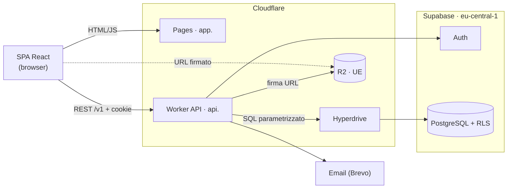
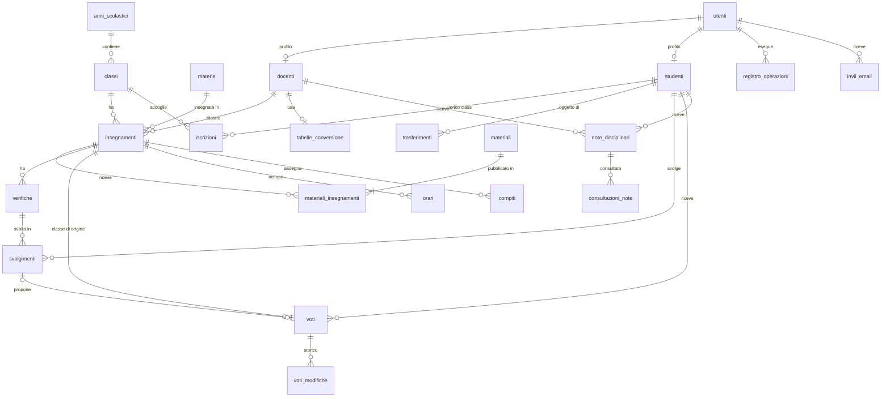
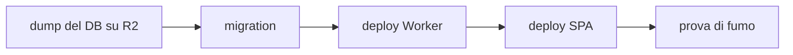

# PRD di ScuolaChill · Team Christian Colonna

---

## Informazioni sul documento

|  |  |
| --- | --- |
| **Prodotto** | ScuolaChill |
| **Team** | Christian Colonna (sviluppatore unico) |
| **Autori** | Christian Colonna |
| **Versione** | 1.2 |
| **Data** | 09/10/2026 |
| **Stato** | Bozza |

### Storico delle versioni

| Versione | Data | Autore | Cosa è cambiato e perché |
| --- | --- | --- | --- |
| 1.0 | 23/09/2026 | Christian Colonna | Prima stesura, dalla board Miro e dalle decisioni del 18/09 |
| 1.1 | 24/09/2026 | Christian Colonna | Allineamento al template: scelte tecniche tolte dalla prima parte |
| 1.2 | 09/10/2026 | Christian Colonna | Testo ridotto sotto le 25 pagine; requisiti dalle interviste; storie in schede separate; revisione di coerenza |

---

# Prima parte · Il cosa

## Scopo e perimetro

### Perché esiste ScuolaChill

**Dal lato business.** Oggi materiale, verifiche, voti, orario e comunicazioni passano da canali
diversi: carta, email personali, chiavette, chat. Il Direttore non ha una vista d'insieme, i
docenti ricopiano gli stessi dati, le famiglie vedono i voti in ritardo. ScuolaChill raccoglie
tutto in un unico posto, con tre ruoli e regole chiare su chi vede cosa.

**Dal lato tecnico.** Un sistema unico, usabile dal browser di telefono e PC, in cui ogni
operazione passa da un solo punto di controllo centrale e i dati di minori sono protetti fin
dalla progettazione (VIN-05). Regge il picco delle verifiche in laboratorio (ASS-02) dentro il
budget dei crediti per studenti (VIN-01).

### Cosa è incluso

- **Direttore**: account docente e studente, classi e materie, assegnazione dei docenti, cambio
  classe con consenso della famiglia, orario, vista d'insieme (DIR-01..04, ORA-01).
- **Docente**: materiale, verifiche online con correzione ibrida, voti con bozza e
  pubblicazione, compiti, note disciplinari (DOC-01..03, COM-01, NOT-01).
- **Studente** (account di famiglia): materiale, voti per materia, orario, compiti e note;
  svolgimento delle verifiche (STU-01..03).
- **Accesso**: login, logout, primo accesso con credenziali via email, reset password (AUT-01).
- **Gestione completa** di ogni entità: creazione, lettura, modifica, eliminazione logica (FR-DIR-03).

### Cosa non è incluso

Tutte le voci sono evoluzioni future, non promesse per la v1.

| Escluso dalla v1 | Perché |
| --- | --- |
| Assenze, presenze, ritardi, giustificazioni | Area a sé; la v1 si concentra su didattica e valutazione |
| Aule e prenotazione dei laboratori; laboratori e monte ore del piano di studi nell'orario | Non servono alle user story della traccia; l'orario controlla solo i conflitti di docente (FR-ORA-01) |
| Indirizzi di studio (corsi) e piani di studio | Le classi e le materie bastano alle user story; il corso si aggiunge con la composizione automatica |
| Composizione automatica delle classi (15-25 studenti, gemelli separati, richieste delle famiglie) | Chiesta dal Direttore; nella v1 le classi si compongono a mano |
| Ruolo Segreteria separato | Tre ruoli (VIN-03): i delegati di segreteria usano il ruolo Direttore (ASS-04) |
| Richieste di materiale e arredi dai docenti al Direttore | Utile, ma esce da didattica e valutazione |
| Pagamenti (PagoPA) | Richiede accreditamento dell'ente e un Partner Tecnologico |
| Orario modificato trascinando le lezioni | La v1 lo modifica da form: stesso risultato, meno complessità |
| Correzione automatica di domande aperte e formule | Un confronto fra testi sbaglia (0,5 contro 1/2): le corregge il docente (FR-VER-04) |
| Account separato per il genitore | Credenziale unica di famiglia (FR-AUT-01) |
| Messaggi fra studenti, famiglie e docenti | Nessun intervistato li ha chiesti: docenti e studenti preferiscono parlarsi a voce, le famiglie hanno libretto e colloqui. Toglierli riduce i dati di minori da proteggere. La scheda MSG-01 resta come evoluzione futura |
| Consegna online dei compiti | Il compito è un avviso con scadenza (FR-COM-01) |
| Versioni diverse della stessa verifica per singoli studenti (per esempio ridotte per DSA) | La v1 copre il tempo aggiuntivo personale (FR-VER-06); una versione ridotta si prepara a parte |
| Contestazione della correzione nel sistema | Avviene a voce in classe, come oggi; se il docente cambia idea corregge il voto con un motivo (FR-VOT-02) |
| Scrutini, pagelle, sistemi ministeriali | Richiedono integrazioni istituzionali |
| Importazione massiva di account | ASS-11 |
| Promozioni in blocco all'anno successivo | ASS-12 |
| Supplenti con permessi diversi per supplenza breve e lunga; variazioni giornaliere dell'orario | ASS-17; un supplente lungo si gestisce come cambio di docente (ASS-22) |
| Notifiche sul telefono, app da installare | Si usa dal browser; gli avvisi si vedono all'accesso |
| Più istituti, altre lingue | Una sola scuola (ASS-01), solo italiano (ASS-13) |

---

## Stakeholder

| Stakeholder | Cosa fa | Cosa gli interessa | Come lo coinvolgete |
| --- | --- | --- | --- |
| Direttore | Gestisce account, classi, orario; supervisiona | Vista d'insieme affidabile, meno lavoro a inizio anno | Due interviste simulate (dall'autore nel ruolo e da Claude su fonti online), validazione dei flussi (board), collaudo |
| Docenti | Materiale, verifiche, voti, note | Meno tempo a correggere e ricopiare; decidere quando i voti sono visibili | Due interviste simulate (dall'autore nel ruolo e da Claude su fonti online), questionario ai docenti reali, un docente in collaudo |
| Studenti | Consultano, svolgono verifiche | Voti e compiti dal telefono, nessuna risposta persa | Collaudo con una classe del primo anno |
| Famiglie | Titolari dell'account Studente e del consenso al cambio classe | Trasparenza su voti e note, tutela dei dati del figlio | Informativa al primo accesso; consenso al collaudo (DIP-03) |
| Docente del corso | Valida il PRD | PRD completo, motivato, coerente | Presentazione e domande |
| Collaudatori del primo anno | Usano ScuolaChill come utenti reali | Semplice e veloce da telefono | Intervista (requisiti impliciti), collaudo (ASS-14) |
| Referente protezione dati | Vigila sul trattamento dei dati | Minimizzazione e conservazione (NFR-08) | Revisione di informativa e tempi (DIP-02) |
| Chi paga e mantiene | Christian Colonna, unico sviluppatore, con i crediti per studenti (VIN-01) | Costi entro i crediti, sistema mantenibile | Revisione di dimensionamento e deployment |

---

## Destinatari e contesto d'uso

### La scuola che avete immaginato

Un istituto tecnico statale di medie dimensioni in una città di provincia, cinque anni di corso.
Le verifiche online si svolgono nei laboratori, sui PC della scuola collegati allo stesso Wi-Fi;
per il resto studenti e famiglie usano il telefono, spesso in rete mobile. I docenti lavorano a
casa o in sala docenti.

|  | Valore |
| --- | --- |
| Numero di studenti | ~600 (ASS-01) |
| Numero di docenti | ~50 (ASS-01) |
| Numero di classi | 28, ~22 studenti per classe (ASS-01) |
| Orario scolastico | 8:00-14:00, lunedì-venerdì, 6 ore da 60 minuti; due quadrimestri (ASS-12, ASS-17) |
| Connettività | Wi-Fi condiviso nei laboratori; rete mobile personale altrove (NFR-05) |
| Laboratori e picco | 4 laboratori da ~25 postazioni: ~90 studenti aprono una verifica nello stesso minuto; ~250 utenti attivi nell'ora di punta (ASS-02) |

### Gli archetipi

| ID | Archetipo | Contesto d'uso | Competenze digitali | Dispositivo principale | Frequenza d'uso |
| --- | --- | --- | --- | --- | --- |
| ARC-001 | Direttore: dirigente o delegato di segreteria, 45-60 anni (1-3 persone, ASS-04) | In ufficio; picco a settembre (account, classi, orario), poi supervisione e casi singoli | Medie: gestionali e fogli di calcolo | PC | Quotidiana a settembre, poi settimanale |
| ARC-002 | Docente, 30-60 anni | Prepara a casa, apre e chiude le verifiche in laboratorio, corregge nel pomeriggio | Molto variabili | PC per preparare e correggere; telefono per consultare | Quotidiana |
| ARC-003 | Studente, 14-19 anni, e la famiglia sulla stessa credenziale; i collaudatori hanno 14-15 anni | **Smartphone** in corridoio, sul bus, la sera; **PC del laboratorio solo per le verifiche** | Alte sul telefono, basse su file e password | Smartphone | Studente più volte al giorno; genitore settimanale |

---

## Panoramica e casi d'uso

### ScuolaChill in poche righe

ScuolaChill è il posto unico della scuola per la didattica. Lei, Direttore, crea gli account,
forma le classi, decide chi insegna cosa e compone l'orario; da una sola schermata vede come vanno
classi e materie. I docenti caricano il materiale e fanno svolgere le verifiche al computer in
laboratorio, dove le crocette si correggono da sole; decidono loro quando i voti diventano
visibili. Le famiglie, con un accesso per figlio, vedono dal telefono voti, compiti, note e
orario. Nessuno vede quello che non lo riguarda.

### User flow e scenari

Qui sono riportate per esteso tre storie, una per ruolo, scelte perché concentrano le regole più
delicate: trasferimenti e voti (Direttore), verifiche e correzione (Docente), svolgimento con
connessione instabile (Studente). Tutte le storie, comprese queste, hanno una scheda completa
nella cartella «user-story» allegata al PRD: AUT-01 (accesso), DIR-01..04, DOC-01..03,
STU-01..03, ORA-01 (orario), COM-01 (compiti), NOT-01 (note); MSG-01 (messaggi) è un'evoluzione futura.

Regole comuni: il ruolo si controlla prima di mostrare qualsiasi dato; ogni errore indica campo e
motivo e conserva i dati inseriti; ogni elenco è paginato e ricercabile (NFR-13); se due persone
modificano lo stesso dato, il secondo salvataggio è rifiutato con l'invito a ricaricare.

**Storia:** DIR-03 · Creare le classi, comporle e trasferire gli studenti (board, frame 4-5)

**User flow**

1. Il Direttore crea la classe (anno di corso 1-5, sezione, anno scolastico) e indica per ogni
   materia il docente titolare (FR-DIR-02).
2. Il sistema rifiuta dati mancanti, classe già esistente, docente non attivo o doppio per la
   stessa materia, nome non valido («1A»: cifra 1-5 e lettera).
3. Trasferimento (FR-DIR-01): dalla scheda dello studente il Direttore sceglie la destinazione;
   serve il consenso della famiglia, che il Direttore registra (ASS-05).
4. Consenso dato → cambio eseguito, voti conservati; negato → «colloquio richiesto».

**Scenario principale.** A novembre Giulia passa dalla 2B alla 2D: il padre firma in segreteria,
il Direttore registra il consenso, Giulia vede l'orario della 2D e i suoi voti marcati «2B».

**Scenari alternativi.** Destinazione uguale o disattivata → errore; verifica in corso →
trasferimento bloccato; classe con studenti → non eliminabile.

**Storia:** DOC-02 · Creare, far svolgere e correggere le verifiche

**User flow**

1. Il docente crea la verifica: titolo, data prevista, durata (ASS-15), domande a scelta multipla,
   vero/falso, aperte e con formule, con un punteggio per difficoltà e le risposte corrette per le
   prime due. Se la classe ha già una verifica quel giorno, il sistema lo avvisa (FR-VER-07).
2. La vede in anteprima e la salva in bozza; di norma l'ordine di domande e risposte è mescolato
   per ogni studente (FR-VER-06).
3. In laboratorio apre la finestra di svolgimento, segue chi ha consegnato, concede estensioni,
   la chiude.
4. Corregge aperte e formule, anche con punteggi parziali; il sistema converte la percentuale in
   voto con la tabella personale del docente (FR-VER-05) e nascono voti in bozza.
5. Dopo il primo avvio da parte di uno studente si modifica solo come previsto da FR-VER-01.

**Scenario principale.** La prof.ssa Rossi apre alle 9:00 una verifica di 10 crocette e 2
esercizi alla 1A, la chiude alle 10:00 e nel pomeriggio corregge i due esercizi; il sistema le
propone i voti con la sua tabella (minimo 3, sufficienza dal 55%).

**Scenari alternativi.** Domanda automatica senza risposta corretta → non si apre; errore nella
chiave dopo la consegna → FR-VER-01; docente senza tabella → tabella predefinita (ASS-06);
studente assente → nessun voto.

**Storia:** STU-02 · Svolgere una verifica

**User flow**

1. In laboratorio lo studente vede solo le verifiche con la finestra aperta per la sua classe.
2. Avvia: domande e tempo residuo.
3. Ogni risposta si salva da sola, con l'indicatore «salvato» (FR-VER-03).
4. Consegna dopo un riepilogo e riceve una ricevuta; correzione e voto arrivano con la
   pubblicazione.

**Scenario principale.** Alle 9:05 Sara apre la verifica di Scienze con altre tre classi e la
vede in meno di 2 s (NFR-01). Il Wi-Fi cade per un minuto: «non salvato, riconnessione», poi
«salvato», nulla perso.

**Scenari alternativi.** Connessione caduta o PC spento → ripresa anche da un'altra postazione
(FR-VER-03); tempo scaduto o finestra chiusa → consegna automatica (FR-VER-02); seconda scheda
aperta → la prima passa in sola lettura; studente con piano personalizzato → il tempo
aggiuntivo è già applicato, senza che i compagni lo vedano (FR-VER-06).

---

## Requisiti funzionali

### Le user story della traccia

Gli AC della traccia restano validi. Quelli aggiunti dal team partono da **AC-10**; qui ne è
riportata una selezione, l'elenco completo è nelle schede. Formato
abbreviato: *Dato che* … → *quando* … → *allora* …. I criteri delle storie aggiunte dal team
(AUT-01, ORA-01, COM-01, NOT-01) sono nelle loro schede, nella cartella «user-story».

| ID | Storia | AC aggiunti dal team | Note |
| --- | --- | --- | --- |
| DIR-01 | Creare account docente | **AC-10** Dato un Docente o Studente, quando tenta di creare un docente, allora l'operazione è rifiutata. **AC-11** Dato un campo vuoto o un'email già usata, quando il Direttore salva, allora vede campo e motivo e i dati restano. **AC-12** Dato un docente disattivato, quando accede, allora è respinto e i suoi dati restano. **AC-13** Dato un invio email fallito, quando il Direttore apre la scheda, allora vede «invio fallito» e rigenera le credenziali. | FR-EXT-01 |
| DIR-02 | Creare account studente | **AC-10** Dato uno studente già iscritto, quando il Direttore lo assegna a un'altra classe, allora si propone il cambio classe, nessun duplicato. **AC-11** Dati due fratelli con la stessa email del genitore, quando si crea il secondo, allora nascono due account. **AC-12** Data una classe inesistente o disattivata, quando si salva, allora c'è errore sul campo. | FR-AUT-01 |
| DIR-03 | Creare classi e comporle | **AC-10** Data una classe già esistente nell'anno, quando si salva, allora è rifiutata. **AC-11** Dato un trasferimento non ancora autorizzato dalla famiglia, quando il Direttore lo avvia, allora lo studente resta nella classe di origine finché il consenso non è registrato. **AC-12** Dato un consenso negato, quando il Direttore lo registra, allora la classe resta invariata e lo stato diventa «colloquio richiesto». **AC-13** Dato un trasferimento eseguito, quando lo studente apre i voti, allora vede anche i precedenti con la classe di origine. **AC-14** Data una classe con studenti attivi, quando si elimina, allora l'eliminazione è rifiutata. | FR-DIR-01, FR-DIR-02 |
| DIR-04 | Vedere tutto | **AC-10** Dato un voto in bozza, quando il Direttore apre la vista d'insieme, allora non compare. **AC-11** Dato un Docente o Studente, quando chiede la vista d'insieme, allora è respinto. **AC-12** Dato il Direttore, quando apre la vista d'insieme, allora vede le classi ordinate per numero di note disciplinari dell'ultimo mese. **AC-14** Dato il quadrimestre in corso, quando il Direttore apre la vista d'insieme, allora vede l'elenco degli studenti con media sotto il 6 in almeno tre materie, calcolata sui soli voti pubblicati. | NFR-10; AC-12 e AC-14 dalle interviste al Direttore |
| DOC-01 | Caricare materiale didattico | **AC-10** Dato un file oltre il limite o non ammesso, quando si carica, allora è rifiutato senza materiale parziale. **AC-11** Dato un materiale eliminato, quando uno studente usa un vecchio link, allora non lo trova. **AC-12** Data una classe non assegnata, quando il docente carica, allora il caricamento è rifiutato. | ASS-10 |
| DOC-02 | Creare le proprie verifiche | **AC-10** Data una verifica già avviata da almeno uno studente, quando il docente la modifica, allora sono ammesse solo le eccezioni di FR-VER-01. **AC-11** Data una chiave corretta, quando si salva, allora i punteggi sono ricalcolati e i voti pubblicati coinvolti segnalati. **AC-12** Data una domanda automatica senza risposta corretta, quando si apre la verifica, allora l'apertura è rifiutata. **AC-13** Data una tabella di conversione importata con percentuali sovrapposte o scoperte, o con voti fuori scala, quando il docente la salva, allora è rifiutata indicando la riga sbagliata. **AC-14** Data una finestra di svolgimento chiusa, quando uno studente prova ad avviare la verifica, allora è respinto. **AC-15** Data una verifica con l'ordine mescolato, quando due studenti la avviano, allora vedono domande e risposte in ordine diverso e la correzione è identica. **AC-16** Data una classe con già una verifica programmata in un giorno, quando un docente ne programma un'altra lo stesso giorno, allora il sistema lo avvisa prima di salvare. | FR-VER-01..07 |
| DOC-03 | Assegnare i voti | **AC-10** Dato un valore fuori scala o non previsto da FR-VOT-01 (11, 0, 6,3, «10+»), quando si salva, allora è rifiutato sul campo; «6+» e «7−» sono accettati. **AC-11** Dato un voto in bozza, quando lo studente apre i voti, allora non lo vede. **AC-12** Dato un voto pubblicato, quando lo si corregge senza motivo, allora è rifiutato. | AC-01 della traccia letto come «visibile dopo la pubblicazione»; FR-VOT-01, FR-VOT-02 |
| STU-01 | Consultare il materiale didattico | **AC-10** Dato un materiale di un'altra classe, quando lo studente lo chiede anche con il link, allora è respinto. | NFR-05 |
| STU-02 | Svolgere una verifica | **AC-10** Dati 90 studenti nello stesso minuto, quando aprono la verifica, allora il 95% la vede entro 2 s. **AC-11** Data una connessione caduta, quando lo studente rientra a finestra aperta, allora ritrova tutte le risposte salvate. **AC-12** Dato il tempo scaduto, quando lo studente non ha consegnato, allora è consegnato l'ultimo salvataggio. **AC-13** Data la verifica aperta in una seconda scheda o su un altro dispositivo, quando lo studente risponde lì, allora la prima sessione passa in sola lettura ed esiste un solo svolgimento. **AC-14** Dato uno studente con tempo aggiuntivo del 30% e una verifica da 60 minuti, quando la avvia, allora ha 78 minuti, anche se il docente chiude la finestra dopo 60, e nessun compagno vede la differenza. | FR-VER-02, FR-VER-03, FR-VER-06 |
| STU-03 | Consultare i propri voti | **AC-11** Dato uno studente, quando chiede i voti di un altro, allora è respinto. **AC-12** Dato un voto corretto, quando lo studente lo apre, allora vede «modificato il …». | ASS-07 |

### Le decisioni lasciate aperte dalla traccia

> **FR-VOT-01 · Scala dei voti** (collegato a *DOC-03*)
> Da 1 a 10 con interi, mezzi voti e segni: per ogni voto n sono ammessi n−, n, n+ e n½ (da 1 a
> 10, senza «1−», «10+» e «10½»: 37 valori). Nelle medie «+» vale +0,25 e «−» vale −0,25 (ASS-06). Ogni
> altro valore è rifiutato con errore sul campo.
> *Motivazione:* i docenti usano i segni (intervista al Docente); dare loro un valore fisso rende
> le medie calcolabili senza ambiguità.

> **FR-DIR-01 · Trasferimento fra classi** (collegato a *DIR-03*)
> Consentito. Primo anno prima dell'inizio delle lezioni → immediato; altrimenti serve il
> consenso del genitore, registrato dal Direttore (ASS-05). I voti restano allo studente con la
> classe di origine; il nuovo docente li vede in sola lettura. Bloccato durante una verifica.
> *Motivazione:* il voto misura lo studente in una materia, non la classe; la regola del consenso
> viene dalla board.

> **FR-VER-01 · Modifica di una verifica dopo lo svolgimento** (collegato a *DOC-02*)
> Libera finché nessuno l'ha avviata. Poi il docente può solo correggere la chiave di una domanda
> automatica (ricalcolo per tutti), annullare una domanda o prolungare la finestra.
> *Motivazione:* tutti vanno valutati sulla stessa verifica; le eccezioni coprono gli errori reali.

> **FR-VER-02 · Finestra e tempo** (collegato a *STU-02*)
> La verifica si svolge solo a finestra aperta. Il tempo parte dall'avvio, è misurato dal server
> e non si ferma se la connessione cade (ASS-15); alla scadenza l'ultimo salvataggio è consegnato.
> Chiudere la finestra ferma chi ha esaurito il proprio tempo; chi ha un tempo aggiuntivo
> (FR-VER-06) continua fino alla propria scadenza.
> *Motivazione:* la finestra in classe mitiga il rischio dell'account di famiglia (FR-AUT-01).

> **FR-VER-03 · Connessione che cade durante una verifica** (collegato a *STU-02*)
> Ogni risposta si salva pochi secondi dopo la modifica, con lo stato sempre visibile. Dopo una
> caduta si riprende dallo stesso punto, anche da un altro PC, a finestra aperta. Uno svolgimento
> per studente: una seconda scheda mette in sola lettura la prima.
> *Motivazione:* 25 PC sullo stesso Wi-Fi rendono probabili cadute brevi (NFR-04).

> **FR-EXT-01 · Fallimento del servizio email** (collegato a *DIR-01*, *DIR-02*, *AUT-01*)
> L'account nasce comunque; l'invio si ritenta più volte; lo stato è visibile nella scheda e
> nella vista d'insieme. Il Direttore rigenera il codice e lo consegna stampato.
> *Motivazione:* un'interruzione a settembre non deve bloccare l'avvio dell'anno.

**Scoperte dal team**

> **FR-VOT-02 · Voti in bozza e pubblicati** (collegato a *DOC-03*, *STU-03*)
> Ogni voto nasce in bozza visibile al solo autore e diventa visibile con la pubblicazione, anche
> in blocco. Correzioni ed eliminazioni di un voto pubblicato richiedono un motivo e restano tracciate.
> *Motivazione:* il docente rivede prima che le famiglie vedano, e può pubblicare dopo aver
> comunicato i voti in classe, come chiede la metà degli studenti (requisiti impliciti); la
> traccia tutela tutti.

> **FR-VER-04 · Correzione ibrida** (collegato a *DOC-02*)
> Scelta multipla e vero/falso le corregge il sistema, aperte e formule il docente; il sistema
> propone il voto con la tabella di conversione del docente (FR-VER-05).
> *Motivazione:* la correzione automatica delle formule sbaglia su risposte equivalenti.

> **FR-VER-05 · Tabella di conversione del docente** (collegato a *DOC-02*, *DOC-03*)
> Ogni docente ha una propria tabella che trasforma la percentuale di punteggio in voto (per
> esempio minimo 3 e sufficienza dal 55%). La crea nel sistema o la importa da un foglio di
> calcolo con due colonne, percentuale minima e voto; la tabella deve coprire da 0 a 100% senza
> sovrapposizioni e usare solo voti di FR-VOT-01. Finché non ne ha una vale la tabella
> predefinita (ASS-06). Il voto proposto resta modificabile prima della pubblicazione.
> *Motivazione:* ogni docente oggi usa la propria tabella, non lineare (intervista al Docente).

> **FR-VER-06 · Verifiche eque e accessibili** (collegato a *DOC-02*, *STU-02*)
> Per ogni verifica il docente può mescolare l'ordine di domande e risposte per ogni studente
> (attivo di default); la correzione non cambia. Gli studenti con piano didattico personalizzato
> hanno un tempo aggiuntivo in percentuale (di norma 30%), che il Direttore registra sulla scheda
> su indicazione del consiglio di classe e che si applica da solo a ogni verifica. Il sistema
> conserva solo la percentuale, mai la diagnosi; la vedono il Direttore, i docenti della classe e
> la famiglia, mai i compagni.
> *Motivazione:* in laboratorio i PC sono vicini; la legge 170/2010 prevede il tempo aggiuntivo
> come misura compensativa, e ricordarlo a mano a ogni verifica è fonte di errori.

> **FR-VER-07 · Verifiche programmate** (collegato a *DOC-02*)
> Ogni verifica ha una data prevista. I docenti di una classe vedono le verifiche già
> programmate (data e materia, non il contenuto) e, se in quel giorno la classe ne ha già una,
> il sistema avvisa prima di salvare; il docente può
> confermare.
> *Motivazione:* la nota ministeriale del 28/09/2026 chiede di programmare le verifiche insieme
> per non concentrarle nella stessa giornata (VIN-08). Avviso e non blocco, perché i recuperi
> possono richiederlo.

> **FR-AUT-01 · Credenziale di famiglia** (collegato a *DIR-02*)
> Un account per studente, intestato al genitore, usato da studente e famiglia; nessun ruolo
> Genitore. Rischio dichiarato: chi conosce la credenziale può svolgere le verifiche (mitigazioni
> FR-VER-02, ASS-03, ASS-56).
> *Motivazione:* tre ruoli come da traccia (VIN-03), un solo accesso per famiglia.

> **FR-DIR-02 · Assegnazione dei docenti** (collegato a *DIR-03*, *DOC-01..03*)
> Il Direttore gestisce le materie e chi insegna cosa in ogni classe; il docente opera solo sulle
> proprie coppie classe-materia. Un cambio di docente in corso d'anno segue ASS-22.
> *Motivazione:* rende verificabile «le sue classi».

> **FR-DIR-03 · Eliminazione logica** (collegato a tutte le storie)
> Nessun dato si cancella dall'applicazione: si nasconde, si registra chi e quando, si può
> ripristinare (ASS-20). La cancellazione definitiva segue i tempi di conservazione (ASS-54).
> *Motivazione:* voti, note e verifiche hanno valore di prova.

> **FR-NOT-01 · Note disciplinari** (collegato a *NOT-01*)
> Individuali; le vedono studente, docenti della classe e Direttore, con consultazioni
> registrate. Modificabili 24 ore, poi solo annullabili con motivo (ASS-09).
> *Motivazione:* dato sensibile di un minore; la presa visione sostituisce la firma.

> **FR-ORA-01 · Orario** (collegato a *ORA-01*) e **FR-COM-01 · Compiti** (collegato a *COM-01*)
> Un orario per classe e anno, da form (ASS-17); un docente non sta in due classi alla stessa
> ora. Il compito è un avviso con scadenza, senza consegna online, modificabile fino alla scadenza.
> Si pubblica solo in orario di lezione; se il docente lo prepara fuori orario resta in bozza
> (ASS-25), come chiede la nota ministeriale del 28/09/2026 (VIN-08).
> *Motivazione:* coprono la board con il minimo, nel rispetto delle regole sui compiti.

---

## Requisiti non funzionali

I requisiti trasversali della traccia sono NFR-12..16 (VIN-04); la scalabilità è NFR-09.

| ID | Famiglia | Requisito | Soglia e condizione | Come si verifica | Storie collegate |
| --- | --- | --- | --- | --- | --- |
| NFR-01 | Prestazioni | Apertura della verifica nel picco | < 2 s per il 95%, con 90 studenti nello stesso minuto | Test di carico | STU-02 |
| NFR-02 | Sicurezza | Ruolo controllato dal sistema su ogni operazione | 100% della matrice ruoli × operazioni; 0 accessi a dati altrui anche manipolando le richieste | Test automatici, prova di manomissione | tutte |
| NFR-03 | Usabilità | Operazioni chiave senza aiuto | ≥ 90% dei collaudatori completa una verifica da solo e trova un voto entro 30 s | Osservazione al collaudo | STU-02, STU-03 |
| NFR-04 | Disponibilità | Servizio attivo a scuola, nessun dato perso | ≥ 99,5% al mese, 7:30-14:30 lun-ven; 0 risposte e voti persi; copia giornaliera, ripristino ≤ 4 h | Monitoraggio esterno, prova di ripristino | STU-02, DOC-03 |
| NFR-05 | Ambientale | Telefono in rete mobile, laboratorio su Wi-Fi condiviso | Usabile sui telefoni con lo schermo più stretto (360 pixel); prima schermata < 3 s in 4G; 25 PC sullo stesso Wi-Fi entro NFR-01 | Prova su telefono reale e in laboratorio (DIP-05) | STU-01..03 |
| NFR-06 | Supporto | Operazioni ricorrenti senza il team | Il Direttore rigenera credenziali e riattiva account da solo; errori con codice citabile; guida di una pagina per ruolo | Revisione dei messaggi di errore | DIR-01, DIR-02, AUT-01 |
| NFR-07 | Interazione | Interfaccia accessibile e coerente | WCAG 2.1 AA sulle schermate principali, verifica compresa: testo ingrandibile al 200% senza perdere funzioni, compatibile con la sintesi vocale (studenti con DSA); il colore non porta mai da solo l'informazione; tema chiaro e scuro | Controllo automatico e manuale | tutte |
| NFR-08 | Conformità | GDPR per dati di minori | Solo dati necessari; conservazione definita (ASS-54); informativa al primo accesso; dati nello SEE | Checklist con il referente (DIP-02) | NOT-01, DIR-02, STU-02 |
| NFR-09 | Scalabilità | Carico doppio senza cambiare architettura | 180 studenti nello stesso minuto e 500 attivi: apertura < 3 s per il 95% | Test di carico a 2× | STU-02, DIR-04 |
| NFR-10 | Prestazioni | Letture reattive nell'ora di punta | 250 attivi: letture < 1 s, vista d'insieme < 3 s, per il 95% | Test di carico | DIR-04, STU-01, STU-03 |
| NFR-11 | Prestazioni | Salvataggio e consegna | Salvataggio < 1 s e consegna < 3 s per il 95%, 90 consegne nello stesso minuto | Test di carico | STU-02 |
| NFR-12 | Sicurezza (traccia: HTTPS) | Traffico cifrato | 100%; richieste in chiaro reindirizzate | Scansione dell'indirizzo pubblico | tutte |
| NFR-13 | Prestazioni (traccia: paginazione) | Elenchi paginati | Nessun elenco completo in una risposta; pagina con default e massimo | Test con 600 studenti | DIR-01..04, STU-01 |
| NFR-14 | Supporto (traccia: OpenAPI e Postman) | Interfaccia documentata e provabile | 100% delle operazioni nella specifica; collezione di prova verde prima di ogni rilascio | Controllo automatico | tutte |
| NFR-15 | Interazione (traccia: errori uniformi) | Errori in formato unico | Codice, messaggio e campo; mai dettagli interni | Test sui casi di errore | DIR-01..03, DOC-03 |
| NFR-16 | Supporto (traccia: Dev e Prod) | Ambienti separati | Dati, configurazione e segreti separati; dati reali mai in sviluppo | Checklist di rilascio | tutte |
| NFR-17 | Usabilità (requisito implicito) | Le informazioni del giorno subito visibili allo studente | Dalla pagina iniziale dell'area Studente si vedono orario di oggi e compiti in scadenza domani senza altri tocchi, in < 3 s da telefono in 4G | Prova a tempo al collaudo | ORA-01, COM-01 |
| NFR-18 | Conformità | Ricostruire chi ha visto o cambiato dati sensibili | Rigenerazione di credenziali, modifiche al tempo aggiuntivo, letture delle note, correzioni ed eliminazioni di voti pubblicati, disattivazioni e trasferimenti registrati con autore e ora, conservati 1 anno; il Direttore ottiene l'elenco di un periodo in meno di 5 minuti, così da notificare una violazione entro le 72 ore richieste dal GDPR | Prova di estrazione prima del collaudo | DIR-01..04, DOC-03, NOT-01 |

### Requisiti impliciti

Domanda: «Cosa daresti per scontato che un'app di questo tipo faccia sempre, o non faccia
mai?». **Intervista simulata**: uno studente di 14 anni del primo anno è stato impersonato sulla
base di sondaggi Skuola.net (2.500 studenti delle superiori) e delle recensioni delle app di
registro elettronico; il verbale con le fonti è allegato. Va sostituita con un'intervista reale
prima della consegna (DIP-04). Non è stato possibile farla prima di questa versione per
mancanza di tempo.

| Chi avete intervistato | Cosa ha detto | Requisito che ne avete ricavato |
| --- | --- | --- |
| Studente simulato, 1° anno | «Mia madre non deve vedere il voto prima che il prof ce l'abbia detto in classe» (il 51% degli studenti nel sondaggio) | FR-VOT-02: il voto è visibile solo quando il docente lo pubblica, di norma dopo averlo comunicato in classe |
| Studente simulato, 1° anno | «Appena apro voglio vedere i compiti per domani e l'orario di oggi» | NFR-17 (nuovo) |
| Studente simulato, 1° anno | «Non deve buttarmi fuori ogni volta né bloccarsi al login» (lamentela frequente nelle recensioni) | ASS-51 e NFR-05, esistenti |
| Studente simulato, 1° anno | «I compagni non devono vedere i miei voti e le mie note; niente valanga di notifiche» | NFR-02 e FR-NOT-01, esistenti; nessuna notifica sul telefono nella v1 |

---

## Assunzioni, vincoli e dipendenze

Qui stanno quelli di scuola e prodotto; quelli legati alle scelte tecniche sono in «Scelte
tecnologiche»; gli altri ID mancanti sono stati tolti insieme alla messaggistica.

### Assunzioni

| ID | Assunzione | Cosa succede se è falsa |
| --- | --- | --- |
| ASS-01 | ~600 studenti, ~50 docenti, 28 classi, lezioni 8:00-14:00 lun-ven. | Si ricalcolano carico, NFR e costi. |
| ASS-02 | Al massimo 4 classi in verifica insieme (~90 studenti nello stesso minuto); ~250 utenti nell'ora di punta. | Cambiano NFR-01, 10, 11 e il dimensionamento. |
| ASS-03 | Le verifiche si svolgono solo in laboratorio, con il docente. | Da casa non si sa chi risponde con la credenziale di famiglia. |
| ASS-04 | *Da validare.* 1-3 Direttori con gli stessi permessi. | Permessi diversi richiedono un quarto ruolo (VIN-03). |
| ASS-05 | *Da validare.* Il consenso al cambio classe si raccoglie per iscritto; il Direttore ne registra esito e data. | Un consenso nell'app dovrebbe impedire che il minore lo dia al posto del genitore. |
| ASS-06 | *Da validare con il docente.* Nelle medie «+» vale +0,25 e «−» vale −0,25; la tabella predefinita, finché il docente non ne crea una, è lineare: 1 + 9 × percentuale, arrotondata al mezzo voto. | Con un valore diverso dei segni cambiano solo le medie, non i voti registrati. |
| ASS-07 | *Da validare.* Media aritmetica dei voti pubblicati del quadrimestre, «indicativa». | Con i pesi cambiano le letture aggregate. |
| ASS-09 | *Da validare.* Nota modificabile per 24 ore, poi solo annullabile. | Cambia solo la soglia. |
| ASS-10 | *Da validare.* File fino a 20 MB, niente video: ~10 GB l'anno. | Con i video lo spazio cresce di 10×. |
| ASS-11 | *Da validare.* Account creati uno alla volta: ~650 × 2 min ≈ 22 ore a settembre. | L'importazione massiva entra nella v1. |
| ASS-12 | Un anno scolastico attivo alla volta; gli anni chiusi in sola lettura. | Servono le promozioni in blocco. |
| ASS-13 | Interfaccia solo in italiano. | Testi da tradurre, dati invariati. |
| ASS-14 | Collaudo: una classe del primo anno (~22), il Direttore, un docente, due settimane. | Metriche di valutazione poco significative. |
| ASS-15 | *Da validare.* Durata decisa dal docente (10-120 min); il tempo corre anche se la connessione cade. Il sistema mostra al docente la durata con il tempo aggiuntivo (per esempio 45 minuti diventano 59), così la verifica resta nell'ora di laboratorio. | Fermarlo richiede regole per distinguere le cadute. |
| ASS-17 | Orario unico per l'anno, 6 ore, nessuna supplenza. | Serve un orario per data. |
| ASS-18 | *Da validare.* Anno 2026/27, PRD consegnato il 09/10/2026 (VIN-07), collaudo ad aprile 2027. | Le milestone slittano in blocco. |
| ASS-19 | *Da validare.* Docente identificato dall'email; studente da nome, cognome e data di nascita, con conferma per gli omonimi. | Con il codice fiscale si raccoglie un dato in più. |
| ASS-20 | *Da validare.* L'eliminazione logica vale per tutti i dati; storico dei voti e registro delle consultazioni delle note non si modificano. | Serve una procedura di cancellazione su richiesta. |
| ASS-22 | *Da validare.* Se cambia il docente di una materia, i voti restano al precedente; il nuovo li vede in sola lettura. | Cambia la regola di appartenenza. |
| ASS-23 | *Da validare.* Il quadrimestre di un voto si ricava dalla data. | Il docente lo sceglie a mano. |
| ASS-25 | *Da validare.* Un compito preparato fuori dall'orario di lezione resta in bozza e si pubblica alle 8:00 del giorno di scuola successivo, ricavato dal calendario dell'anno scolastico (inizio, fine, vacanze) che il Direttore inserisce a settembre. | Se la scuola applica la nota in modo più flessibile, basta togliere il vincolo. |
| ASS-50 | *Da validare.* Si accede con un identificativo nella forma nome.cognome, generato dal sistema; l'email serve solo per codici e link. | Per i fratelli con la stessa email serve comunque un identificativo. |
| ASS-51 | *Da validare.* Sessione fino alla chiusura del browser, 30 giorni con «Ricordami» (spento di default); chiusa alla consegna della verifica. | Rischi sui PC condivisi o accessi troppo frequenti. |
| ASS-52 | *Da validare.* 5 errori in 15 minuti bloccano identificativo e rete per 15 minuti. | Soglie basse bloccano un laboratorio intero. |
| ASS-53 | *Da validare.* Codice di primo accesso 72 ore, link di reset 60 minuti, monouso; password di almeno 10 caratteri. | Più rigenerazioni o finestra di abuso più ampia. |
| ASS-54 | *Da validare con il referente (DIP-02).* Note e risposte delle verifiche fino alla fine dell'anno successivo, account disattivati e registro delle operazioni sensibili (NFR-18) 1 anno. | Cambiano solo i parametri di cancellazione. |
| ASS-55 | *Da validare.* Il Direttore usa anche un secondo fattore (app di autenticazione). | Il furto della sua password apre tutti gli account. |
| ASS-56 | *Da validare.* Se la rete della scuola è riconoscibile (indirizzi pubblici fissi), le verifiche si accettano solo da lì. | Restano finestra e sessione unica. |

### Vincoli

| ID | Vincolo | Da dove viene |
| --- | --- | --- |
| VIN-01 | Costi nei crediti per studenti e nei piani gratuiti. | Traccia |
| VIN-02 | Cloud pubblico e collaudo con utenti reali. | Traccia |
| VIN-03 | Tre soli ruoli: Direttore, Docente, Studente. | Traccia; decisione del 18/09/2026 |
| VIN-04 | HTTPS, paginazione, OpenAPI e Postman, errori uniformi, Development e Production (NFR-12..16). | Traccia |
| VIN-05 | Dati di minori: GDPR e Codice privacy. | Normativa |
| VIN-06 | Template del corso, 15-25 pagine. | Docente del corso |
| VIN-07 | Consegna del PRD: 09/10/2026. | Docente del corso |
| VIN-08 | Compiti assegnati entro l'orario delle lezioni, niente inserimenti nel pomeriggio, la sera o nel fine settimana; verifiche programmate collegialmente per non concentrarle nello stesso giorno. | Nota ministeriale del 28/09/2026, anno 2026/27 |

### Dipendenze

| ID | Dipendenza | Serve entro | Chi se ne occupa |
| --- | --- | --- | --- |
| DIP-01 | Crediti cloud per studenti attivati | Prima versione in cloud | Christian Colonna |
| DIP-02 | Referente protezione dati disponibile | Prima del collaudo | Christian Colonna |
| DIP-03 | Classe del primo anno, Direttore, docente; consenso delle famiglie | Collaudo | Christian Colonna |
| DIP-04 | Intervista a un ragazzo del primo anno | Consegna del PRD | Christian Colonna |
| DIP-05 | Laboratorio da 25 postazioni per la prova reale | Test di carico (M7) | Christian Colonna |
| DIP-50 | Nomina dello sviluppatore a responsabile del trattamento; accordi con i fornitori; valutazione d'impatto | Prima dei dati reali | Christian Colonna con l'istituto |
| DIP-51 | Indirizzi pubblici della rete scolastica (ASS-56) | Prova in laboratorio | Christian Colonna |

---

# Seconda parte · Il come

## Stima del carico

### Utenti concorrenti

Metodo: **concorrenti = sessioni nell'ora × durata media / 60 min**, con il modello d'uso di
ASS-60: sessione da telefono di ~8 min e ~15 chiamate, docente di ~20 min e ~40 chiamate; uno
studente in verifica resta collegato per l'ora intera.

| Situazione | Utenti concorrenti | Da dove viene il numero |
| --- | --- | --- |
| Uso normale durante la giornata | **~25** (0,7 req/s, punte di 2) | ~1.000 sessioni al giorno, il 15% nell'ora più carica: 135 × 8/60 + 15 × 20/60 |
| Picco delle 9:00 (verifiche) | **~115** (3,8 req/s di media, **~40 req/s** per pochi secondi) | 90 studenti in verifica (ASS-02) + 160 altri utenti × 8/60 |
| Fine quadrimestre (voti) | **~32** (1 req/s, punte di 3) | 80% delle famiglie fra le 20 e le 23, metà nell'ora più carica: 240 × 8/60 |

Il picco delle 9:00 nasce da tre raffiche: **apertura** (90 × 5 chiamate in ~15 s ≈ 30 req/s),
**riconnessione del Wi-Fi** dopo una caduta (90 salvataggi in 2-3 s ≈ 30-45 req/s) e **consegna**
(90 × 2 in 10 s ≈ 18 req/s). Fra le raffiche il salvataggio progressivo (ASS-61) fa 3 req/s. Con il
carico doppio di NFR-09 il picco è ~80 req/s. **Lo scenario che dimensiona il sistema è il picco
delle verifiche.**

| Volume | Giorno tipico | Giorno di picco |
| --- | --- | --- |
| Richieste API (sessioni + 127 chiamate per studente in verifica, 4 o 8 classi) | ~29.000 | ~40.000 |
| Istruzioni SQL (× 4, ASS-62) | ~116.000 | ~160.000 |

In un mese ≈ **650.000 richieste**, ~800.000 nei mesi di fine periodo. Il DB cresce di ~150 MB
l'anno (ASS-21), i file di ~10 GB (ASS-10).

### Profilo di carico

| Operazione | Frequente? | Pesante? | Critica? | Note |
| --- | --- | --- | --- | --- |
| Login | Sì: ~1.000 al giorno, 90 in un minuto alle 9:00 | No | Sì | Tutti i login arrivano a Supabase Auth dal Worker: limite per IP da alzare (ASS-64) |
| Apertura verifica | 4-8 classi al giorno | Media: 5 chiamate, 15-30 KB | **Sì** (NFR-01) | SPA già in cache nei laboratori (ASS-66) |
| Salvataggio risposte | ~120 per studente all'ora | Leggera | Sì (NFR-04, NFR-11) | Raffica alla riconnessione |
| Consegna verifica | 90 nello stesso minuto | Media: transazione con correzione | Sì (NFR-11) | Stessa transazione per la consegna automatica |
| Dashboard del Direttore | Poco: 1-3 utenti | **Sì**: aggregati su ~58.000 voti l'anno | No | Calcolata nel DB, mai nel Worker (VIN-30) |
| Caricamento materiale | ~10 al giorno | In banda (20 MB), non per il Worker | No | Dal browser a R2 con URL firmato |

---

## Scelte tecnologiche

Criterio comune: **ogni operazione passa dal Worker** (VIN-34). Si scarta per prima cosa ciò che
porta il browser a interrogare il database o aggiunge un secondo backend.

| Area | Scelta | Alternativa considerata | Perché avete scelto così |
| --- | --- | --- | --- |
| **Backend** | API REST su **Cloudflare Workers** (TypeScript, **Hono**) | Node + Express su server sempre acceso | Nessun server da gestire, scala da solo nel picco, stessa piattaforma di Pages e R2; Express va dimensionato e pagato anche di notte. |
| **Frontend** | SPA **React + Vite** con **MUI**, TanStack Query, React Hook Form + Zod | Angular · Nuxt/Vue · Next.js | Angular è meno conosciuto dal team. Nuxt/Vue, il più familiare, non impone un'architettura a livelli; Nuxt e Next.js portano anche un server che fa da secondo backend. MUI dà tema chiaro/scuro e DataGrid. |
| Librerie | **SurveyJS** (verifiche), **KaTeX** (formule), **FullCalendar** (orario), **Recharts** (grafici) | Verifica scritta a mano · MathJax · Chart.js · AG Grid | SurveyJS dà tipi di domanda e un JSON che il Worker corregge; KaTeX è veloce su telefono; AG Grid tiene a pagamento le funzioni utili. |
| **Database** | **PostgreSQL** gestito da **Supabase** | Cloudflare D1 (SQLite) | Dominio relazionale con transazioni; Supabase aggiunge autenticazione, RLS e migration, che su D1 andrebbero scritte da zero. |
| Accesso al DB | **Hyperdrive** + **Postgres.js** | Client Supabase via PostgREST | Pubblicazione dei voti e consegna devono essere atomiche: PostgREST non ha transazioni su più istruzioni. Hyperdrive tiene il pool di connessioni. |
| Autenticazione | **Supabase Auth**, chiamato solo dal Worker | Scritta dal team | Hash, reset e token sono il codice più delicato: meglio un servizio collaudato. |
| File | **Cloudflare R2**, bucket privato UE, URL firmati | Supabase Storage | Nessun costo di uscita e il file non passa dal Worker; con Supabase Storage il browser parlerebbe con Supabase. |
| **Provider cloud** | **Cloudflare** + **Supabase** | AWS (Lambda, RDS, S3, Cognito) | Piani adatti a 650 utenti; AWS richiede IAM, VPC e un RDS a costo fisso. |
| **Servizi cloud** | Pages · Workers · Hyperdrive · R2 · Supabase Postgres + Auth · email | Asset serviti dal Worker | Pages separa il rilascio della SPA da quello dell'API. |
| **Regione** | Supabase **Francoforte (UE)**, R2 in giurisdizione **UE** | Supabase Zurigo | Dati di minori nell'UE; Zurigo sarebbe un trasferimento da motivare. |
| **Servizio esterno** | Email **Brevo** (*da validare*, ASS-30) | Resend · SMTP di Supabase | Brevo tiene i dati in UE; Resend negli USA; l'SMTP di Supabase invia 2 email l'ora (VIN-32). |
| Migration e test | **Supabase CLI** · **Vitest** nel runtime Workers | Drizzle Kit · Jest | La CLI riproduce in locale Postgres, Auth e RLS; Jest gira su Node e non vede le differenze del runtime. |
| Attività pianificate | **Cron Trigger** di Cloudflare: ritentare le email, pubblicare alle 8:00 i compiti in bozza, cancellare i dati scaduti | Esecuzioni pianificate di GitHub Actions · pg_cron in Supabase | Stesso runtime e stessi service del Worker. GitHub Actions dipende dalla CI e non garantisce l'orario; pg_cron porterebbe la logica nel database e non può chiamare il servizio email. |

#### Assunzioni, vincoli e dipendenze tecniche

| ID | Assunzione tecnica (*tutte da validare*) | Se è falsa |
| --- | --- | --- |
| ASS-21 | ~58.000 voti e ~15.000 svolgimenti l'anno: ~150 MB di DB, indici, registro delle operazioni (NFR-18) e margine compresi. | Si anticipa la conservazione degli svolgimenti. |
| ASS-24 | Un materiale su più classi è un solo file R2, rimosso solo dalla conservazione. | Il ripristino del materiale non è più possibile. |
| ASS-30 | Brevo Free, 300 email al giorno: le ~650 credenziali partono in 3 giorni. | Si cambia l'adapter email. |
| ASS-31 | Dominio proprio: SPA su app.<dominio>, Worker su api.<dominio>. | CORS e cookie vanno rivisti. |
| ASS-33 | URL firmati R2 validi 5 minuti, un oggetto e un metodo. | Link condivisi riusabili o caricamenti lenti falliti. |
| ASS-34 | Solo Development (locale) e Production. | Uno staging raddoppia progetti e segreti. |
| ASS-40 | Elenchi filtrati di poche migliaia di righe: paginazione a offset. | Quella risorsa passa al cursore. |
| ASS-60 | 1,5 sessioni al giorno per famiglia, 2 per docente; 15% nell'ora più carica; 4 classi in verifica al giorno (8 nel picco). | Richieste e costi scalano in proporzione. |
| ASS-61 | Salvataggio 3 s dopo l'ultima modifica, al massimo ogni 10 s (~1 ogni 30 s). | Più traffico o più dati persi in una caduta. |
| ASS-62 | ~4 istruzioni SQL per richiesta. | Latenza più alta (~20 ms l'una). |
| ASS-64 | Limiti per IP di Supabase Auth alzati a 200 in raffica e 600 ogni 5 min. | Alle 9:00 dal trentunesimo login: «troppe richieste». |
| ASS-65 | Supabase Pro in produzione dal primo giorno con dati reali. | Niente backup e pausa dopo 7 giorni. |
| ASS-66 | SPA ≤ 1 MB compressa e in cache; laboratorio ≥ 100 Mbit/s. | Senza cache l'apertura rischia NFR-01. |
| ASS-67 | CI su GitHub Actions; con un solo sviluppatore il rilascio in produzione richiede un'approvazione manuale esplicita dopo che tutti i controlli sono verdi. | Cambiano solo i file della pipeline; senza approvazione un errore arriva subito in produzione. |

| ID | Vincolo tecnico | Da dove viene |
| --- | --- | --- |
| VIN-20 | Hyperdrive condivide le connessioni: contesto utente solo locale alla transazione. | Documentazione Hyperdrive |
| VIN-21 | Una vista Postgres ignora la RLS se non è dichiarata con l'opzione «security invoker». | Documentazione PostgreSQL |
| VIN-30 | Workers: 128 MB; nel Free 10 ms di CPU e 100.000 richieste al giorno. | Cloudflare Workers Limits |
| VIN-32 | L'SMTP di Supabase invia 2 email l'ora, solo al team. | Documentazione Supabase |
| VIN-33 | Supabase Free: 500 MB, pausa dopo 7 giorni. | Supabase Pricing |
| VIN-34 | Il browser non raggiunge mai Supabase; la RLS è difesa in profondità. | Traccia; decisioni di progetto |
| VIN-50 | Un access token di Supabase non si revoca prima della scadenza. | Supabase Sessions |
| VIN-60 | Limiti predefiniti di Supabase Auth: 150 login ogni 5 min per IP, raffica di 30. | Supabase Rate Limits |
| VIN-61 | Hyperdrive Free: 100.000 istruzioni SQL al giorno. | Hyperdrive Pricing |
| VIN-62 | Supabase Pro: compute Micro nei crediti, backup giornalieri per 7 giorni, nessuno SLA. | Supabase Pricing |

| ID | Dipendenza tecnica | Serve entro | Chi se ne occupa |
| --- | --- | --- | --- |
| DIP-30 | Account Cloudflare (Workers, Pages, R2, Hyperdrive) e dominio | Prima versione in cloud | Christian Colonna |
| DIP-31 | Progetto Supabase nella regione di Francoforte | Inizio dello sviluppo | Christian Colonna |
| DIP-32 | Account email con dominio verificato (SPF, DKIM) | Collaudo | Christian Colonna |
| DIP-60 | Repository GitHub con ambiente di produzione protetto | Prima versione in cloud | Christian Colonna |
| DIP-61 | Pagamento attivo per Workers Paid e Supabase Pro | Cloud / collaudo | Christian Colonna |
| DIP-62 | Monitoraggio esterno gratuito sulla route di stato | Collaudo | Christian Colonna |

---

## Architettura

### Diagramma dei componenti

Nessuna freccia va dal browser a Supabase (VIN-34). L'unico traffico fuori dal Worker è il
trasferimento dei file su R2, autorizzato dal Worker con un URL firmato di pochi minuti. Nel
frontend le route guard **nascondono**, non autorizzano.

### I livelli

| Livello | Cosa fa in ScuolaChill | Esempio concreto (pubblicazione dei voti) |
| --- | --- | --- |
| Presentation / API | Verifica token e ruolo, valida l'input con Zod, chiama un service, restituisce DTO; errori in formato uniforme | Il controller verifica che chi chiama sia Docente e che il corpo sia un elenco di ID; altrimenti 422 |
| Application / Business | Regole del prodotto: appartenenza, stati, finestre, scala dei voti; confini delle transazioni | Il service controlla che i voti siano del docente e in bozza, poi li pubblica tutti o nessuno |
| Data access | SQL parametrizzato, conversione riga ↔ entità; adapter per R2, Auth, email | Il repository aggiorna tutti i voti con una sola istruzione, nella transazione aperta dal service |

### Le dipendenze fra i livelli

Presentation conosce Application; Application definisce le proprie **porte** (repository, file,
email, autenticazione, orologio); Data access le implementa. Solo la composition root conosce
tutti. Nessun service importa Hono, Postgres.js o R2: cambiare fornitore significa riscrivere un
adapter, e una regola di lint sugli import lo verifica. I service si testano con porte in memoria.

---

## Le API

### Le risorse

Tutte le API stanno su un unico indirizzo, api.<dominio>/v1. La versione sta nel percorso; le
risorse usano i nomi del glossario al plurale; identificativi UUID; date in formato ISO 8601 UTC.
Le azioni che non sono creazione, lettura, modifica o eliminazione sono sotto-risorse chiamate in
POST (per esempio «pubblicazioni» e «consegna»); DELETE è sempre un'eliminazione logica; ogni
ruolo riceve una propria rappresentazione dei dati (allo studente la verifica arriva senza la
chiave di correzione).

| Area | Risorse |
| --- | --- |
| Accesso | sessione, primo accesso, reset password |
| Anagrafiche | anni scolastici (con il calendario), docenti, studenti (con i trasferimenti), classi, materie, insegnamenti, orari |
| Didattica | materiali, verifiche (con gli svolgimenti), voti, tabelle di conversione, compiti, note |
| Letture e servizio | statistiche dei voti, voti per materia di uno studente, verifiche programmate di una classe, registro delle operazioni sensibili, stato del servizio |

### Il contratto delle API principali

Ogni route con sessione può rispondere 401, 403, 404, 422, 429 e 500. Ogni PUT, PATCH e DELETE
porta il numero di versione del dato e può rispondere 409 se nel frattempo qualcuno l'ha cambiato.

| Verbo | Route | Chi può chiamarla | Payload di esempio | Risposte previste |
| --- | --- | --- | --- | --- |
| POST | /v1/auth/sessione | Pubblica | identificativo e password | 200 con cookie di sessione · 401 · 429 troppi tentativi |
| POST | /v1/docenti | Direttore | nome, cognome, email | 201 · 422 con il campo sbagliato · 409 email già usata |
| PUT | /v1/docenti/{id} | Direttore | tutti i dati del docente e la versione | 200 · 409 |
| DELETE | /v1/docenti/{id} | Direttore | versione | 204, account disattivato |
| POST | /v1/studenti/{id}/trasferimenti | Direttore | classe di destinazione | 201 in attesa di consenso · 409 verifica in corso |
| POST | /v1/materiali | Docente (sue classi) | titolo, classi e materie di destinazione | 201 con l'indirizzo per caricare il file · 422 file troppo grande |
| POST | /v1/verifiche | Docente (sue classi) | classe e materia, titolo, data prevista, durata, domande, ordine mescolato sì o no, conferma dello stesso giorno | 201 in bozza · 409 la classe ha già una verifica quel giorno: si ripete con la conferma |
| GET | /v1/classi/{id}/verifiche-programmate | Docenti della classe · Direttore | — | 200 date e materie, senza contenuto |
| POST | /v1/voti | Docente (sue classi) | studente, classe e materia, data, voto (es. 7½ o 6+), tipo (es. orale), commento facoltativo | 201 in bozza · 422 voto fuori scala · 403 |
| PATCH | /v1/voti/{id} | Docente autore | nuovo valore, motivo, versione | 200 · 422 motivo obbligatorio |
| POST | /v1/voti/pubblicazioni | Docente autore | elenco dei voti da pubblicare | 200 · 409, tutti o nessuno |
| PATCH | /v1/verifiche/{id}/svolgimenti/{id} | Studente (sé) | sessione, numero progressivo, risposte cambiate | 200 · 409 sessione sostituita o tempo scaduto |
| POST | /v1/verifiche/{id}/svolgimenti/{id}/consegna | Studente (sé) | sessione | 200 con ricevuta; ripeterla non cambia nulla |
| GET | /v1/studenti/{id}/voti-per-materia | Studente (sé) · Docente (sue classi) · Direttore | — | 200 solo voti pubblicati · 404 per altri studenti |
| GET | /v1/registro-operazioni | Direttore | — (filtri: periodo, tipo di operazione) | 200 elenco paginato · 403 agli altri ruoli |
| GET | /v1/stato | Pubblica | — | 200 · 503 se il database non risponde |

### Errori, validazione e paginazione

**Formato uniforme degli errori** (NFR-15). Ogni errore segue lo standard Problem Details (RFC
9457): tipo, titolo, codice HTTP, un codice dell'errore leggibile, l'identificativo della
richiesta da citare all'assistenza e, per gli errori di compilazione, l'elenco dei campi con il
loro messaggio. Esempio: per un voto 11 la risposta è 422 «Dati non validi», con il campo
«valore» e il messaggio «Il voto va da 1 a 10: interi, mezzi voti, + e −». Un formato inventato è
scartato perché andrebbe documentato da zero. 422 se va corretta la richiesta, 409 se lo
impedisce lo stato dei dati; 404 se la risorsa non è visibile a chi chiama, così non ne scopre
l'esistenza.

**Validazione degli input.** Le regole di validazione sono scritte una volta sola con Zod e
condivise fra frontend e Worker. Il form le usa per comodità dell'utente, la barriera vera è il
Worker, che rifiuta con 422 anche i campi non previsti. Le regole che dipendono dai dati
(appartenenza, stati, scadenze) le controllano i service.

**Paginazione** (NFR-13). Parametri: numero di pagina, righe per pagina (25 di default, massimo
100), ordinamento sui soli campi ammessi, testo da cercare. La risposta contiene le righe della
pagina e il totale, che serve alla tabella dell'interfaccia (ASS-40).

**Documentazione e verifica** (NFR-14). Le route sono dichiarate insieme agli schemi Zod, che
generano automaticamente la specifica OpenAPI 3.1 (consultabile con Swagger UI solo in
Development). Dalla specifica si genera la collezione Postman, che Newman esegue in CI contro
Development (ASS-34); un test fallito blocca il rilascio.

---

## Persistenza e modello dei dati

### Diagramma ER

Credenziali e password stanno nel servizio di autenticazione di Supabase; ogni utente ha lo stesso identificativo nei due sistemi.

- **Insegnamento** = un Docente, una Materia, una Classe (FR-DIR-02). Voti, verifiche, compiti e
  materiali puntano all'Insegnamento e così conservano la classe di origine (FR-DIR-01).
- **Iscrizione** lega Studente e Classe per un periodo: la classe attuale è quella senza data di
  fine, nessuna colonna che un trasferimento sovrascriva.
- **Dati per verifiche e compiti**: lo studente porta la sola percentuale di tempo aggiuntivo; la
  verifica la data prevista e se l'ordine è mescolato; lo svolgimento l'ordine assegnato a quello
  studente (FR-VER-06, FR-VER-07). Il compito porta la data di pubblicazione, l'anno scolastico
  il calendario delle vacanze (ASS-25).
- **Registro delle operazioni** (NFR-18) e **invii email** (coda con stato e tentativi,
  FR-EXT-01) sono tabelle in sola aggiunta.
- Ogni tabella ha colonne di audit (chi e quando ha creato e modificato, numero di versione) ed eliminazione logica (ASS-20); i
  vincoli di controllo e di unicità ripetono nel DB le regole del Worker.

### Identificatori

**UUID** generati dal Worker per tutte le tabelle, con un valore predefinito nel DB come riserva. Alternativa scartata: numeri incrementali.
L'UUID coincide con l'ID di Supabase Auth, non rivela i volumi nelle route, ed è noto al Worker
prima dell'insert (serve per la chiave del file R2). Il costo in spazio è irrilevante sotto le
100.000 righe l'anno (ASS-21). Le chiavi naturali (nome della materia, «1A») sono vincoli di
unicità, non chiavi primarie, perché possono cambiare.

### Tre modelli diversi

| Entità | Nel database | Nel dominio | Esposta dall'API | Dove differiscono e perché |
| --- | --- | --- | --- | --- |
| Voto | Una riga con voto intero, mezzo o segno, stato (bozza o pubblicato) e versione; le correzioni in una tabella di storico; il valore numerico per le medie si calcola nelle viste (ASS-06) | Un oggetto che accetta solo i 37 valori di FR-VOT-01 e sa pubblicarsi e correggersi secondo le regole | Due versioni: una per il docente, una per lo studente | Lo studente non riceve bozze né stato |
| Verifica | Il testo completo, chiave di correzione compresa | Domande tipizzate con la regola di correzione per ogni tipo | Versione per lo studente senza la chiave | La chiave non arriva mai al browser dello studente |
| Studente | Tre tabelle (credenziali, utente, studente) più lo storico delle iscrizioni per la classe | Un solo oggetto Studente con tutore e classe attuale | Versione completa per il Direttore, ridotta per il docente | Il docente non vede data di nascita né email del genitore (NFR-08) |

### Normalizzazione e letture aggregate

Schema in terza forma normale, **senza medie né conteggi memorizzati**. Unica ridondanza voluta:
l'orario copia il docente per rendere un vincolo di unicità il divieto di mettere un docente in due classi alla stessa ora
(ORA-01, vedi la sua scheda). Le letture aggregate sono due viste che rispettano la RLS di chi le interroga (VIN-21):
**voti dello studente** (voti pubblicati per materia, STU-03) e **statistiche dei voti** (media e
distribuzione per classe e materia, note per classe, studenti con più insufficienze, DIR-04). ~58.000 voti si aggregano in decine di millisecondi,
dentro NFR-10, e la vista è sempre aggiornata. Scartata la vista materializzata: refresh e ritardo
senza guadagno misurabile; si adotta solo se il test di carico lo chiede.

### Accesso ai dati

Postgres.js via Hyperdrive, cache delle query spenta (con la RLS la stessa query dà righe diverse
a utenti diversi). **Solo query parametrizzate**: i valori viaggiano separati dal testo della query e non
diventano mai codice; le query costruite concatenando testo sono vietate da un controllo automatico; colonne di
ordinamento da una mappa chiusa. Ogni richiesta è una transazione che imposta il contesto RLS
locale (VIN-20); le modifiche usano il blocco ottimistico sul numero di versione.

---

## Sicurezza e integrazione

### Autenticazione e token

**Come si ottiene.** La SPA invia identificativo e password (ASS-50): il Worker,
unico client di Supabase Auth, fa il login e riceve access token (JWT) e refresh token.
Credenziali errate e identificativo inesistente hanno lo stesso 401; i tentativi ripetuti danno
429 (ASS-52). Il Direttore aggiunge un codice TOTP (ASS-55).

**Cosa contiene.** Il JWT firmato da Supabase porta l'identificativo dell'utente, il ruolo
(scritto solo dal Worker), la sessione, il livello di autenticazione e la scadenza. Classi e anagrafica no: il service le legge
dal DB. Il Worker verifica la firma con la chiave pubblica in cache, senza chiamate di rete.

**Come viaggia il profilo.** In due cookie protetti (non leggibili dagli script, solo su HTTPS, mai inviati da altri siti): access token da
15 minuti e refresh token (ASS-51). Scartato il token salvato nella memoria del browser, leggibile da uno script
iniettato. Contro le richieste falsificate da altri siti: cookie limitati al sito, controllo dell'origine, CORS solo per app.<dominio>. Poiché un JWT
non si revoca (VIN-50), ogni transazione verifica che sessione e utente siano ancora attivi:
logout, reset e disattivazione valgono dalla richiesta successiva. Nessuna password viaggia per
email: l'utente la sceglie con un codice monouso (ASS-53).

### Chi può fare cosa

| Operazione | Direttore | Docente | Studente |
| --- | --- | --- | --- |
| Creare un docente o uno studente, classi, orario | ✅ | ❌ | ❌ |
| Caricare materiale, creare verifiche e compiti | ❌ | ✅ sue classi | ❌ |
| Leggere materiale e compiti | ✅ | ✅ sue classi | ✅ sua classe |
| Svolgere una verifica | ❌ | ❌ | ✅ solo la propria, a finestra aperta |
| Impostare il tempo aggiuntivo di uno studente | ✅ | ❌, lo vede per le sue classi | ❌, lo vede solo per sé |
| Inserire, pubblicare, correggere voti | ❌ | ✅ sue classi | ❌ |
| Vedere i voti di uno studente | ✅ pubblicati | ✅ sue classi, anche bozze | ✅ solo i propri pubblicati |
| Scrivere una nota | ❌ | ✅ sue classi | ❌ |
| Leggere le note | ✅ registrato | ✅ sue classi, registrato | ✅ solo le proprie |
| Vista d'insieme e statistiche dei voti | ✅ | ❌ | ❌ |
| Leggere l'orario | ✅ | ✅ il proprio e delle sue classi | ✅ della sua classe |
| Registrare il consenso a un trasferimento | ✅ | ❌ | ❌ |
| Creare o importare la tabella di conversione | ❌ | ✅ solo la propria | ❌ |
| Prendere visione di una nota | ❌ | ❌ | ✅ solo le proprie |
| Vedere le verifiche programmate di una classe | ✅ | ✅ sue classi: data e materia, non il contenuto | ❌ |
| Estrarre il registro delle operazioni sensibili | ✅ | ❌ | ❌ |

**Dove si applica.** Nel Worker: il middleware verifica il token (401) e il ruolo della route
(403); il service controlla l'appartenenza sul dato vero e risponde 404 fuori perimetro. La RLS
ripete le regole come difesa in profondità; la SPA nasconde, non autorizza. Ogni cella è un test
automatico (NFR-02).

#### Dati di minori e GDPR

Titolare è l'istituto (compito di interesse pubblico, art. 6.1.e GDPR; per la percentuale di tempo aggiuntivo, che
rivela indirettamente un dato sanitario, art. 9.2.g); ScuolaChill è responsabile
del trattamento (art. 28, DIP-50); i dati restano nell'UE. Minimizzazione: niente codice fiscale,
foto né indirizzi; dei piani personalizzati solo la percentuale di tempo aggiuntivo, mai la
diagnosi; note individuali; nessuna messaggistica; operazioni sensibili
registrate e consultabili dal Direttore (NFR-18); log senza dati personali; conservazione secondo ASS-54. Rischio della credenziale di
famiglia: mitigato da finestra in laboratorio, sessione unica e rete della scuola (FR-VER-02,
FR-VER-03, ASS-56).

### L'API esterna

Brevo (ASS-30), chiamato solo dal Worker, invia codice di primo accesso e link di reset; riceve
email, nome e link, mai voti o note. **Se non risponde** (FR-EXT-01): l'account nasce comunque e
l'invio entra in una coda nella stessa transazione; un Cron Trigger ritenta dopo 5 min, 30 min,
2 h e 6 h; poi lo stato «fallita» compare nella scheda e nella dashboard. Il Direttore può sempre
stampare un nuovo codice.

### Configurazione e segreti

| Valore | Development | Production |
| --- | --- | --- |
| Chiave segreta Supabase, chiavi R2, chiave Brevo | File locale escluso dal repository, valori locali o finti | Secret cifrati del Worker |
| Password del DB | File locale escluso dal repository | Configurazione di Hyperdrive |
| Indirizzo dell'API (pubblico) | File locale del frontend | Variabile di Pages |

Nessuna chiave arriva al browser; la CI blocca il merge se trova segreti nel codice. Dev e Prod
hanno progetti e chiavi separati (NFR-16).

---

## Qualità architetturale

### Organizzazione del codice

Un solo repository con quattro parti: frontend, Worker, codice condiviso (schemi Zod e DTO) e
migration del database. Il Worker è diviso **per livello, poi per risorsa** (API, applicazione,
dominio, infrastruttura), così la regola sugli import si applica per cartella; il frontend per
area (Direttore, Docente, Studente). Pattern: Repository, Service layer, Adapter per
R2/Auth/email, Unit of Work per le operazioni tutto-o-niente, Strategy per la correzione.

### Dependency inversion e IoC

I service dipendono da interfacce del livello Application; le implementazioni le sceglie una
**composition root** che costruisce i service per ogni richiesta (nel Worker segreti e binding
arrivano con la richiesta). Iniezione nel costruttore, senza container: InversifyJS e tsyringe
richiedono decoratori, e una ventina di service si cablano a mano restando controllati dal compilatore.

### Testabilità

| Dipendenza | Test unitari | Test di integrazione |
| --- | --- | --- |
| Database | Repository in memoria | Postgres locale della Supabase CLI |
| Autenticazione | Finta, utenti per ruolo | Supabase Auth locale |
| File / Email | Finti; email che registra o fallisce sempre | R2 simulato; nessun invio |
| Tempo | Orologio fisso | Orologio fisso |

Gli unitari coprono le regole (voto fuori scala, pubblicazione tutto-o-niente, email fallita con
account creato); l'integrazione query, transazioni e RLS; Postman e pochi end-to-end il resto.

### Development e Production

|  | Development | Production |
| --- | --- | --- |
| Database | Supabase CLI in locale (Docker) | Supabase a Francoforte via Hyperdrive |
| Segreti | File locali esclusi dal repository | Secret del Worker, variabili di Pages |
| Log | Dettagliati, con lo stack degli errori | Essenziali, strutturati, con ID richiesta, nessun dato personale |
| Errori | Dettaglio tecnico | Messaggio generico + ID richiesta |
| Email e file | Nessun invio; R2 simulato | Brevo; bucket R2 in UE |
| Dati | Scuola sintetica di prova | Reali, mai copiati in Development |

**Migration.** File SQL versionati nel repository, solo in avanti e compatibili
all'indietro; le modifiche incompatibili si fanno in due rilasci (*expand/contract*).

---

## Dimensionamento e costi

| Componente | Servizio | Taglia (CPU, RAM, storage) | Istanze | Costo mensile stimato |
| --- | --- | --- | --- | --- |
| Frontend | Cloudflare Pages | Free, statico sull'edge | 1 progetto | 0 $ |
| Backend | Workers Paid (Hyperdrive incluso) | 128 MB per invocazione; 10 M richieste e 30 M ms CPU inclusi | Automatiche | 5 $ |
| Database e Auth | Supabase Pro (ASS-65) | Micro: 1 GB RAM, CPU condivisa, 8 GB disco | 1 | 25 $ (Micro nei crediti inclusi) |
| Storage dei file | R2 Standard, UE | ≤ 10 GB nell'anno 1 | 1 bucket | 0 $ |
| Email · CI · dominio | Brevo Free · GitHub Actions · registrar | 300 email al giorno · 2.000 min | — | ~1 $ (dominio) |
| **Totale** |  |  |  | ***~31 $ al mese*** |

**Perché queste taglie.** Il picco di ~40 req/s occupa ~4 connessioni al DB (8 a 2×), contro le 60
della Micro. Il primo limite gratuito a saltare sono le 100.000 istruzioni SQL al giorno di
Hyperdrive Free (VIN-61): ~116.000 nel giorno tipico, perché un'ora di verifica fa ~10.800
salvataggi. Salvare meno spesso aumenterebbe i dati persi in una caduta, quindi si paga Workers
Paid (5 $), che toglie anche il limite di 10 ms di CPU sulla consegna. Supabase Free regge il
carico ma non ha backup e va in pausa dopo 7 giorni (VIN-33), contro NFR-04: in produzione serve
Pro. Ripiego se i crediti non bastano: Free con copia notturna del DB su R2, accettando la pausa.
Con backup giornalieri un guasto del fornitore può far perdere fino a 24 ore; copie extra alle
14:30 e alle 20:00 riducono la finestra, il ripristino puntuale (~100 $) è fuori budget.

**Strategia di scalabilità.** Pages, R2 e Worker scalano **in orizzontale e in automatico**. Il
database scala **in verticale e a mano** (Micro → Small, riavvio di pochi minuti fuori orario) ed
è il primo collo di bottiglia. Segnale: 95° percentile della consegna sopra 3 s (NFR-11).

**Se la stima si rivela sbagliata.** **Metà degli utenti**: nulla cambia, ~31 $ (i servizi a
consumo hanno un minimo). **Doppio** (NFR-09: 180 in verifica, ~80 req/s): test di carico a 2×,
Postgres Small se serve, credenziali iniziali in 5 giorni, 31-36 $. **10×** (rete di scuole):
fuori dalla v1, servono schema multi-istituto e Postgres Medium, ordine di 100 $.

Prezzi verificati il 23/09/2026 sulle pagine ufficiali di Cloudflare, Supabase e GitHub; il
limite di 300 email al giorno di Brevo Free è confermato al 09/10/2026.

---

## Piano di deployment

**Messa in servizio**, una volta: progetto Supabase con i limiti di Auth alzati (ASS-64), bucket
R2 privato in UE, Hyperdrive, DNS di app.<dominio> e api.<dominio> con HTTPS automatico (NFR-12), segreti del
Worker e di GitHub (DIP-60), account del Direttore creato da script.

**Passaggio da una versione alla successiva.** A ogni push la CI esegue lint, test unitari e di
integrazione, Newman ed end-to-end. Dopo l'integrazione nel ramo principale e l'approvazione manuale del rilascio
(ASS-67), la pipeline esegue in ordine:

Le migration vanno prima perché sono compatibili all'indietro: il Worker vecchio funziona con lo
schema nuovo. La SPA va per ultima perché può chiamare route nuove. Si rilascia dopo le 14:30 o nel
fine settimana, mai nella fascia di NFR-04. Rollback: Worker e SPA tornano alla versione
precedente in meno di un minuto; lo schema non torna mai indietro, si corregge con una migration
nuova; i dati danneggiati si ripristinano dal dump o dal backup entro 4 h.

**Modifiche allo schema nel tempo.** Le API della versione 1 cambiano solo aggiungendo. Lo schema
segue *expand/contract*: per rinominare una colonna, il rilascio N aggiunge la nuova e il Worker
scrive in entrambe; il rilascio N+1 rimuove la vecchia.

---

# Terza parte · Tempi e valutazione

## Milestone

Date stimate «se va tutto bene» per un solo sviluppatore, più ~25% di margine concentrato prima del collaudo (ASS-18). Lavorando da soli non si possono fare due attività in parallelo: se una milestone slitta, slittano anche le successive.

| Milestone | Cosa è pronto | Data prevista | Responsabile |
| --- | --- | --- | --- |
| PRD consegnato (M1) | Questo documento | 09/10/2026 | Christian Colonna |
| PRD validato (M2) | Questo documento, approvato dal docente del corso | 23/10/2026 | Christian Colonna |
| Prima versione in cloud (M3) | Accesso (AUT-01), tre aree protette, Development e Production, rilascio automatico | 27/11/2026 | Christian Colonna |
| Area Direttore (M4) | DIR-01..03, materie, orario (ORA-01) | 18/12/2026 | Christian Colonna |
| Area Docente e Studente (M5) | DOC-01..03, STU-01..03; richiesta dei collaudatori (DIP-03) | 26/02/2027 | Christian Colonna |
| Funzioni aggiuntive (M6) | COM-01, NOT-01, DIR-04 | 26/03/2027 | Christian Colonna |
| Test di carico e sicurezza (M7) | NFR-01, 02, 07, 09..11 e 18 superati; prova in laboratorio (DIP-05) | 09/04/2027 | Christian Colonna |
| Collaudo con il primo anno (M8) | Due settimane con una classe, Direttore e un docente (ASS-14) | 12-23/04/2027 | Christian Colonna |
| Versione finale (M9) | Correzioni dal collaudo e relazione di valutazione | 21/05/2027 | Christian Colonna |

## Piano di valutazione

| Metrica | Obiettivo | Come la misurate | Quando |
| --- | --- | --- | --- |
| Collaudatori che completano una verifica senza aiuto | ≥ 90% (NFR-03) | Osservazione con griglia per studente | Collaudo |
| Collaudatori che trovano un voto entro 30 s | ≥ 90% (NFR-03) | Prova a tempo dal proprio telefono | Collaudo |
| Orario di oggi e compiti di domani dalla pagina iniziale | < 3 s in 4G (NFR-17) | Prova a tempo dal telefono | Collaudo |
| Tempo aggiuntivo applicato | 100% degli studenti con piano personalizzato, anche a finestra chiusa (FR-VER-06) | Confronto fra durata attesa e assegnata | M7 e collaudo |
| Verifica con testo al 200% e sintesi vocale | Tutte le funzioni utilizzabili (NFR-07) | Prova manuale con lettore di schermo | M7 |
| Estrazione del registro delle operazioni | < 5 min per un mese di dati (NFR-18) | Prova cronometrata | M7 |
| Risposte e voti persi | 0 (NFR-04) | Confronto fra salvato e consegnato; Wi-Fi staccato a metà verifica | M7 e collaudo |
| Apertura della verifica con 90 studenti | < 2 s per il 95% (NFR-01) | Test di carico, poi misura in laboratorio | M7 e collaudo |
| Matrice ruoli × operazioni | 100% superata (NFR-02) | Test automatici a ogni rilascio | Da M3 |
| Credenziali consegnate | ≥ 98% al primo invio, 100% recuperabili (FR-EXT-01) | Stati di invio registrati | Collaudo |
| Disponibilità in orario scolastico | ≥ 99,5% (NFR-04) | Monitoraggio esterno | Collaudo |
| Soddisfazione dei collaudatori | Punteggio SUS ≥ 70 | Questionario standard a fine collaudo | Fine collaudo |

---

## Acceptance Criteria di questa PRD

- [x] Ogni parte rappresentata da questo template ha tutte le sezioni richieste senza saltare nessun punto (una storia per ruolo è riportata per esteso; tutte le storie sono nella cartella «user-story»)
- [x] Avete deciso tutti i punti che la traccia e gli esempi lasciano aperti (i punti minori sono assunzioni «Da validare» con un default)
- [x] Ogni requisito non funzionale ha una soglia e una condizione
- [x] Ogni NFR è collegato ad almeno una user story
- [ ] Avete inserito i requisiti impliciti emersi da interviste che avete fatto: **in parte**, per mancanza di tempo l'intervista allo studente è simulata su fonti online; quella reale resta da fare (DIP-04)
- [x] Assunzioni, vincoli e dipendenze sono separati e scritti
- [x] I numeri della stima del carico sono coerenti con la scuola immaginata e con il dimensionamento (600 studenti → 90 in verifica → ~40 req/s → ~31 $ al mese)
- [x] Ogni scelta tecnica ha almeno un'alternativa scartata e una motivazione
- [x] La prima parte non contiene scelte tecniche
- [x] Lo storico delle versioni è aggiornato
