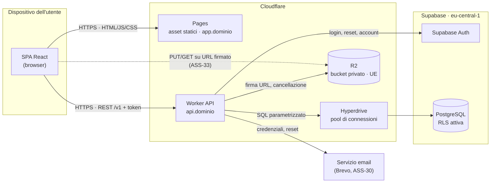

## Architettura

### Diagramma dei componenti

Nessuna freccia va dal browser a Supabase: la SPA non ne conosce né URL né chiavi (VIN-34), e
anche login e reset passano dal Worker. L'unico traffico che non attraversa il Worker è il
trasferimento dei file su R2, comunque autorizzato dal Worker con un URL firmato per una sola
operazione e pochi minuti.

Nel frontend la direzione è la stessa: pagine per area → hook per risorsa → un unico client API,
l'unico modulo che chiama `api.`. Le route guard **nascondono**, non autorizzano. Ogni area è un
bundle caricato su richiesta (SurveyJS e KaTeX solo nella verifica, ASS-66).

### I livelli

| Livello | Cosa fa | Esempio concreto |
| --- | --- | --- |
| **Presentation / API** (route, controller, middleware) | Verifica token e ruolo richiesto dalla route, valida l'input con Zod, chiama un solo metodo di service, restituisce DTO; un error handler centrale produce il formato uniforme. Nessuna regola di business. | **Pubblicazione dei voti in blocco**: il controller verifica che chi chiama sia un Docente e che il corpo sia un elenco di identificativi; un corpo malformato si ferma con 422. |
| **Application / Business** (service, dominio) | Applica le regole del prodotto: appartenenza (il Docente insegna quella materia in quella classe), stati, finestre temporali, scala dei voti. Decide cosa sta in una transazione. | Il service controlla che i voti siano del Docente, in bozza e nella scala 1-10 a mezzi punti, poi li pubblica tutti o nessuno. |
| **Data access** (repository, adapter) | SQL parametrizzato via Hyperdrive, conversione riga ↔ entità; adapter per R2, Supabase Auth ed email. Non conosce HTTP né ruoli. | Il repository dei voti esegue un solo `UPDATE` sugli identificativi dentro la transazione aperta dal service. |

I permessi si controllano in due punti, entrambi nel Worker: il middleware respinge chi non ha il
ruolo; il service verifica l'appartenenza sul dato vero. La RLS è solo difesa in profondità
(matrice in «Chi può fare cosa»).

### Le dipendenze fra i livelli

- **Chi conosce chi.** Presentation conosce Application; Application conosce il dominio e le
  proprie **porte** (interfacce per repository, file, email, autenticazione, orologio). Data access
  implementa le porte, quindi dipende da Application e non il contrario. Solo la composition root
  conosce tutti.
- **Accoppiamento.** Nessun service importa Hono, Postgres.js, R2 o il servizio email: cambiare
  fornitore (ASS-30) significa riscrivere un adapter. Una regola di lint sugli import lo verifica
  in CI.
- **Testabilità.** Le regole più preziose ricevono le porte nel costruttore e si testano con
  implementazioni in memoria (vedi «Testabilità»).

---
