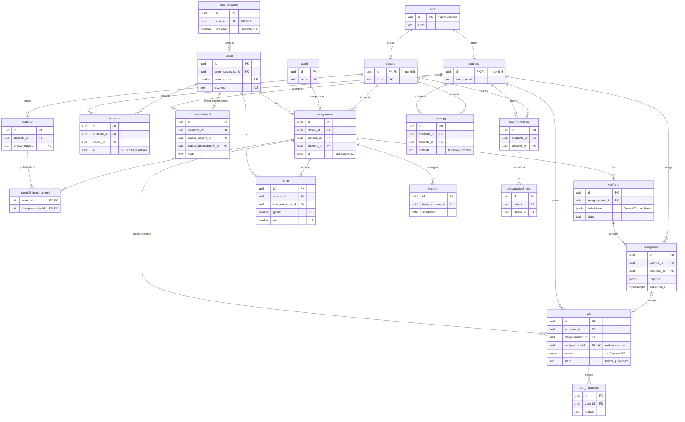

## Persistenza e modello dei dati

### Diagramma ER

Venti tabelle in PostgreSQL. Credenziali e hash delle password stanno in `auth.users` (Supabase
Auth), non nel nostro schema: `utenti.id` coincide con `auth.users.id`. Il diagramma mostra solo
chiavi e campi significativi.

Scelte da spiegare:

- **Insegnamento** è l'assegnazione di un Docente a una Materia in una Classe (FR-DIR-02). Non
  cambia mai docente: una sostituzione chiude il precedente e ne apre uno nuovo (ASS-22). Voti,
  verifiche, compiti e materiali puntano all'Insegnamento e portano con sé materia, docente e
  **classe di origine**.
- **Iscrizione** lega uno Studente a una Classe per un periodo. La classe attuale è l'iscrizione
  con `al` vuoto: nessuna colonna `studenti.classe_id` che un trasferimento sovrascriverebbe.
- **Messaggio** ha sempre sia `studente_id` sia `docente_id`: un messaggio fra due studenti non è
  rappresentabile (FR-MSG-01).
- **Svolgimento** e **Voto** sono separati: il voto di una verifica nasce come bozza collegata,
  un voto orale o pratico non ha svolgimento.

Ogni tabella ha colonne di audit (`creato_il/da`, `aggiornato_il/da`, `versione`) scritte da
trigger, e di soft-delete (`eliminato_il/da`, `motivo_eliminazione`, ASS-20); su `utenti` il
soft-delete è la disattivazione dell'account. `voti_modifiche`, `consultazioni_note` e
`messaggi` sono append-only. I vincoli (unicità, `check` sui valori del voto e sulla griglia
oraria) ripetono nel database le regole già validate dal Worker, come seconda barriera.

### Identificatori

Chiave primaria **`uuid`** generata dal database (`gen_random_uuid()`) per tutte le tabelle,
tranne `materiali_insegnamenti` (chiave composta delle due FK).

| | UUID (scelto) | `bigint identity` (scartato) |
| --- | --- | --- |
| Autenticazione | `utenti.id` coincide con l'ID di Supabase Auth, già UUID | Servirebbe una seconda chiave per gli utenti |
| Route | `/v1/voti/{id}` non rivela i volumi né invita a provare l'ID successivo | `…/voti/1041` sì; l'autorizzazione resta comunque la barriera vera (NFR-02) |
| Generazione | Il Worker conosce l'ID prima dell'insert (chiave R2 del Materiale) | L'ID esiste solo dopo l'insert |
| Costo | 16 byte, indici meno compatti: irrilevante sotto 100.000 righe l'anno (ASS-21) | 8 byte |

Le chiavi naturali (codice dell'anno, nome della materia, anno di corso e sezione) sono vincoli
di unicità, non chiavi primarie: possono cambiare (DIR-03) e trascinerebbero tutte le FK.

### Tre modelli diversi

Modello DB (righe), modello di dominio (entità con regole, in `worker/src/dominio/`) e DTO
(contratto JSON, in `shared/`) sono distinti; i mapper convertono riga ↔ entità ↔ DTO, un DTO
per ruolo quando serve.

| Entità | DB | Dominio | DTO | Perché differiscono |
| --- | --- | --- | --- | --- |
| **Voto** | `voti` con `valore numeric(3,1)`, `stato`, `versione`; storico in `voti_modifiche` | `Voto` con value object `ValoreVoto` (solo i 19 valori di FR-VOT-01); `pubblica()`, `correggi()`, `elimina()` | `VotoDocenteDto` · `VotoStudenteDto` | Lo studente non riceve bozze né `stato` (DOC-03 · AC-11); `classeOrigine` solo se diversa dall'attuale (STU-03) |
| **Verifica / Svolgimento** | `definizione jsonb` **con** risposte corrette; `svolgimenti.risposte jsonb`, `sequenza`, `scadenza_il` | `Verifica` con domande tipizzate e strategie di correzione; `Svolgimento.salvaRisposte()` rifiuta sessioni superate e tempo scaduto | `VerificaStudenteDto` ripulita dalla chiave · `SvolgimentoInCorsoDto` | La chiave non arriva mai al browser dello studente; punteggi e correzioni escono solo dopo la pubblicazione del voto (STU-02) |
| **Studente** | Tre tabelle: `auth.users`, `utenti`, `studenti`; classe da `iscrizioni` | Un aggregato `Studente` con `Tutore` e `classeAttuale` | `StudenteDto` (Direttore) · `StudenteInClasseDto` (Docente) | Il Docente non riceve data di nascita né email del genitore (NFR-08); credenziali solo in Supabase |

### Normalizzazione e letture aggregate

Lo schema è in terza forma normale e **non memorizza medie né conteggi**. Tre ridondanze
controllate: `orari` copia docente e anno scolastico per rendere un vincolo di unicità il divieto
di doppia prenotazione (ORA-01 · AC-01), con FK composte che impediscono alle copie di divergere;
`classi.nome` è generata; `svolgimenti.punteggio` è ricalcolato dal service.

**Cambio classe e voti (FR-DIR-01).** Il trasferimento chiude l'iscrizione attuale e apre la
nuova in una transazione; voti e svolgimenti non si toccano. Puntando all'Insegnamento d'origine,
conservano la classe di origine e la media per materia li somma tutti. Il nuovo docente li legge
in sola lettura; il docente d'origine può pubblicare le sue bozze ma non inserire voti nuovi.

**Letture aggregate.** Due viste ordinarie con `security_invoker = true`, così rispettano la RLS
di chi interroga (VIN-21):

- **`v_voti_studente`** (STU-03): voti pubblicati e non eliminati con materia, docente, classe
  di origine e quadrimestre (ASS-23); la media per materia è un `avg(valore)` sulla vista (ASS-07).
- **`v_statistiche_voti`** (DIR-04): media e distribuzione per fasce per anno, quadrimestre,
  classe e materia, sui soli voti pubblicati (DIR-04 · AC-11).

Indici parziali sui voti pubblicati (per studente e per insegnamento) servono entrambe le viste.

**Perché viste ordinarie.** Circa 58.000 voti l'anno (ASS-21) si aggregano in decine di
millisecondi, dentro i 3 s di NFR-10, e la vista è sempre aggiornata: un voto pubblicato compare
subito. Scartata la vista materializzata: aggiunge un job di refresh e un ritardo senza guadagno
misurabile; la si adotta solo se il test di carico supera NFR-10. Scartata la tabella di
riepilogo aggiornata da trigger: un solo errore la disallineerebbe per sempre.

### Accesso ai dati

Il Worker usa **Postgres.js** tramite **Hyperdrive**, con la cache delle query disattivata: con
la RLS la stessa query restituisce righe diverse a utenti diversi.

**Query sempre parametrizzate.** Solo tagged template di Postgres.js: ogni valore viaggia come
parametro `$n`, separato dal testo SQL, e non può diventare codice. `sql.unsafe()` e la
concatenazione di stringhe SQL sono vietati da una regola di lint in CI; i nomi di colonna per
ordinamenti e filtri vengono da una mappa chiusa; nella ricerca testuale `%` e `_` dell'utente
sono escapati. Questo chiude la porta alla SQL injection.

**Transazioni.** Ogni richiesta gira in una transazione che imposta per prima cosa il contesto
RLS in modo locale alla transazione, perché Hyperdrive riusa le connessioni. Esempi: la
pubblicazione dei voti in blocco è tutto-o-niente; la correzione di un voto pubblicato scrive il
nuovo valore e lo storico insieme. Le modifiche usano il blocco ottimistico sulla `versione`.

**Migration.** Supabase CLI, file versionati, solo in avanti e compatibili all'indietro; le
modifiche incompatibili si fanno in due rilasci (*expand/contract*). Il seed di Development usa
solo dati inventati (NFR-16).
