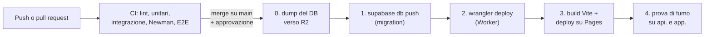

## Piano di deployment

Due ambienti, Development in locale e Production nel cloud (ASS-34); come cambiano
configurazione, dati e segreti è scritto in «Development e Production». Qui si descrive come il
codice arriva in produzione e come si torna indietro.

#### Messa in servizio (una volta sola)

1. Progetto Supabase in `eu-central-1` (DIP-31), piano secondo ASS-65, limiti di Auth alzati
   (ASS-64).
2. Bucket R2 privato in giurisdizione `eu`, con la regola CORS per la sola origine `app.`.
3. Configurazione Hyperdrive sulla connessione diretta a Postgres (il pool lo fa già Hyperdrive).
4. DNS del dominio su Cloudflare (ASS-31): `app.<dominio>` come dominio personalizzato del
   progetto Pages, `api.<dominio>` del Worker. I certificati TLS sono automatici e il traffico in
   chiaro è reindirizzato a HTTPS (NFR-12). Dominio mittente dell'email con SPF e DKIM (DIP-32).
5. Segreti del Worker (`wrangler secret put`) e dell'ambiente `production` di GitHub (DIP-60).
6. Primo rilascio con la pipeline qui sotto, poi creazione dell'account del Direttore con uno
   script dedicato: `seed.sql` non va mai in Production.

#### Pipeline di rilascio

- **CI a ogni push** (GitHub Actions, ASS-67): i controlli descritti in «Testabilità», con
  Postgres e Auth locali della Supabase CLI. Un test rosso blocca il rilascio.
- **Rilascio**: dopo il merge su `main`, un job con l'ambiente protetto `production` chiede
  l'approvazione di un secondo membro del team, poi esegue i passi **in quest'ordine**:
  1. **Migration** (`supabase db push`), preceduta da un dump del DB salvato su R2. Se fallisce
     ci si ferma: Worker e SPA restano quelli di prima.
  2. **Worker** (`wrangler deploy`). Trova già le colonne nuove; e siccome le migration sono
     compatibili all'indietro, fino a questo momento il Worker vecchio ha continuato a funzionare.
  3. **SPA** (build con `VITE_API_URL=https://api.<dominio>`, deploy su Pages). Arriva per
     ultima perché può chiamare route che esistono solo nel Worker nuovo.
  4. **Prova di fumo**: una route di stato del Worker, che controlla anche il DB, e il
     caricamento di `app.`; se fallisce, rollback.
- **Quando**: dal lunedì al venerdì dopo le 14:30 o nel fine settimana, mai nella fascia di
  NFR-04 (7:30-14:30) né nei giorni di scrutinio. Un rilascio invalida la cache della SPA: i
  PC del laboratorio la riscaricano al login della mattina dopo, prima dell'apertura della
  verifica (ASS-66).

#### Passaggio tra versioni e migration nel tempo

- **API**: le modifiche dentro `/v1` sono solo additive (campi e route nuovi), così una SPA
  rimasta aperta nel browser durante il rilascio continua a funzionare con il Worker nuovo. Una
  modifica incompatibile richiede `/v2`, fuori dalla v1.
- **Schema** (espandi e contrai, regola di «Migration del database»). Esempio, rinominare una
  colonna: nel rilascio N la migration aggiunge la colonna nuova e la popola, e il Worker scrive
  in entrambe e legge la nuova; nel rilascio N+1, quando nessun Worker usa più la vecchia, una
  seconda migration la rimuove. Le migration non tornano mai indietro: un errore si corregge con
  una migration nuova.

#### Rollback

| Cosa | Come | Tempo |
| --- | --- | --- |
| Worker | `wrangler rollback` a una delle ultime 100 versioni. Funziona con lo schema nuovo perché le migration sono compatibili all'indietro. È bloccato se nel frattempo è cambiato un binding (R2, Hyperdrive) | < 1 minuto |
| SPA | Rollback di Pages a un rilascio precedente dal pannello (i rilasci restano disponibili) | < 1 minuto |
| Schema del DB | Mai all'indietro: migration correttiva in avanti | Minuti |
| Dati danneggiati | Ripristino dal dump pre-rilascio o dal backup giornaliero (ASS-65); il progetto resta fermo durante il ripristino | Entro le 4 h di NFR-04 |

**Monitoraggio dopo il rilascio.** Un controllo esterno gratuito chiama ogni 5 minuti la route
di stato e misura la disponibilità di NFR-04; le metriche del Worker (errori, CPU, durata) e
i log JSON con ID richiesta dicono quale rilascio ha introdotto un problema.

> Dipendenza: api-designer (R-19), architetto (R-20)

---

# Terza parte · Tempi e valutazione
